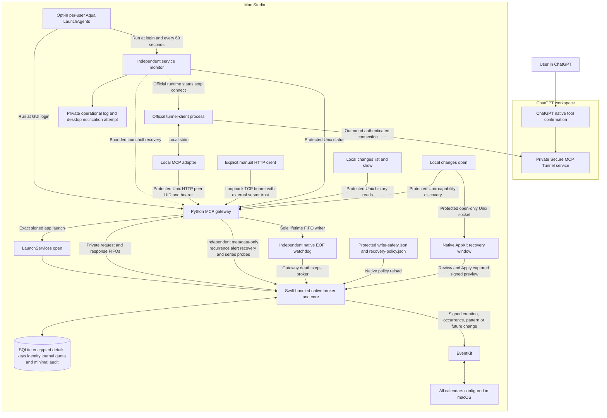
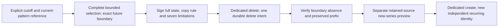
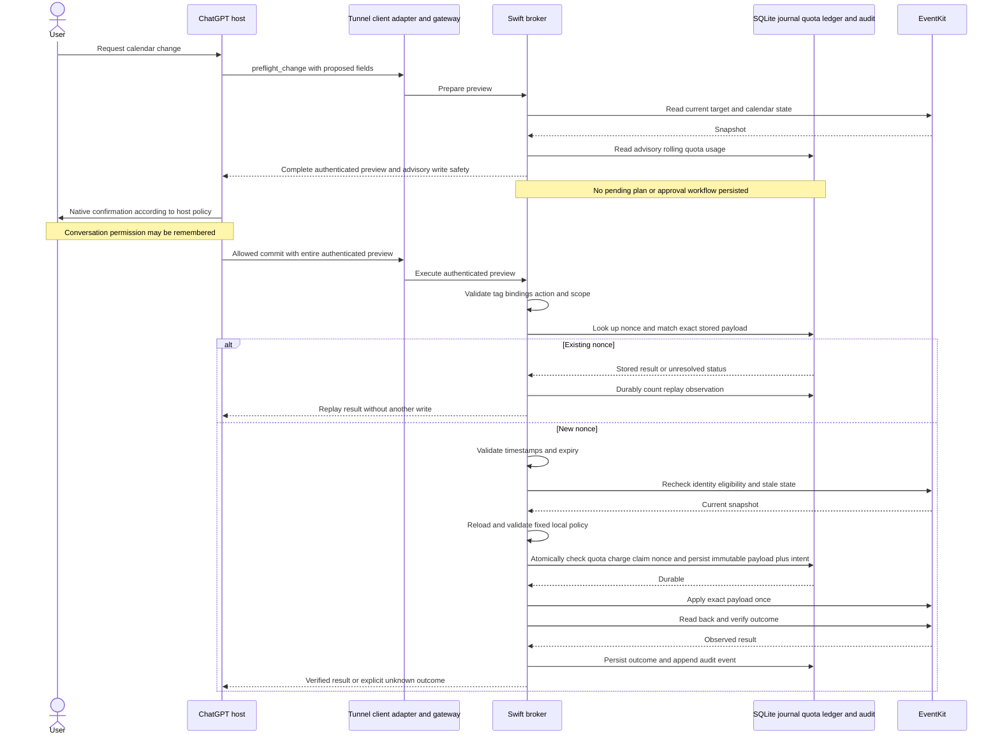
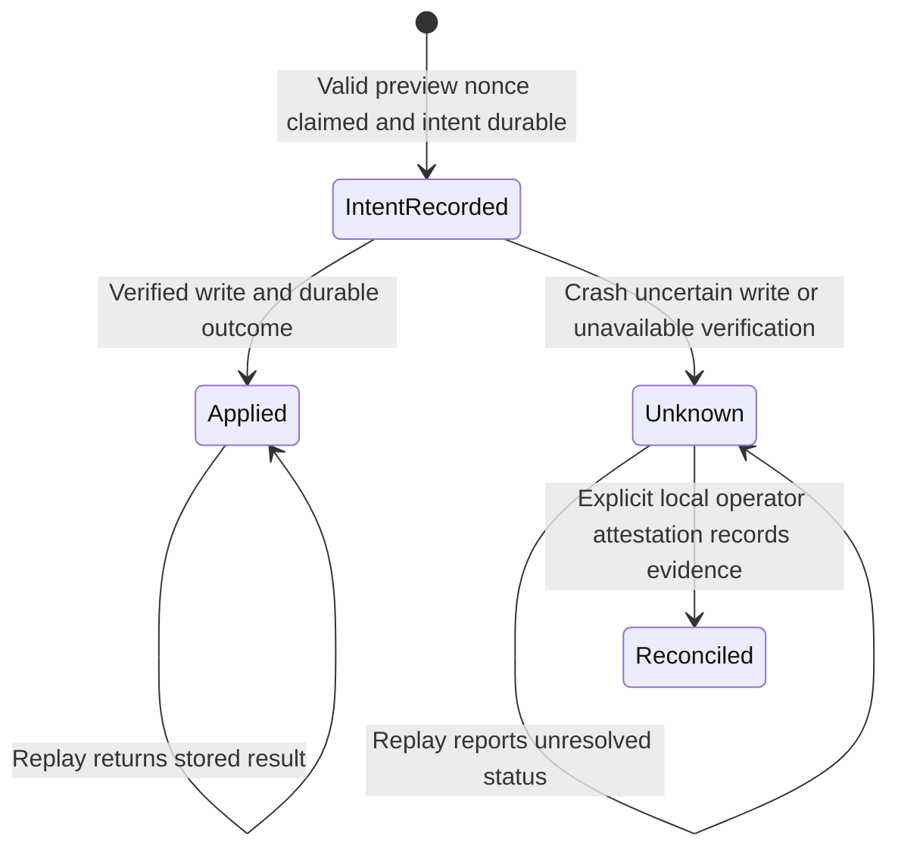

# Calendar MCP architecture

Updated 25 October 2026. This is the private calendar integration for the Mac Studio, with implementation and validation status below. ChatGPT supplies native tool confirmation; a Swift broker owns exact changes, EventKit access and a durable execution audit. This design supersedes Terminal approval and a persisted pending-plan approval workflow.

## Implementation status

| Component | Status |
| --- | --- |
| Swift broker and EventKit boundary | Combined v5/v6 helper implemented, Astra-reviewed, synthetically validated and deployed. Signed SHA-256 `4fe2ce4560c1c5c0ea82ef9ace3091e19630c4fc9521d689fb1ce9ebc0a5f8dd`; raw `f23d1b9cb4d8413fd05bf70529c99b797742636427f9fba891ffc929f0740b5b`. Metadata-only cutover verified. After the user reported Settings access and one explicit authorization follow-up, actual resident and fresh same-build status are `eventkit` / `denied`, raw 2; effective access remains pending, without proof of a prompt or human denial. Earlier helper full-access/listing records are historical. |
| Protected project-client transport | Deployed: stdio, status, history CLI and monitor use protected Darwin AF_UNIX HTTP with peer-UID checks before HTTP bytes and no TCP fallback. Explicit manual TCP clients retain the documented server-identity limitation. |
| JSON and stdio boundaries | Deployed recursive Unicode/finite-number checks, pre-submission native validation that preserves healthy channels, safe JSON-RPC IDs/initialization and contained result failures with no-retry guidance. |
| Future termination and independent copy | Separate authorized deployed version-6 feature: inclusive cutoff selection in a complete bounded 366-day native window, exact seven disclosures, dedicated delete/new-series recovery tools and floor 5. Source validation passed 158 native tests, ran 123 Python tests (120 passed, three packaged skips), and separately passed all three staged signed lifecycle checks with zero skips. The combined floor-5 rollout is metadata-verified with nineteen tools; effective-access/live validation remain pending. |
| Future default fields | Separate deployed version-5 feature with dedicated future modify/inverse tools, exact selected inclusive strictly-future boundary, supported unbounded/date-ended subset and compatibility floor 4. Source validation passed 139 native tests and ran 116 Python tests (113 passed, three packaged skips), including actual synthetic v5 inverse/replay and seventeen-tool discovery. The combined deployed writer retains the v5 minimum contract and publishes nineteen tools at floor 5; its effective-access/live validation remain pending. |
| Current-pattern default fields | Implemented and deployed dedicated version-4 `commit_series_modify` and `commit_series_rollback` for title, notes, plain location and alerts. The combined capability-verified helper exposes nineteen tools, retaining this version-4 contract. Native/synthetic lifecycle passed. The alarm-order fix is retained in the current helper; strict read/preview matching passed under the prior alarm-fix helper for two references and their common complete first anchor, without establishing replacement access. Live propagation and host presentation remain unverified. |
| History, recovery and compatibility | Deployed forward-only recovery metadata floor 5, with version-2 encrypted detail/marker encoding and configurable five-day default detail retention. Ordinary recovery and one-source series inverse preserve replay/unknown guards. Immutable payloads/keys, consumed nonces, quotas, audit/legacy history and identity/signing metadata remain preserved; the selected attestation result is the explicitly audited update. |
| Native accounting and retention | Deployed fixed-category durable observation counters with hourly cumulative audit checkpoints, indexed expiry checks and unresolved-only hold traversal. New counter tables were empty at the original accounting rollout; historical audit rows were preserved. |
| Preview, journal and quotas | Native-only signing, exact immutable payload/nonce claim before mutation, serialized execution, one charge per modify/delete intent and conservative unknown outcomes remain enforced. Read-only verification on 25 October found three executions: two applied and one human-attested `reconciled/not_applied`; zero unresolved records, two quota claims and a valid four-record audit chain (the original three-record prefix plus an observation checkpoint). The deployed scoped guard preserves the reconciled history and conservative legacy fallbacks; zero unknown outcomes remain. |
| Gateway, owned tunnel and monitor | The combined rollout reconnected the same owned profile/tunnel/environment reference and resumed monitoring last, preserving restart-budget history. Fresh post-grant metadata health/counts are pending. Earlier scoped-guard raw-3/healthy/2/0 and fifteen-tool observations remain historical. |
| Optional recovery window | Protected per-user open-only IPC and isolated optional UI failure are deployed; `local_ui` is an actual availability boolean. Synthetic lifecycle/review tests passed. Visual click-through and production Apply remain unverified. |
| Multiple alerts and recurrence | Deployed typed recurrence creation, one-occurrence modify/delete, complete alert replacement and disclosed standalone-copy recovery. Version-1 through version-3 ordinary and version-1/version-2 recovery contracts remain supported; broader pattern writes use separate version-4/version-5/version-6 tools and their exact contracts. |
| Attachments | Unsupported by public EventKit and not implemented. Metadata-only listing plus explicit content fetch remain planned, pending the user's provider-native versus MCP-only choice. Current nineteen tools expose no attachment operation. |

## Current Studio deployment

The combined v5/v6 rollout completed once on 25 October after separate feature commits `87de159` and `1575f66`, final Astra source/artifact/procedure review and a maintenance notice. Installed signed SHA-256 `4fe2ce4560c1c5c0ea82ef9ace3091e19630c4fc9521d689fb1ce9ebc0a5f8dd` matches the private staged app; frozen raw SHA-256 is `f23d1b9cb4d8413fd05bf70529c99b797742636427f9fba891ffc929f0740b5b`. Protected HTTP and configured stdio verified the exact new initialization contract and nineteen tools. At cutover the actual resident reported `eventkit` / `not_determined`, raw 0. No Calendar tool call, query/write, authorization request or reconciliation occurred during rollout.

The writer advanced only compatibility metadata from floor 3 to 5, retaining detail/marker encoding 2. Every authoritative baseline/final execution/detail/cipher/key/nonce/quota/audit/legacy/identity/signing value was preserved: three executions (two applied, one reconciled), zero unresolved, two quota claims, four valid audit records and 132 identities. Protected configuration/policies and restart-budget histories were preserved. Hash/count-only private proofs were retained; full sensitive row comparisons stayed in memory. The same owned profile, tunnel and environment reference were reconnected, without recreating the remote tunnel; monitoring resumed last. Old code was left non-executable in a non-app inert path, with no fallback or downgrade.

After the user reported reenabling Full Access, one explicit active-user OS-authorization follow-up on the exact installed signed build exited successfully but returned `full_access:false`, with no stderr. The actual resident and a fresh same-build no-state diagnostic both subsequently reported `denied`, raw 2 (the fresh diagnostic had earlier reported raw 0). Effective access remains pending. No observation establishes that an OS prompt appeared or that a human denied it; the user's prompt observation is pending. No Calendar query/write, new native state owner, production restart or repeated authorization ran in that follow-up. The rollout's zero-authorization record remains separate.

The maintenance notice, owned intake stop, repeated idle checks and stable current baseline mitigated arrivals without claiming all-client acknowledgement or an atomic admission gate. Independent local admission can still race; no such race was detected in this successful run. The reviewed procedure aborts detected activity for forward inspection and preserves gateway/native state, with ownership-verified intake closure and monitor re-pause on final failure. No Calendar mutation retry or older-state restore is a recovery path.

The final source proof is 158 native tests passed in 53.063 seconds, 123 Python tests run in 6.280 seconds (120 passed, three packaged skips), and those exact three staged signed synthetic lifecycle checks separately passed in 1.430 seconds with zero skips and an unchanged signed hash. This establishes synthetic and metadata deployment behavior. Fresh post-grant resident/service-health/restart-count metadata, web **Refresh tool** discovery of all nineteen tools and host/iPhone confirmation presentation remain pending; actual future modifications/termination/copy recovery remain unverified and separately consented. The separate OpenAI safety gate remains unchanged.

The following records describe the superseded scoped-guard and earlier deployments; their grants, hashes, tool counts and rolling-count snapshots are historical.


On 25 October, the monitor recorded `native_unavailable` followed by `restart_requested` at 17:21:47 UTC (also Europe/London). Subsequent read-only checks verified the unchanged installed alarm-fix helper, actual resident `eventkit` / `full_access`, raw 3, healthy gateway/owned tunnel, both registered jobs and current monitoring. Before replacement, rolling gateway/tunnel restart counts were 1/0, preserved without reset. This followed the user's reported macOS privacy toggle; the timing does not establish its cause. No manual repair or permission prompt was needed.

Dynamic history checks found three executions (two applied, one reconciled), zero active intents or unknown outcomes, two quota claims and a valid four-record audit chain. Immutable execution/detail/key/nonce/quota and legacy history matched the post-reconciliation baseline; the exact original three-record audit prefix remains, followed by a normal observation checkpoint. Automatic approval review initially rejected the proposed cutover before execution; that attempt changed nothing. The user then explicitly approved deployment, and the exact reviewed procedure completed once as described below. The user approved changing only this calendar plugin to `ask_before_writes`, and the host permission readback verified that mode. A subsequent `commit_series_modify` was still refused by the separate OpenAI safety gate; the signed nonce remained `not_received` with no native intent. The mode change does not establish a fresh confirmation click or bypass that gate.

The previous alarm-order release was deployed at `build/Calendar MCP Helper.app/Contents/MacOS/CalendarHelper`, signed SHA-256 `97d6a2fb537a769fda119cb50100597b99a1eac408f10acf34b2797c2f1baa01`; frozen raw SHA-256 `17898efb637eb7e13e31aac4b9358d0118c15405a04aaf69735a879795e8d37d`. Its code-only rollout required no migration. Exact comparisons with a persisted pre-stop baseline preserved authoritative executions, ciphertext/keys, nonces, quota/audit/legacy history and security metadata, plus protected configuration, policies and service budgets. Storage compatibility floor remains 3 and detail/marker encoding remains version 2. At that rollout, three executions were two `applied` and one `unknown`, with two quota claims and two audit records.

The user subsequently authorized recording the former unknown as `not_applied`, based on their inspection and best-knowledge assessment. At reconciliation verification, state was two `applied`, one `reconciled/not_applied`, zero unresolved, two retained quota claims and a valid three-record audit chain. The existing native CLI ran once in a private TTY entered by the assistant on the user's behalf. The encrypted result retains the prior unknown result and attributed evidence; audit provenance is `local_operator_attestation` / `not_provided`, without independent historical verification or fresh-human-click proof. Exact verification allowed only the selected state/result/result ciphertext, one audit append and monotonic maintenance clocks; immutable payload/payload ciphertext/key/nonce, quotas and all other history remained unchanged. A reviewed lifecycle-lock/paused-monitor maintenance exception preserved configuration and budgets, kept the tunnel running, restored the same helper at full access and resumed monitoring last. No Calendar query, write or rename occurred. The then-global unresolved-write guard was verified clear before the scoped-guard deployment.

Protected Unix HTTP discovery returned the exact fifteen-tool schema. The user accepted the prior alarm-fix app's separate explicit OS prompt; a same-bundle service refresh verified actual resident `eventkit` / `full_access`, raw 3 while preserving exact native history, configuration and budgets. At that refresh, both Aqua jobs were active, monitoring and gateway/owned tunnel health were current, and rolling gateway/tunnel counts were 0/0. The tunnel remained running. Neither rollout nor permission refresh made a Calendar tool call.

A subsequent bounded live read/preflight check against the installed signed hash passed strict snapshot equality for two recurring references, including complete raw alarm arrays and fingerprints, without probe normalization. Both version-4 title-only previews identified the same complete first anchor: opaque identity, fingerprint, recurrence details and full snapshot matched. Exact field masks, unchanged structural/unmasked fields, dedicated `commit_series_modify` routing and all four signed recovery limitations passed. Rowid-inclusive hashes/counts for execution, encrypted detail/key, quota, audit/legacy, recovery-link and observation tables remained unchanged; identity counts were unchanged. Previews remained only in memory. No commit, recovery preflight, unknown reinspection or reconciliation ran.

On the prior security/series helper, the user's explicit OS grant and coordinated restart restored resident raw 3. Authorized bounded reads found two matching recurring references and returned a v4 title-only preview; full selected snapshot comparison exposed alarm order alone changing the fingerprint. Complete raw alarm-object counts and multisets matched. Those historical observations prompted the now-deployed fix; the fixed-app proof above is separate. The earlier repair preserved execution/quota/audit counts across the restart and exact authoritative history across its forward-repair interval.

Independent earlier history inspection found one unresolved, recovery-ineligible delete whose retained exact target currently resolves. Current snapshot equality varied between reads and does not establish whether that historical write ran. That was the pre-reconciliation state; current presence alone did not establish the past outcome. Across those read/preflight probes, rowid-inclusive hashes/counts for executions, encrypted details/keys, quotas, audit/legacy history, recovery links and observation tables were unchanged; identity counts were unchanged. No preview was saved; no commit, recovery preflight, retry or reconciliation ran.

The full native suite passed 100 tests in 38.177 seconds, including nine alarm regressions. The frozen raw helper passed 110 Python tests in 4.703 seconds (107 passed, three explicit packaged LaunchServices skips); those three synthetic lifecycle checks separately passed against the exact signed staged app in 1.675 seconds with zero skips. These establish synthetic behavior. The scoped live check establishes read/preview stability for those references. Provider default propagation, detached overrides/exclusions, recovery and refreshed ChatGPT/iPhone presentation remain unverified.

The earlier approved no-backup security/series rollout advanced compatibility floor 2 to 3 while preserving all historical authoritative rows, encrypted details/keys, nonces, audit/quota and identity/signing metadata, protected configuration and budgets. Its protected Unix HTTP/stdio fifteen-tool discovery and zero-Calendar-tool deployment checks remain historical evidence.

### ChatGPT publication verification

After the combined rollout, protected HTTP/configured stdio verifies nineteen tools with all four dedicated future commit routes and `preflight_change.scope:this|series|future`. The next web **Refresh tool** and independent host/iPhone full-preview/confirmation presentation check are pending. Earlier fifteen-tool discovery below is historical. The final helper's effective Calendar access remains pending at denied/raw 2; metadata discovery does not query Calendar or establish access, fresh confirmation or safety-gate removal.

At the earlier refresh, protected HTTP and the exact configured stdio command returned the same fifteen-tool schema and initialization instructions, including `preflight_change.scope: this|series` and both dedicated series commit tools. The owned official tunnel is healthy and ready, with matching profile, actual child command, interpreter and working directory. Before refresh, the connected host catalog exposed only the nine original tools and a `this`-only preflight signature without alerts/recurrence or recovery/series contracts. The earlier unobserved-discovery state and diagnostic traffic correlation describe that pre-refresh interval.

The user then reported clicking **Refresh tool** at the bottom of the web plugin management page. At 14:19:32 Europe/London on 24 October 2026, the owned runtime observed successful `tools/list`, all fifteen expected names including both series commit tools, and complete discovery without partial/limited flags. Initialization epoch reached 5; fourteen dispatches and responses completed with zero failures, timeouts or control-plane failures. This verifies completed runtime discovery after refresh. No Calendar query, mutation or service restart was needed.

The user subsequently reported a fresh ChatGPT series preview followed by a commit blocked by the then-unresolved journal record. The full fifteen-tool UI and complete confirmation presentation have not been independently inspected; the earlier task's nine-tool catalog was historical and did not establish refresh failure. Follow the [custom-plugin refresh/tool-selection workflow](https://developers.openai.com/api/docs/guides/custom-mcp-server#how-to-use) and [setup section 7](setup.md#7-add-the-private-tunnel-in-chatgpt) for the next `@`-selected, preflight-only check. The [publishing scan/Live definition workflow](https://developers.openai.com/plugins/deploy/submission#update-to-your-mcp-server) applies only where those controls exist. Legacy `commit_modify` remains intentionally occurrence-only. Tool refresh does not reconcile journal outcomes; the separate human-attested reconciliation above cleared the former unknown under the prior global guard without a Calendar mutation.

## Scoped conflict guard: deployed

The historical scoped-guard helper from commit `bfb9d1e` was deployed at the same app path, signed SHA-256 `7fd9594c51f8f130a942af21acc8d01e334adb0fe944cd034b145812388ce0e8`, built from frozen raw `b44335204801027cd431a57dfa7f1d99b542661d738c9357b57815b5a2900c16`. A maintenance notice and verified idle intake preceded stopping the owned runtime; the gateway remained alive until native work was idle and a stable dynamic baseline was captured. The code-only atomic replacement preserved exact authoritative rows, ciphertext/keys, nonces, quotas, audit/legacy/identity history, configuration, policies and budget histories. Only allowed maintenance-clock highwaters advanced; storage floor 3 and fifteen-tool HTTP/configured-stdio metadata remain unchanged. The same owned runtime profile, tunnel and secure environment reference were reconnected, without recreating the remote tunnel; monitoring resumed last.

Post-lock checks verified both jobs, current monitoring, a healthy owned tunnel and preserved restart counts 1/0. The replacement initially reported resident `not_determined`, raw 0, while a fresh isolated process reported `denied`, raw 2; a separate explicit authorization attempt returned without a grant or visible prompt. The user then reenabled Full Access in macOS Settings and reported accepting the OS-requested helper restart. Natural recovery produced a new resident with `eventkit` / `full_access`, raw 3; actual process ownership matches the configured service user. Both jobs, gateway/tunnel and monitoring are healthy, with current rolling counts 2/0. The prepared same-bundle permission refresh was not run. A connected-plugin calendar listing succeeded with twelve calendars on the replacement, in addition to the earlier listing on the old helper.

Read-only verification after access returned matched all authoritative schema/table digests to the saved rollout baseline except allowed monotonic clock highwaters; floor 3, observation-clock identity/last checkpoint and exact audit history remain preserved. Three executions remain two applied and one reconciled, zero active intents/unknowns, two quota claims and a valid four-record audit chain. The code-only cutover made no Calendar tool call, migration, reconciliation or authorization request; the later listing was read-only, and no live Calendar write occurred. Startup/tests never request authorization. The user approved changing only this calendar plugin to `ask_before_writes`, and the host permission readback verified that mode. A subsequent `commit_series_modify` was still refused by the separate OpenAI safety gate; the signed nonce remained `not_received` with no native intent. The mode change does not establish a fresh confirmation click or bypass that gate.

After original preview authentication, native code derives a version-1 `conflict_scope` for each new immutable `storage_version:2` execution marker. The footprint records the native calendar and calendar-item groups, affected opaque event IDs, source/ancestor nonces, whether the target already exists, completeness and the maximum identity-registry rowid at claim. Selected series references and first anchors must resolve to the same native group. Recovery includes the complete available source/ancestor closure and current bindings, unioning frozen and current affected groups so a rebind cannot erase a conflict. Closure traversal rejects cycles, missing evidence or more than 512 nodes / 128 depth. The complete marker must fit 256 KiB before quota or intent is recorded. Transport cannot choose this footprint.

Shared affected IDs, source nonces or native groups remain conflicting. With complete same-calendar evidence, an existing candidate group can pass only when every native group has an exact registry witness at or before the unresolved execution's frozen cutoff, outside its affected IDs. A newly observed occurrence/first-anchor alias is not automatically unsafe or independent: an older witness for that independent group can suffice, while a genuinely new group or possible write-output alias without a prior witness stays blocked. Frozen/current affected group aliases always block. Historical rebinds without a qualifying old witness remain conservatively blocked. New creation or standalone restoration in the same calendar cannot use this existing-target exception. An unknown creation can still permit independently witnessed pre-existing groups; its possible new output remains blocked.

Missing legacy footprints supply no retrospective same-calendar witness: a trustworthy native calendar limits the fallback to that calendar; missing calendar evidence blocks globally. Malformed or inconsistent present footprints fail closed, including across calendars. Shared dependencies veto independence before cross-calendar separation is considered. Authenticated early commit checks, the transactional native claim, exact rollback steps and later series/recovery boundaries use the same independence predicate. Preflight remains read-only/advisory; an unrelated operation is not guaranteed to pass when evidence is incomplete.

Storage compatibility floor remains 3 and encrypted detail/marker encoding remains version 2. No migration, backfill, reconciliation, signed-envelope/authentication change, encrypted-payload rewrite, new public tool, schema, annotation or server-instruction change is required. Existing nonces, quotas and all authoritative history remain untouched; only future claims add the native footprint. Older helpers can remain more conservative and must not be used as a rollback after new state is written.

The approved native baseline passed 121 tests in 39.527 seconds. The exact frozen raw helper passed 110 Python tests in 5.463 seconds (107 passed, three explicit packaged skips); all three synthetic LaunchServices lifecycle checks passed against the exact staged signed app in 1.562 seconds with zero skips and unchanged executable hash. A subsequent test-label-only privacy cleanup was verified by the single affected case (one pass in 0.117 seconds); production source and executable bytes were unchanged. These checks used isolated synthetic state and did not access Calendar data, request permission or change production services/state.

A later user-reported OpenAI safety-gate refusal occurred before the blocked preview had any native intent (`get_change_status` returned `not_received`). That host gate is separate from this native conflict fix; no claim is made that deployment will remove the refusal or change host confirmation. Whether the host displayed its confirmation remains a separate user observation.

## Historical deployments

The following paragraphs record earlier releases and are superseded by the current deployment above. Their app hashes, grants, thirteen-tool discovery and restart observations are historical.

Historical recurrence rollout on 24 October 2026, before the security/series release: the then-installed signed recurrence-capable helper executable at `build/Calendar MCP Helper.app/Contents/MacOS/CalendarHelper` has SHA-256 `a608e1bb46c8713eeb446fc6cf5e524ae6b51512ede91d8e3c40f7ce605a3ef9`. After Astra approved the source and rollout without findings, the reviewed code-only rollout stopped the monitor, stopped the owned official managed runtime, then stopped the gateway; it atomically exchanged the app at the existing path and restarted the gateway. Exact thirteen-tool recurrence/alert/recovery HTTP metadata discovery passed before the owned official adapter was refreshed, and the monitor restarted last. No database migration or backup was performed.

Rollout verification preserved byte-identical metadata records and outcomes for all three executions (two applied, one unknown), both quota claims, the valid two-record hash-linked audit chain and native signing/identity/credential metadata. Protected configuration, environment reference, policies, plists and persisted monitor budgets were preserved. Static resident backend/authorization remained `eventkit` / `not_determined`, raw 0. Direct HTTP initialization/discovery and the exact configured stdio command's MCP `2025-11-25` initialization/discovery returned the exact thirteen-tool version-3 schema, with zero `tools/call` requests. Final service status reports installed/active, both jobs registered, a current monitor observation (`monitor_stale:false`), gateway health `permission` and a healthy tunnel. Rolling restart counts are zero gateway and zero tunnel; the previous tunnel attempt aged out naturally without resetting persisted budgets. No Calendar query, mutation, authorization prompt, retry or reconciliation was performed. The deferred grant and existing unknown remain separate blockers; provider recurrence normalization, identity behavior and ChatGPT/iPhone presentation were not live-validated.

The prior multiple-alert release had signed helper SHA-256 `ca3e6f1e7bb1312f9dd7f6a558ee7455c6519ae1cce0e472b5c88388c3db55ac`. It was a separate code-only upgrade with preserved storage-v2 history and metadata-only validation. The following alert rollout observations are historical.

The initial alert rollout completed the native replacement but stopped both jobs when complete discovery exceeded the local response parser's depth-20 limit. History remained unchanged. The response-only parser fix allows depth 32 while retaining the incoming depth-20 boundary; actual synthetic HTTP/stdio full-schema regression tests passed. Reviewed forward repair restarted the fixed gateway, then used the official managed runtime stop/connect operations with the existing protected profile/environment reference to respawn its stdio adapter. It verified healthy runtime ownership and preserved history/security/configuration before bootstrapping the owned monitor last. Refreshed ChatGPT discovery remains deferred.

At the end of that earlier alert rollout, service metadata confirmed both jobs registered, service active, a current monitor observation, healthy tunnel and gateway health `permission` for the deferred raw-0 grant. Its then-current rolling budgets reported zero gateway and one tunnel restart attempt. The exact configured Python stdio command passed local MCP `2025-11-25` initialization and complete thirteen-tool alert/recovery discovery with zero tool calls. Those recurrence-rollout observations superseded the still earlier alert rollout; the current security/series status above supersedes both.

The earlier approved storage-v2 migration bound the eight-record legacy audit into its checkpoint and backfilled two historical delete quota charges. It preserved three retained execution records and their outcomes. That migration was separate from the code-only alert upgrade.

During the earlier storage-v2 rollout, the monitor stopped before the gateway, the migration ran offline, and the app was atomically exchanged at the existing path. The readiness parity check then stopped the jobs because the replacement reported Calendar `not_determined` rather than the earlier app's `full_access`. This was a permission-readiness failure after successful migration and replacement. The same gateway and monitor jobs were subsequently bootstrapped forward using the upgraded helper, preserving their configuration and monitor budgets; no legacy helper was restarted against v2 state. The gateway is reachable on `127.0.0.1:18765`, both jobs were successfully bootstrapped, and the official managed tunnel is healthy. Metadata-only local `tools/list` returned all thirteen tools, including the four recovery operations, with zero `tools/call` requests. Refreshed ChatGPT discovery and real replacement-helper Calendar access remain unverified.

Historical permission observation after that recurrence rollout: the actual resident broker reports backend `eventkit`, authorization `not_determined`, raw 0. The monitor treats this as nonrestartable. At that time the durable unknown remained unresolved and blocked every fresh write even after permission was granted; it required separate evidence-based local reconciliation, never an inferred outcome or blind retry. The user explicitly instructed that remaining unattended work must not modify actual calendars.

Protected state remains `$HOME/Library/Application Support/Private Calendar MCP`, with active launch diagnostics under `service`. Port 8765's existing listener was untouched. Managed alias `calendar-studio` uses the configured absolute Python interpreter with `-m calendar_mcp stdio --state-dir <configured-state> --port 18765` from the repository working directory; its protected profile references the approved local environment credential without plaintext. No event details, exact personal times or opaque IDs are copied here. See [Installation and operation](setup.md#current-studio-deployment) for the current runbook.

Historical observations are superseded where they differ from this snapshot: the older helper reported full access during earlier service recovery checks; a 23 October five-record/zero-unresolved audit was later followed by an eight-record/one-unknown pre-migration state. The first automatic approval review rejected cutover before execution; the user's subsequent explicit no-backup authorization superseded that approval block, and the reviewed migration then completed. Initial source-only/approval-pending notes do not describe the current deployed state.

Automated data validation uses synthetic providers and temporary protected state. Before replacement, a separately authorized live metadata-only probe verified the earlier production broker's Calendar permission and shutdown, without constructing an EventKit store, querying calendars/events or mutating Calendar data. Build/test commands do not authorize Calendar access or changes. Synthetic test success alone does not establish permission attribution, provider behavior or host confirmation rendering.

The explicit local `--authorize` path retains its EventKit store across the request and reports bounded NSError domain/code/message and bundle context on failure. It never emits error `userInfo` or changes MCP error responses. Production launches use LaunchServices for the exact signed app path: direct Python subprocess launch attributed permission differently and could not use the app's grant. Explicit authorization and resident status must use the same app identity. An already running helper can require a coordinated service restart after the exact app receives a grant; a fresh process's full-access result alone does not establish resident readiness. Verify actual resident raw 3 before any scoped live read, and restart the monitor only after gateway/owned adapter readiness. A remote laptop Codex UI does not determine which Mac owns the permission request or displays its consent dialog; that belongs to the execution Mac's logged-in desktop.

## System design

The diagram describes the deployed protected project-client boundary. Manual TCP compatibility has a separate residual server-identity limitation.



The official tunnel client establishes the outbound private connection and starts or communicates with the local stdio adapter. Python handles MCP framing, authentication and schema validation. Swift owns EventKit, opaque event identity, preview signing, stale checks, serialized writes, the local destructive-write policy and durable execution state. Python cannot choose replacement write payloads. The recovery implementation keeps local review and Apply inside the native broker; the local Unix socket can only open its window.

The optional launchd layer in this diagram is a separate installation choice; see its implementation and deployment status below. It supervises availability and never submits Calendar tools or replays a mutation.

All calendars exposed by macOS can be queried, including subscribed and read-only calendars. Write eligibility is checked per target. No separate iCloud credentials are needed. New events and presentation default to `Europe/London` unless the user specifies otherwise; existing event timezone semantics are preserved.

Private deployment uses a `tunnel_id`, runtime credential and workspace association with read and use access, following [Secure MCP Tunnels](https://developers.openai.com/api/docs/guides/secure-mcp-tunnels). A public deployment would need the documented [OAuth authentication flow](https://developers.openai.com/plugins/build/auth) and is outside the initial scope.

The ChatGPT Tunnel form uses **No authentication** for this private adapter design: trusted tunnel/workspace access is the outer boundary, while the adapter independently authenticates to the local gateway. There is no per-user backend identity or multi-user authorization layer. No local gateway token is pasted into that form, and no arbitrary static bearer-token form is assumed. Local Codex stdio configuration applies only to the gateway host; remote SSH arrangements require separate explicit configuration.

## User flow and consent

1. Install the signed helper and explicitly grant macOS full calendar access. This operating system permission is separate from consent to a particular change.
2. Connect the private tunnel to the intended ChatGPT workspace and ask for a calendar change.
3. ChatGPT requests preflight. The broker reads current state and returns an authenticated preview of the complete change, without queuing it or creating approval state.
4. ChatGPT invokes the appropriate write tool with that full preview visible in its arguments. Native confirmation follows the host's current approval policy.
5. The broker validates the preview, rechecks state and the current local write-safety policy, atomically records any quota charge with durable intent, executes the authenticated payload once and verifies the result.

Normal writes have no Terminal approval step, remote `approve` endpoint or caller-provided `userApproved` boolean. Stateless preflight aims for one write confirmation. The host may still request permission for reads.

Custom MCP write tools require confirmation by default, with `readOnlyHint` informing host handling. ChatGPT can remember approval or denial per tool for the conversation; a new or refreshed chat prompts again. The documentation does not guarantee permanent “Always allow” for custom MCP tools. See [Custom MCP servers](https://developers.openai.com/api/docs/guides/custom-mcp-server).

The backend trusts an authenticated caller using ChatGPT's host policy. An allowed call is not cryptographic proof of a fresh human decision; remembered permissions may prevent a new prompt. Audit records use `approval_source: chatgpt_host_policy` and `approval_evidence: not_provided`.

## Trust boundaries

| Boundary | Required behavior |
| --- | --- |
| ChatGPT and tunnel | Restrict workspace access; protect and revoke runtime credentials. Test native confirmation display. |
| Adapter and gateway | Project clients derive a protected Darwin Unix endpoint from canonical gateway state and the configured authority port. They validate the private OS temporary base, owned `0700` parent and owned `0600` socket, then check peer UID using Darwin libc `getpeereid` before sending HTTP bytes. The Unix listener checks peer UID before HTTP parsing. All HTTP requests retain bearer authentication and exact Host/Origin checks, with bounded sizes, concurrency and deadlines. No redirects, proxy-environment routing, retries or TCP fallback. Manual literal-`127.0.0.1` HTTP does not authenticate server identity: an external/manual bearer client can expose credentials to a port prebinder and must use the protected project client or an independently authenticated encrypted channel. |
| Gateway and broker | EventKit launches exact app through LaunchServices; private owned request/response/lifetime FIFOs, noninherited sole lifetime writer and independent native watchdog. Synthetic normally uses direct pipes. Narrow operation allowlist, strict typed schemas and unknown-argument rejection. No approval API or arbitrary native dispatch. |
| Broker and state | Native-only signing secret; protected SQLite registry, journal, destructive-intent ledger and audit; serialized mutations and fail-closed policy/durability checks. |
| Recovery details and local UI | Native version-2 detail encoding at compatibility floor 5 encrypts event-bearing execution details with per-record keys and keeps minimal replay/audit/quota metadata. A protected open-only socket can activate the AppKit window; native review captures the exact signed step and Apply executes inside the broker with fixed `local_native_ui` provenance. Neither Python nor the socket accepts approval or replacement write payloads. |
| Native local policy | Only the fixed protected `write-safety.json` in native state is accepted. A trusted local operator can edit it; no MCP tool, preview argument, transport-selected path or approval flag can raise/disable limits. |
| Local account | The token identifies an adapter credential, not a cryptographically established human. Same-user malicious processes are outside file-permission isolation. |

Calendar text is untrusted data and cannot authorize actions. Credentials never appear in tool responses or audit records. Preview authentication supplies integrity and authenticity, not confidentiality or proof of consent.

## Optional login service and independent monitor

The implemented optional service uses two per-user **Aqua LaunchAgents**, not a root daemon. The gateway runs in the foreground with `RunAtLoad` and no `KeepAlive`; the independent monitor runs at login and on a 60-second `StartInterval`. This is configured to start after the owning user logs into the GUI following a restart; actual login/reboot operation remains unverified. FileVault unlock, login, an available user session and network connectivity remain prerequisites; it cannot provide pre-login availability. The helper bundle keeps its existing signature and LaunchServices permission identity.

Only the monitor owns automatic recovery. It asks launchd to restart the owned gateway job and uses the official tunnel client's `runtimes status`, `stop` and `connect` commands for the configured managed alias/profile. It does not start a second raw tunnel daemon or signal a native PID, unrelated listener or arbitrary process. The official managed client detaches its runtime from the short-lived monitor process; no launchd `AbandonProcessGroup` override is needed. The installer must reject conflicting jobs, listeners and runtimes rather than taking them over.

Health uses authenticated local gateway/native authorization metadata and official runtime metadata. It never queries calendars/events, constructs a test event, requests Calendar authorization or treats a healthy tunnel as proof that MCP tools work. A busy broker interrupts the failure streak and must not be restarted. Repeated five-second HTTP timeouts can recover the owned gateway only after three failed checks and the 120-second threshold, exceeding the native request deadline. Denied/not-determined Calendar access and runtime ownership conflicts require an alert and local repair, rather than restart attempts. A startup grace of 120 seconds and three consecutive failures gate recovery. Per component, durable retry state applies nominal 60/120/240-second backoff, caps delays at 15 minutes and allows at most three restart attempts per hour. A 120-second grace floor after each restart makes the first three effective delays 120/120/240 seconds. This bounds recovery even across monitor invocations.

A hashed local boot/login episode marker refreshes observation grace and failure streaks for a new session while preserving rolling attempt budgets, backoff and existing incidents. The expected initial managed-tunnel connection records a startup action and consumes the same bounded budget without announcing an outage; a failed startup can alert after grace. Raw boot/session identifiers are not emitted to logs or responses.

The monitor records bounded private operational events and attempts deduplicated outage/recovery desktop notifications, with recovery reported after 120 seconds of sustained healthy checks. Missing, corrupt or incompatible persisted monitor state fails closed: recovery is suspended and a private error marker plus one notification attempt records the problem. A shared lifecycle lock serializes render/install/uninstall and monitor actions. These operational records are separate from the native execution audit and contain no credentials, event data or before/after snapshots. Notification delivery depends on the GUI session, macOS notification permissions and Focus settings; local notifications cannot alert an absent user through another device or report a whole-Mac outage. External alert delivery is a separate user choice.

Service registration is explicit and opt-in: `service render` stages configuration/plists without activation; `service install` activates them after ownership/conflict checks. LaunchAgent arguments and plists contain paths and environment references, never credentials. Runtime credentials are read by a strict private-file loader, without shell sourcing or evaluation, and passed only through the official runtime process's environment. Profiles retain an `env:` credential reference. Uninstall stops the monitor before the gateway and the service-owned managed tunnel; a staged-only uninstall cannot stop preexisting manual services. It preserves credentials, profiles and native journal/audit state. Ordinary stopped-state maintenance requires uninstalling the service first so monitoring cannot race a rotation, backup/restore or reconciliation; resuming requires explicit installation. The one recorded attestation used a separately reviewed lifecycle-lock/paused-monitor exception described above, restoring the same owned jobs while preserving configuration and budgets.

A gateway or broker restart never resubmits a Calendar request. Native startup preserves consumed nonces and marks interrupted durable intent conservatively unknown. An unresolved write retains scoped conflict protection until evidence-based local reconciliation; legacy or insufficient identity evidence uses conservative calendar/global fallbacks. The service does not turn availability recovery into write recovery or a new consent surface.

## Calendar container deletion prohibition

Deleting a calendar container is a permanent, non-configurable prohibition for this integration, including future providers and local tooling. No confirmation, write-safety policy change or recovery operation can enable it. Individually authorized event deletions remain supported within the existing quotas; those deletions can empty a calendar while leaving its container intact.

The existing public tool/action allowlists and native operation allowlist expose no calendar-removal operation. Delete preflight requires one opaque event identity, rejects `calendar_id` and accepts only `scope: this`; native identity resolution distinguishes calendar identities from event identities. Commit authenticates and independently checks the exact action and scope, resolves the signed before-event identity, and journals that event change. Recovery writes are create/modify only. The EventKit deletion boundary accepts an `EKEvent` with `.thisEvent`, with no calendar-removal call.

Verified on 24 October 2026 with seven synthetic Python schema/protocol tests and a focused native regression test built in an isolated temporary directory. Container deletion requests fail before dispatch or native mutation; calendar identities and wildcard event identities cannot become deletion targets. Even authentically signed envelopes with a widened action/scope are rejected without a durable write intent. Exact individual event deletion succeeds and preserves the calendar container. These checks required no runtime change, deployment, service restart or real Calendar access.

## MCP tools

The original nine tools are implemented and published by `calendar_mcp/schema.py`; four recovery tools are additionally published only for a capability-verified upgraded helper. Read tools use `readOnlyHint: true`. All tools use `openWorldHint: false` because they operate within the bounded configured calendar account set, with no arbitrary recipients, invitations or public publishing. Provider synchronization alone does not change that scope.

| Tool | Purpose | Other target annotations |
| --- | --- | --- |
| `list_calendars` | Read opaque calendar references, sources and eligibility. | Read-only. |
| `query_events` | Read a bounded time range with optional calendar filters. | Read-only. |
| `get_event` | Read one uniquely resolved event or occurrence. | Read-only. |
| `get_availability` | Derive free/busy windows from bounded calendar reads with explicit timezone and filters. | Read-only; no reservations or event creation. |
| `preflight_change` | Return the complete native-authenticated create, modify or delete preview. | `readOnlyHint: true`, `destructiveHint: false`. |
| `commit_create` | Execute an authenticated create preview. | `readOnlyHint: false`, `destructiveHint: false`. |
| `commit_modify` | Execute an authenticated modify preview. | `readOnlyHint: false`, `destructiveHint: true`. |
| `commit_delete` | Execute an authenticated delete preview. | `readOnlyHint: false`, `destructiveHint: true`. |
| `get_change_status` | Read a nonce's journal outcome and audit reference. | Read-only; no write resubmission. |
| `list_changes` | Browse retained integration modifications/deletions with snapshot-bound cursor pagination and optional filters. | Read-only; pages are not all-history selections. |
| `get_stored_change` | Inspect one change's retained before/proposed/observed details and recovery eligibility. | Read-only; expired details are null. |
| `preflight_rollback` | Prepare complete signed recovery steps for exact source IDs or all matching sources within limits. | Read-only; non-idempotent; at most 25 sources and 450 KiB complete response. |
| `commit_rollback` | Execute one unchanged signed recovery step. | Write/destructive/idempotent; separate host permission scope. |
| `commit_series_modify` | Deployed, capability-gated current-pattern default-field modification using a complete version-4 preview. | Write/destructive/idempotent; dedicated host permission scope. |
| `commit_series_rollback` | Deployed, capability-gated inverse fields for one retained version-4 series source. | Write/destructive/idempotent; dedicated host permission scope. |
| `commit_future_modify` | Deployed version-5 selected future-occurrence default fields; final effective-access/live checks pending. | Write/destructive/idempotent; dedicated host permission scope. |
| `commit_future_rollback` | Deployed version-5 inverse fields for one original future source before its boundary; live checks pending. | Write/destructive/idempotent; dedicated host permission scope. |
| `commit_future_delete` | Deployed version-6 cutoff termination from an exact future boundary; live checks pending. | Write/destructive/idempotent; dedicated host permission scope. |
| `commit_future_restore` | Deployed version-6 new independent series from one retained termination; live checks pending. | Write/non-destructive/idempotent like creation; dedicated host permission scope. |

Separate commit tools keep remembered permission scopes distinct. Write tools advertise `idempotentHint: true` after native journal tests and end-to-end replay validation passed; this does not authorize automatic transport retries. Both preflight tools advertise false because each call creates new nonces. The four recovery tools are published and dispatched only after an exact successful internal `recovery_capabilities({})` probe against the actual resident helper: `{version:1,storage_version:5,recovery:true,detail_retention:true,local_ui:<boolean>,max_selection:25}` (the matcher also accepts integer storage versions 2, 3 and 4 for supported compatibility; `local_ui` must be a real boolean). The probe is cached once per native process and uses no EventKit. Old-helper `unknown_operation`, malformed responses or any probe failure leave only the original nine tools and recovery calls return `feature_unavailable`; they never dispatch. The existing strict four-field `authorization_status` contract is unchanged. Preflight reads configured calendar state and returns a preview; incidental identity-cache or diagnostic bookkeeping creates no pending action, approval state or user-visible workflow.

The resident helper launches with `--serve --state-dir <private-native-state> --backend eventkit|synthetic --credential-binding <SHA256-local-token>`. EventKit mode requires a matching `.app` bundle and uses `/usr/bin/open -n -W -g` with its exact path, private stdin/stdout FIFOs and `--lifetime-fifo <private-path>`. Python alone selects these local startup arguments. Synthetic mode normally retains a direct child process. One newline JSON request `{op: <tool_name>, arguments: {...}}` receives one `{result: <object>}` or `{error: {code, message}}` response. Remote requests cannot select an executable, native state, backend, binding or replacement execution payload. A transport failure closes the channel/lifetime and marks the broker unavailable. Recovery requires an operator restart or the separately installed bounded service monitor; neither path retries a possibly submitted write.

Per-launch FIFOs live in an owned `0700` temporary directory with `0600` FIFO permissions. Anchors are nonblocking, close-on-exec and never inherited by `open`. Request/response RDWR anchors prevent startup rendezvous/EOF races, while the monitored `open -W` wrapper detects app exit. Only Python owns the lifetime writer; an independent native watcher installed before state access exits on EOF/error/unexpected input even if request execution is blocked. Clean teardown closes request input first, waits briefly, then closes lifetime to bound a hung broker and finally cleans the wrapper. Native PID is diagnostic metadata, never a signalling authority. No private TCC/responsibility API or additional host Calendar grant is used.

Native internal `authorization_status` accepts only `{}` and returns backend, PID, authorization name and raw value. Synthetic returns `not_applicable`/null without invoking EventKit; EventKit uses only static authorization status, with no store construction/query/prompt. LaunchServices startup validates this handshake. Authenticated fixed GET `/status` and the local status CLI query that actual resident broker without exposing another MCP tool. Reachability remains distinct from full access; denied/not-determined status does not itself prevent diagnostic service startup.

The deployed project-client transport is protected Darwin AF_UNIX HTTP. `GatewayClient.send` and `.status` use it, so stdio, status CLI, history list/show/open capability discovery and service monitoring inherit the same boundary. `--port` remains the conventional HTTP authority and selects the matching Unix endpoint; project clients never use it as a TCP route. Missing or unsafe Unix transport fails closed before HTTP credentials or payloads are sent. Unsupported platforms or unavailable peer-identity APIs also fail closed. Same-UID malicious processes remain outside file-permission isolation. Manual TCP compatibility retains its server-identity risk; the direct TCP security tests establish authentication/parser behavior only.

The endpoint is `<confstr(_CS_DARWIN_USER_TEMP_DIR)>/cmgw-<hash>/s`. Its hash is the first 20 lowercase SHA-256 hex characters of strict UTF-8 canonical gateway-state path, NUL and ASCII decimal actual authority port. Darwin's numeric confstr fallback is 65537. The supplied temporary-base leaf is validated before and after POSIX canonicalization: owned directory, no symlink leaf and no group/other mode bits. There is no `TMPDIR` or shared `/tmp` fallback. The owned child is exactly `0700`; the owned socket is exactly `0600` with one link; its encoded full path is under 104 bytes. Both peers require current installation UID through the documented libc `getpeereid` call before HTTP parsing/emission. A port-0 synthetic server learns its actual TCP authority before deriving this endpoint.

Startup binds TCP first, obtains an exclusive private per-endpoint `flock`, and reclaims only a valid stale owned socket under that lock before binding Unix. Unsafe existing nodes are refused. Unix setup failure is fatal and closes the TCP listener. Cleanup removes only the socket device/inode recorded after bind, preserving replacement nodes. It does not recursively remove directories. Both listeners share the same protocol/native broker, eight-connection semaphore and HTTP limits; shutdown closes both and joins the secondary listener. Native previews, host consent, journal, audit and replay semantics are unchanged.

Synthetic regression coverage includes zero fake-TCP connections when Unix is missing or unsafe, wrong connect/accept peer UID before HTTP bytes, peer-query failure, Unicode/long-state and port-specific derivation, `TMPDIR` manipulation, unsafe directories/sockets/lock files, repeated path/peer checks, shared connection limits, partial-startup cleanup, exclusive ownership, stale socket reclaim and inode-safe replacement preservation. These checks establish source behavior, not deployed transport or live Calendar behavior.

HTTP POST `/mcp` supports JSON responses with no session state or SSE subscription. Initialized notifications return 202; GET/other methods at `/mcp` return authenticated 405. Supported versions are `2025-03-26`, `2025-06-18` and `2025-11-25`; unsupported versions fail closed. Bodies are limited to 1 MiB, native responses to 4 MiB and HTTP responses to 8 MiB; JSON duplicate keys, nonfinite numbers, excessive nesting and unknown tool arguments are rejected. Eight request threads, five-second socket inactivity, a 55-second connection deadline and 45-second native deadline bound resources. Native dispatch is independently serialized and validated.

Incoming HTTP/stdio JSON remains limited to depth 20. The local adapter's bounded HTTP response parser allows depth 32 so complete tool discovery can include nested version-specific preview, alert and recurrence JSON Schemas. This response allowance does not relax tool argument validation. Synthetic HTTP and stdio discovery tests round-trip complete nineteen-tool schemas and legacy fifteen-/thirteen-tool contracts within the existing response-size/depth bounds and verify the incoming depth limit remains enforced.

Deployed input hardening rejects invalid Unicode scalar strings and object keys, and recursively rejects nonfinite numbers including numeric exponent overflow. The same checks protect direct Python schema/protocol calls and native request serialization. Invalid requests rejected before submission return `invalid_arguments` without closing or poisoning a healthy resident native channel. Channel failures after possible submission retain the conservative unknown-outcome/no-retry behavior. These changes are deployed; synthetic regression checks do not establish live Calendar behavior.

The deployed stdio adapter accepts only string or integer request identifiers, excluding booleans, and uses a null error identifier for invalid IDs. Nonobject initialize parameters are forwarded for protocol rejection without unsafe local field access. Invalid gateway results are contained before output serialization; a safe error preserves the validated request ID and reports no-retry/status guidance after possible submission. Subsequent framed requests can continue. This is deployed and does not retry ambiguous writes.

Deployed local-window IPC derives its short endpoint from canonical UTF-8 state-path bytes inside Darwin's protected per-user temporary base, independently of `TMPDIR` and public legacy endpoint preclaims. Optional UI startup failure leaves the broker available and reports `local_ui:false`; the exact recovery capability contract permits either boolean for this field while keeping every other key, value and type fixed. The four remote history/recovery tools remain available when local UI is unavailable. Synthetic availability checks do not establish production UI or Calendar behavior.

File attachment support is a documented future requirement, not part of the current nineteen tools. Public EventKit does not expose native file attachment APIs; reads and retained recovery snapshots cannot establish native attachment inventory, preservation or restoration. The future contract must keep ordinary reads/listings metadata-only and retrieve bytes through an explicit separate operation. Provider-native attachments and MCP-only file associations are distinct options pending user choice. The current MCP subset has no attachment fields/tools, resource/file-transfer methods or binary-result mapping. [Attachment findings and requirements](attachments.md) records primary sources, transport limits and unresolved authentication, identity, execution, retention and security boundaries.

This follows the official [annotation guidance](https://developers.openai.com/plugins/plugin-guidelines#correct-annotation) for previews and bounded private accounts. Annotations inform host safeguards and do not replace [server authentication and validation](https://developers.openai.com/plugins/build/mcp-server#tool-annotations-and-elicitation).

## Authenticated preview and exact execution

The broker returns `{preview: {envelope, authentication_tag}, safety: ...}` using a versioned deterministic canonical envelope and HMAC-SHA-256. The envelope includes version, nonce, issued/expiry timestamps, installation ID, credential generation, key ID, action, calendar identity, explicit occurrence scope, complete before event and complete proposed after fields. Create has null before; delete has null after. Before includes reviewable deterministic details such as URL, alarms, recurrence and structured location alongside its fingerprint. The signing secret stays native.

Native metadata binds the state directory to its backend mode. It also binds signing/credential generation to SHA-256 of the current high-entropy local bearer credential, passed only at startup. A binding change rotates signing key/key ID/generation atomically and audits it while preserving consumed nonces and unresolved intents. The hash is not a bearer credential. A running gateway retains its previous credential until stopped; rotation requires stopping/restarting the gateway and adapters.

The complete envelope is visible in write-tool arguments, not hidden behind an opaque ID or digest. Review content includes calendar and source, scope, title, start/end offsets and timezone, all-day and exclusive-end semantics, location, notes and other details relevant to the action. Changed fields must not be silently truncated. Host rendering needs testing; visible arguments do not prove a person read every field.

The previous multiple-alert release issued version-2 previews and accepted legacy version-1 previews unchanged; the deployed integration issues version-3 ordinary occurrence/creation previews and dedicated version-4 current-pattern, version-5 future-field and version-6 cutoff/copy previews, while retaining acceptance of versions 1 and 2. `preflight_change.fields.alerts` is an optional complete replacement list of zero through ten display/time alerts: each object has exactly one integer `relative_minutes` from -525600 through 525600, or explicit-offset timestamp `at`. Negative offsets precede the start; positive offsets follow it; zero means at start. Relative minutes measure elapsed time, including all-day events and DST transitions. Absolute timestamps normalize to UTC. Same-kind canonical duplicate triggers are rejected; an absolute trigger and relative trigger that currently coincide remain distinct. Omission on modify preserves the complete existing native alarm list; an explicit empty list clears it. Create omission defaults to an explicit empty list. Replacements create plain display alerts; richer existing sound/location/proximity settings are represented in `before.details.alarms` and are replaced only when an explicit list is supplied.

Alert support is independent of recovery support. A metadata-only `alerts_capabilities({})` probe must exactly return `{version:1,alerts:true,max_alerts:10,preview_version:2}` with matching JSON types. The result is cached per resident helper. Only a verified helper receives alert-enabled schema, version-2 commit schema and alert instructions; unsupported helpers reject alert requests and version-2 commits before dispatch. Tool count and recovery capability contract do not change. Event read snapshots keep the seven-field legacy `fields` shape and complete alarms in `details.alarms`, preserving existing snapshot/fingerprint and encrypted-history interpretation. Version 1 cannot contain `after.alerts` or the new recovery restoration field. No storage migration rewrites prior execution payloads or retained snapshots.

Alarm-order hardening is implemented, reviewed, source-validated and deployed; bounded fixed-app live read/preview equality is verified. New EventKit records and event views sort complete raw alarm objects by their canonical JSON bytes, preserving duplicates and every exact value. Compatibility comparison first validates both original event fingerprints, then permits only a different ordering of those complete alarm objects; all other snapshot fields and alarm values must match. The same narrow comparison is used for stale checks, retained-history bridges and generated rollback metadata. Retained, restored and unmasked alarms use complete-object multiset equality for provider readback verification. HMAC verification, supplied authenticated envelopes, retained bytes, source digests and replay payload equality remain exact and unchanged. No schema, preview version, tool contract or storage compatibility floor changes. The full native suite passed 100 tests in 38.177 seconds, including nine alarm regressions. The frozen raw helper passed 110 Python tests in 4.703 seconds (107 passed, three explicit packaged LaunchServices skips); those three lifecycle checks separately passed against the exact signed staged app in 1.675 seconds with zero skips. That alarm-fix release's signed executable SHA-256 was `97d6a2fb537a769fda119cb50100597b99a1eac408f10acf34b2797c2f1baa01`; frozen raw SHA-256 was `17898efb637eb7e13e31aac4b9358d0118c15405a04aaf69735a879795e8d37d`. Live mutation propagation and recovery remain unverified.

Version-2 recovery previews sign `rollback.alarm_restoration`, the exact retained raw alarm array, for both create and modify recovery; the public ten-alert replacement cap does not truncate retained native alarms. The native broker owns this provenance and rejects caller substitutions through the existing authentication, stale-state, immutable journal and replay checks. Recovery need not translate richer retained alarms into the public display/time replacement format. Existing version-1 recovery payloads remain readable and valid under their original contract. Synthetic validation cannot establish EventKit/provider normalization or alarm delivery.

The recurrence release adds optional `preflight_change.fields.recurrence` only for `action:create,scope:series`. Its typed rule has `frequency:daily|weekly|monthly|yearly`, optional integer `interval:1..999` (default 1), optional `end:null|{count:1..1000}|{until:<explicit-offset timestamp>}` (default null/unbounded), and optional unique nonempty weekly-only `days_of_week` integers 1 Sunday through 7 Saturday. The native broker validates the named timezone, requires until at/after start and the anchor start weekday in explicit weekly days, then signs canonical frequency/interval/end and sorted supplied weekdays. Weekly intervals use Monday week boundaries; monthly/yearly recurrence skips invalid anchor dates. Nonseries creation and modification omit recurrence entirely, and explicit null is rejected. Existing event snapshots keep their original `fields` shape and raw recurrence in `details`, so legacy fingerprints and encrypted history are not reinterpreted.

Ordinary version-3 envelopes retain the existing fields and add mandatory `recovery:{mode,limitations}`. Create signs `not_applicable` with an empty list; modify signs `occurrence_fields`, with a fixed structural warning for recurring/detached occurrences; delete signs `standalone_copy`, with the fixed new-provider-identity warning and, for a recurring/detached occurrence, this exact additional warning: "Recovery recreates only this occurrence as a standalone event with new provider identity. It does not remove the series exclusion, reattach the occurrence, restore series membership, or make future series edits apply to the copy." Python rejects malformed/action-inconsistent disclosures before dispatch; native authentication and semantics remain authoritative. Create may use scope series only with the canonical rule; modify/delete remain scope this. The warning is visible before deletion and copied into the later version-2 rollback limitations. Eligibility requires that exact retained version-3 deletion contract, so older recurring delete previews and history remain blocked. No caller flag can waive it.

The independent metadata-only `recurrence_capabilities({})` probe must exactly return `{version:1,recurrence:true,preview_version:3,create_series:true,modify_occurrence:true,delete_occurrence:true,future_scope:false,series_modify_delete:false,delete_recovery:"standalone_copy",max_count:1000}` with exact JSON types. It is cached once per resident helper. Python additionally requires exact alert capability support before publishing combined version-3 schemas; recovery tools continue to require the independent recovery probe. Unknown/malformed/failed recurrence probes preserve the helper's exact prior version-1/version-2 schema and reject recurrence or version-3 arguments before dispatch, without dropping fields. The legacy recurrence capability alone exposes thirteen tools with recovery or nine without it. The independent storage-3 series capability adds the two dedicated version-4 tools. The earlier recurrence release had no storage migration; the earlier security/series upgrade advanced the compatibility floor to 3 as described below, and the alarm fix leaves that floor unchanged. No pending approval workflow, transport-selected replacement payload or calendar-container override is added.

The gateway authenticates the HTTP caller; the broker receives requests over private local FIFOs/pipes and does not independently verify a bearer token or human identity per request. Before trusting preview data, the broker enforces envelope size/schema limits, validates typed fields/canonical encoding, selects a recognized key ID and compares the tag in constant time. It validates native installation/configured credential bindings, action and scope, never trusting caller actor claims. It then looks up the nonce and checks the exact stored payload: terminal replays return the stored result without rerunning expiry or freshness checks; committing/unknown attempts return status without writing. Only a new nonce proceeds to timestamp/expiry checks and refreshed identity, eligibility and full relevant fingerprint checks. Only the authenticated payload executes; no replacement fields are accepted. Canonicalization and fingerprints are deterministic and versioned, not archive byte equality.

Preflight creates no persisted pending plan, queue or approval record. At commit, one SQLite transaction rechecks the current quota and inserts any destructive-intent charge, immutable execution payload, nonce claim, journal state and durable audit intent before EventKit is called. A completed nonce with a currently authentic preview returns its stored result; a committing or unknown nonce never calls EventKit again. An expired unexecuted preview requires new preflight. Credential/signing rotation invalidates old preview authentication, including replays; `get_change_status` still reads the preserved journal by nonce.

## Current-pattern default-field modification

This feature is implemented, synthetically validated and deployed for title, notes, plain location and alerts. Live Calendar propagation, exception behavior and confirmation rendering remain unverified. Version-1 through version-3 ordinary previews and version-1/version-2 recovery keep their existing contracts. The broader operation has dedicated `commit_series_modify` and `commit_series_rollback` tools; the existing `commit_modify` and `commit_rollback` reject version 4. Separate names provide distinct host permission scopes without proving a fresh human click.

Publication requires verified alerts, recurrence and recovery contracts plus the independent cached, metadata-only `series_modification_capabilities({})` result with exact keys, values, array order and JSON types:

```json
{"version":1,"storage_version":3,"preview_version":4,"current_series_modify":true,"fields":["title","notes","location","alerts"],"inverse_field_recovery":true,"future_scope":false,"series_delete":false,"structural_changes":false,"commit_tools":["commit_series_modify","commit_series_rollback"]}
```

Verified publication exposes fifteen tools; a failed, old or malformed probe keeps the exact prior thirteen-tool schema when legacy capabilities are present. Python rejects unsupported series requests before dispatch and never removes fields to fit an older helper. Complete synthetic discovery fixture serialization is 96,967 bytes at depth 22, within the existing 8 MiB/depth-32 HTTP/stdio response bounds. Full ordinary and inverse version-4 request fixtures fit the unchanged incoming depth-20 limit.

The original series writer advanced the recovery metadata compatibility floor to storage version 3. The combined deployed writer reports floor 5, recognizes supported recovery floors 2 through 5, and treats the exact legacy series capability storage version 3 as its minimum, allowing series publication at recognized floor >=3. Encrypted detail and immutable minimal-marker encoding remain version 2, and authoritative history is preserved. The forward-only metadata upgrade prevents a frozen older helper from opening this state and treating a series edit as ordinary occurrence history. Do not downgrade or restore an older state after the upgrade.

`preflight_change` accepts `action:modify,scope:series,event_id,fields` with a nonempty subset of the four allowed fields and no calendar argument. The version-4 envelope signs the full canonical first-anchor event as `before`, the full merged seven stable fields as `after`, and `series:{provider_scope:"current_pattern_from_first_occurrence",selected:<complete originally selected event>,changed_fields:<sorted unique field mask>}`. Ordinary `after.alerts` is present exactly when alerts are masked; no recurrence property is permitted. Dates, times, timezone, all-day state and unmasked text must equal the anchor snapshot. Editable text bounds apply only to masked ordinary values; unmasked and inverse fields preserve retained snapshot bounds. Native validation remains authoritative for all-no-change detection, structured-location eligibility, alarms, provider provenance and exact signed state.

The native implementation resolves a non-detached selected occurrence and the provider's first occurrence of its current recurring pattern, with the same calendar/provenance and no guessed query horizon. Commit refreshes both full signed snapshots and the anchor again immediately before provider entry, changes only masked properties and saves from the first occurrence using `.futureEvents`. Only the anchor opaque identity may be rebound after verified save; a later-occurrence identity is never turned into an anchor identity. Readback verifies anchor defaults and unchanged anchor structure/raw recurrence; it does not inspect every exception. Apple documents first-occurrence lookup through [`calendarItem(withIdentifier:)`](https://developer.apple.com/documentation/eventkit/ekeventstore/calendaritem%28withidentifier%3A%29) and instance-forward saving through [`EKSpan`](https://developer.apple.com/documentation/eventkit/ekspan). This supports the scoped current-pattern design, not full historical-series restoration.

Every ordinary and inverse preview signs the exact four ordered limitation strings defined in `SERIES_LIMITATIONS`: the current pattern includes its past and future occurrences but does not merge split segments; detached overrides and exclusions remain provider-controlled; recovery reverses only retained prior defaults without reconstructing structure or identities; and one operation may affect an unbounded number of occurrences while consuming one modify intent. This version-4 contract does not support future-only scope; the separate version-5 contract below adds restricted future default fields. User-directed structural edits, arbitrary historical/full-series deletion and calendar-container deletion remain unsupported; restricted cutoff termination is a separate version-6 contract below. Quotas count durable intents and do not bound the number of affected occurrences.


Inverse-field recovery uses exactly one original applied, retained version-4 source selected alone. Mixed series/occurrence selections and multiple series sources are rejected. Its version-4 preview has the same series/recovery contract plus `rollback`: exactly one source ID, existing source digest/selection ID, `restoration:null`, and `alarm_restoration` equal to the retained raw array exactly when alerts are masked, otherwise null. Its `series.selected` is the current full first-anchor view, and its seven-field `after` restores only masked prior text while preserving other current values; typed alerts are absent. It expires at the earlier of ten minutes or source detail expiry. Each `preflight_rollback` step includes a `commit_tool` hint; clients route the complete preview to that tool, and native version/scope/authentication checks enforce the target independently of the hint.

The deployed native lineage checks preserve opaque calendar/scope markers on new immutable intents and a series-anchor marker on version-4 series intents after secret details expire. Series inverse recovery is blocked by any later execution intent in the same calendar; a legacy row whose independence cannot be established blocks conservatively. Ordinary occurrence recovery cannot cross a newer series-default edit in that calendar since its earliest selected source. Row ordering uses authoritative journal order. Replays do not create new intents. Existing unresolved outcomes, consumed nonces, quotas and authoritative history remain protected; no automatic retry or reconciliation is added.

Historical security/series source validation passed all 91 native tests in 35.036 seconds. The frozen raw helper (SHA-256 `2f39b7a7dbc4b2d8d70d1d10e01653fb50206e92cb5d6bdc13b919b78df19f6a`) passed the full 110-test Python suite in 5.184 seconds: 107 passed and three explicit packaged LaunchServices tests were skipped. The actual synthetic version-4 modify/inverse/replay lifecycle executed successfully, alongside protected Unix peer checks, complete fifteen-tool HTTP/stdio discovery and legacy contract regressions. The three skipped lifecycle tests separately passed in 1.573 seconds with zero skips against the staged signed app (SHA-256 `4590669a77c843b9d74ddd8e1a62efc78a01a254a3f80bf4d727bac1954e30ee`), whose hash remained unchanged. Those tests used synthetic temporary state for clean shutdown/state-lock release, abrupt owned gateway-child death and lifetime EOF under response backpressure. No installed production helper/state, actual Calendar query/write or authorization prompt was involved. These results establish source/synthetic behavior; the deployed release has metadata-only verification, while real provider/host validation remains separate.

## Future default-field modification

This separately authorized version-5 feature is implemented, synthetically validated and deployed. Final source validation passed all 139 native tests in 44.040 seconds, including 18 focused future tests in 5.614 seconds. The final frozen raw helper SHA-256 `4b7895c799f0be55c6b4052df5e4bfa522e3c396a551ddec77c68c273acaf347` ran the full 116-test Python suite in 5.858 seconds (113 passed, three explicit packaged LaunchServices skips pending a staged signed app). Actual synthetic version-5 apply/inverse/replay and full seventeen-tool protected HTTP/stdio discovery passed. The combined rollout is metadata-verified at floor 5 with nineteen tools; the final helper's effective Calendar access and live behavior remain pending. No actual Calendar query/write, authorization request, production restart or bundle replacement is part of source validation. Cutoff termination with limited independent-copy recovery is a separately authorized version-6 contract below; the version-5 tools reject that contract.

`preflight_change` accepts `action:modify,scope:future,event_id,fields`, with the exact selected non-detached recurring occurrence and a nonempty subset of title, notes, plain location and alerts. Its occurrence equals its actual start, and that start must be strictly later than native now. The selected occurrence is included; there is no automatic boundary advance. Both selected reference and original first anchor retain writable-calendar, invitation, structured-location and alarm guards. The initial subset accepts exactly one valid supported raw recurrence rule, unbounded or date-ended; count-ended and multiple-rule patterns are rejected before intent. User-directed structural changes and arbitrary historical/full-series deletion remain unsupported; cutoff termination has its own version-6 contract below.

The independent cached metadata-only probe is exact in keys, values, array order and JSON types:

```json
{"version":1,"storage_version":4,"preview_version":5,"future_modify":true,"fields":["title","notes","location","alerts"],"inverse_field_recovery":true,"boundary":"selected_occurrence_inclusive_strictly_future","recurrence_ends":["unbounded","until"],"series_delete":false,"structural_changes":false,"commit_tools":["commit_future_modify","commit_future_rollback"]}
```

Version-5 publication requires a recognized actual recovery floor >=4 plus the exact new probe and all legacy alert/recurrence/series capabilities. The combined source accepts integer recovery floors 2 through 5. The exact old recurrence capability remains version 1/preview 3 with `future_scope:false`; the exact old series capability remains storage 3/preview 4 with `future_scope:false`, identifying those unchanged contracts rather than the new dedicated feature. A version-5-only helper exposes seventeen tools; a verified version-6 helper adds its two dedicated tools. Old/failed/malformed capabilities preserve their supported nine/thirteen/fifteen-tool sets. No older commit route accepts version 5, and future routes accept no older preview. Write/destructive/idempotency annotations match existing modify semantics and do not bypass host gates.

The signed envelope contains version 5, existing nonce/time/installation/credential/key bindings, `action:modify,scope:future,calendar,before,after,future,recovery`, plus `rollback` only for the dedicated inverse route. `before` is the complete selected occurrence snapshot; `after` merges only masked defaults into that selected snapshot. `future` contains exactly `provider_scope:selected_occurrence_and_future`, the exact canonical selected start/occurrence `boundary`, complete original `first_anchor`, and sorted unique `changed_fields`. Both snapshots have the same native calendar/group and raw recurrence rule; anchor occurrence is no later than boundary. Equal opaque IDs require equal full snapshots. Typed `after.alerts` appears exactly when masked on an ordinary preview; inverse uses separately retained raw alarms. Unmasked and inverse fields preserve snapshot text bounds. The transport forwards the complete payload unchanged.

The exact four ordered `FUTURE_LIMITATIONS` disclose the inclusive future scope excluding earlier field/time changes and not merging prior segments; possible EventKit splitting/provider identity/end-metadata changes and provider-controlled overrides/exclusions without exhaustive verification; inverse defaults only on the same verified segment while the original boundary remains future, without structural reconstruction and potentially unavailable before detail expiry; and an unbounded occurrence impact charged as one modify intent. `structural_changes:false` prohibits user-directed structural edits while disclosing provider bookkeeping changes.

Expiry is the earliest of issue plus ten minutes, selected start and retained-source expiry when applicable. Commit authenticates exact payload before replay lookup; an authentic replay returns the stored outcome even after the boundary. A fresh commit rechecks selected time before claim. The provider refreshes the exact selected reference and first anchor, both full snapshots and all guards, assigns only mask fields and immediately rechecks time before exactly one `save(selected,span:.futureEvents,commit:true)`. It never assigns dates/timezone/calendar/recurrence or creates/removes events. A boundary crossing after intent, provider error, identity ambiguity or verification/persistence failure is conservatively unknown with no compensation/retry. Wall-clock/provider CAS remains unavailable.

Verification follows the directly saved native identity, with no title/time search fallback. The tail must resolve uniquely at the original selected boundary, be recurring/non-detached and its own first occurrence, preserve complete original recurrence, calendar, exact requested user fields/times and supported unmasked metadata/alarms. Only provider-owned identity/creation/modification metadata is retained as observed. If the original anchor precedes the boundary, its exact native identity/occurrence is reread: displayed fields/times, timezone/all-day, availability/status, complete alarms, URL, structured location and invitation state remain unchanged. Its rule body remains exact; only a provider date termination before boundary, no earlier than that anchor and no later than an existing finite end, is allowed. A missing/ambiguous tail or prefix witness is unknown. A prefix witness is not exhaustive past-instance evidence; exclusion relies on Apple's `.futureEvents` semantics.

Only the selected boundary opaque ID can be rebound to its verified direct-save tail identity. The earlier anchor is never rebound, and sibling references are not bulk rewritten; stale siblings require a fresh query. Results retain full tail `event` and optional earlier `past_anchor`. Native intent persists the exact immutable v5 payload and nonce before provider entry, charges one modify intent and preserves host-policy provenance without claiming fresh-click evidence.

Every original/inverse v5 claim freezes a native `conflict_scope` with trusted calendar and `complete:false`, including selected/anchor IDs, original/current groups and recovery dependencies. The incomplete footprint intentionally blocks every same-calendar mutation while unknown because a split may create unknown groups; other calendars still need existing disjoint evidence. Immutable scope/boundary/anchor markers recognize expired future history. Ordinary and version-4 recovery cannot cross a later possibly related future intent, including after application/detail expiry; a new split identity is never proof of independence. No old marker/history is rewritten.

Inverse recovery selects exactly one retained applied original v5 source alone, without prior recovery ownership, unresolved hold or later possibly related intent. Stored-history list/get remains metadata-only: eligibility is provisional from journal and time evidence, while exact provider/source checks occur at recovery preflight and commit. The current selected ID must exactly match the source's verified result and its current first anchor must be that same boundary. The original boundary remains strictly future and recurrence/calendar match exactly. The new preview roots `before` and `future.first_anchor` in that current boundary and restores only original mask values from retained source `before`; raw alarm restoration is present exactly when masked. `rollback` retains the version-4 key set with one source ID, selection/digest binding, null structural restoration and the exact future limitations. It revalidates at commit, uses the existing future segment first boundary, consumes lineage through the new intent and is not recursively recoverable. It never merges/recreates prior segments or silently selects a later boundary.

Version-5-only startup transactionally advances writer compatibility floor 3 to 4 after validating supported prior history (that writer accepts 2/3/4); the combined version-6 writer advances to floor 5 as described below. Detail/marker encoding stays version 2. Every existing execution/payload/result/ciphertext/key/nonce/quota/audit/legacy/identity/signing row remains unchanged; only the floor and existing permitted monotonic maintenance clocks can advance. Frozen floor-3 helpers refuse floor 4. There is no backfill, downgrade or restore of older history after commit: repair forward. Capability probes and metadata verification do not construct a Calendar store or request authorization.


Live provider splitting/normalization, complete past/override behavior and ChatGPT/iPhone presentation remain unverified. The separate OpenAI safety refusal still applies; the user-approved/readback-verified `ask_before_writes` mode does not promise a fresh confirmation or gate removal.

## Cutoff termination and independent-tail copy

This separately authorized deployed version-6 feature stops the provider's current pattern from a precisely selected future boundary, with explicit limited recovery as a new independent recurring series. Final source validation passed all 158 native tests in 53.063 seconds, including 20 focused tests in 7.451 seconds. Frozen raw SHA-256 `f23d1b9cb4d8413fd05bf70529c99b797742636427f9fba891ffc929f0740b5b` ran the full 123-test Python suite in 6.280 seconds (120 passed, three explicit packaged skips). Those three synthetic lifecycle checks separately passed in 1.430 seconds with zero skips against the private staged signed app SHA-256 `4fe2ce4560c1c5c0ea82ef9ace3091e19630c4fc9521d689fb1ce9ebc0a5f8dd`, unchanged after execution. Actual v6 termination/independent-copy/replay/source-ownership and complete nineteen-tool protected HTTP/stdio discovery passed. The combined rollout is metadata-verified at floor 5/nineteen tools with final effective-access/live behavior pending; version-5 source validation is recorded separately above. No Calendar access, authorization or production restart is part of source validation.

`preflight_change` accepts only `action:delete,scope:future,event_id,cutoff`, without fields or calendar arguments. The reference identifies one non-detached current pattern. Cutoff is either exact real `date:YYYY-MM-DD` plus explicit IANA `time_zone`, or explicit-offset `at`; native canonicalizes the instant and rejects invalid/ambiguous/nonexistent local midnight. It resolves the first anchor and reads the complete bounded same-calendar native-group window from cutoff through 366 calendar days (UTC days for `at`), independently of public query pagination. The earliest eligible non-detached default must have occurrence equal actual start and be strictly future; no elapsed candidate is skipped. A known detached/moved candidate before the chosen default boundary raises `unsupported_detached_boundary`. An excluded date has no default occurrence to select. No candidate returns bounded `future_boundary_unavailable`, not proof of no later series events.

Before issuing deletion, the exact single unbounded/date-ended raw rule must roundtrip through the public typed creation constructor and retain an honest default phase. Named timezone, wall-clock start/end and calendar-day duration must match original anchor semantics; implicit weekly weekday, explicit weekday set/first-day phase, monthly original day and yearly month/day/leap-day are checked. Count ends, multiple/unsupported selectors, nil timezone and normalized substitutes that cannot start the same default phase fail before intent. This derives a possible independent copy; it never sets recurrence during deletion.

The independent cached metadata-only capability is exact, with all required older capabilities and actual recovery floor 5:

```json
{"version":1,"storage_version":5,"preview_version":6,"future_delete":true,"cutoff_forms":["date_with_time_zone","offset_datetime"],"max_selection_days":366,"recurrence_ends":["unbounded","until"],"recovery":"independent_tail_copy","past_occurrence_delete":false,"calendar_container_delete":false,"commit_tools":["commit_future_delete","commit_future_restore"]}
```

Recovery recognizes floors 2 through 5. Exact old series and v5 capability objects keep minimum floors 3 and 4, with gates at actual floor >=3 and >=4. New exact v6 support requires floor 5 and yields nineteen tools; older/malformed helpers keep their verified nine/thirteen/fifteen/seventeen-tool sets. No old route accepts version 6. Delete remains write/destructive/idempotent. Dedicated restore is write/non-destructive/idempotent like `commit_create`: it creates a new series without modifying existing prefix/events. The action-based annotations are not weakened to evade host gates.

The signed v6 deletion envelope uses existing nonce/time/installation/credential/key bindings, `action:delete,scope:future,calendar,before:<complete chosen boundary>,after:null,future,recovery`. The exact nine-key `future` contains `provider_scope:selected_occurrence_and_future`, canonical cutoff, `resolved_cutoff`, inclusive `boundary`, full `reference`, full `first_anchor`, exact `selection_window`, native-computed `removes_entire_current_pattern` and canonical typed `copy_recurrence`. All snapshots share the original calendar/group/rule; the full boundary, raw alarms and details remain visible. A true whole-pattern flag is valid only when first anchor equals the future boundary, allowing the entire not-yet-started current pattern to be removed without authorizing historical/full-series deletion. Transport never chooses the boundary or replacement payload.

Both delete and restore sign exact `recovery:{mode:independent_tail_copy,limitations:[...]}` with all seven ordered `FUTURE_TERMINATION_LIMITATIONS`: current-pattern future scope excludes earlier field/time changes and other segments/copies; cutoff is inclusive and excluded dates have no default boundary; detached/moved events may survive and deletion is not exhaustive; recovery creates a separate new series without merging prefix; exclusions/overrides are not restored, so skipped dates can recur and survivors can duplicate; recovery may recreate now-past dates under separate exact confirmation and retained/current-prefix guards; and unbounded deletion consumes one delete intent while recovery follows creation policy. This accepted fidelity compromise never promises full undo.

Fresh commit authenticates the complete signed payload, redoes the exact bounded selection and full reference/boundary/first-anchor checks, then refreshes the full native time/TTL checks immediately before claiming immutable intent/nonce and one delete charge. Expiry is capped at min(issue+600s,boundary); boundary is checked before claim and immediately before one `remove(selected,span:.futureEvents,commit:true)`. No manual end assignment, occurrence deletion loop, creation or compensation occurs. A crossing after claim is conservatively unknown. Readback requires exact original boundary absence by precise `event_missing`; permission/ambiguity/errors are not absence. An earlier anchor must preserve complete displayed fields/times, calendar/alarms/supported metadata/status/invitation state and original occurrence, with only allowed provider date-end shortening before boundary; a whole not-yet-started pattern requires exact original-anchor absence. A bounded witness is not exhaustive past/override topology proof. Original IDs are never rebound. Results retain `event:null`, original boundary/cutoff and optional observed prefix; any post-intent failure is unknown without retry.

Recovery list/get stays metadata-only with provisional source/lineage eligibility. Preflight/commit selects exactly one retained applied original v6 termination, no prior owner/unresolved hold/possibly related later intent, and requires exact original boundary absence plus exact observed post-delete prefix (including end metadata) or whole-pattern absence. Re-grown or externally changed prefix is stale; independent copies elsewhere are not claimed detectable. Unlike v5 inverse fields, this independent-copy option can be approved after the original boundary is past, within ordinary TTL/detail retention.

Restore signs `action:create,scope:future,before:null,after:<complete retained boundary fields plus canonical recurrence>`, the exact original source `future` object and same seven disclosures. `rollback` uses exactly selection ID, one source ID, source digest, `restoration` and limitations; restoration contains supported retained `details`, `availability` and exact current `past_anchor` or null. Typed alert directives are absent because complete raw alarms come from retained details. Long unchanged text keeps snapshot bounds. Native commit re-derives all exact creation/source/prefix bindings, refreshes full native time/TTL checks immediately before claim, persists immutable create intent plus source linkage, and invokes one dedicated new-tail creation with public typed recurrence constructors and exact fields/URL/structured location/alarms/availability. Direct identity readback rejects any copied native identity already bound in the registry and verifies a new recurring first occurrence at the original boundary and exact copied fields/rule/metadata, with unchanged prefix and no original ID rebound. Success returns a genuinely new opaque identity and lineage; unknown save/verification/persistence never triggers retry or compensation. Normal creation policy applies with no new modify/delete charge, and the original delete charge stays consumed. Source ownership is once-only, including unknown restoration; mixed/recursive recovery is rejected.

Every v6 delete/restore freezes a trusted-calendar `complete:false` native footprint with original identities and full source closure, never claiming split/created aliases are exhaustive. An unresolved v6 intent blocks all same-calendar mutations; other calendars still need established independence. Immutable future/version/kind markers preserve series-boundary/crossing and lineage behavior after detail expiry. Ordinary/v4/v5 recovery cannot cross later possibly related v6 original or restoration intents. Retention pins unresolved source evidence, replay stays exact and no historical marker is rewritten.

Startup automatically raises writer floor 4 to 5 after recognizing/validating supported prior history, keeps detail/marker encoding 2 and preserves every existing execution/payload/result/cipher/key/nonce/quota/audit/legacy/identity/signing row. Frozen floor-4 helpers refuse floor 5. The combined reviewed rollout advanced the previous installed floor 3 directly to 5 while preserving the same authoritative history; it ran no Calendar operation. Repair forward after migration commit, with no downgrade or older-state restore.



Provider termination/normalization, detached survivors, complete topology/past preservation and ChatGPT/iPhone presentation remain unverified pending separately scoped live validation. No host safety gate is bypassed or fresh click attested.

## Retained details and recovery

The recovery implementation is implemented, reviewed, synthetically validated and deployed. The approved no-backup upgrade advanced compatibility floor 2 to 3 while preserving version-2 encrypted details, execution/quota history and prior cleanup metadata. The prior scoped-guard replacement's full access/listing were verified historically; the final combined helper's effective access is pending verification, and production recovery writes remain unverified. Five-day default detail retention is controlled only by the fixed protected `recovery-policy.json`: strict `{version:1,retention_days:5}`, with integer days from 1 through 365. Native capture fixes each expiry. New detail capture uses the maximum of the current wall clock and the persisted retention high-water mark, preventing a clock rollback from immediately expiring newly captured history; execution and quota timestamps retain their own existing semantics. Existing expiry dates remain fixed, configuration changes affect future records, and expired data never resurrects. Event-bearing change payloads, results and migrated legacy-audit details for creates, modifies and deletes use per-execution AES-GCM encryption, including associated data binding to the nonce and detail field. Plaintext execution rows and the v2 audit contain only minimal metadata, digests and detail references. The operational identity registry separately retains native calendar/event identifiers, occurrence identity and `known_start` timestamp metadata needed for safe lookup; bounded detail retention does not promise that all event-related identifiers or times disappear. This avoids indefinite duplicate event snapshots in journal/audit history. Keys and ciphertext share the protected local state boundary; encryption is a detail-lifecycle mechanism, not isolation from a same-user process while keys remain available.

Startup, operations and a metadata-only 60-second resident timer remove overdue per-record keys and record expiry. A stopped broker does so on next startup. Unresolved executions and the source details required by unresolved recovery are pinned; expiry must not destroy evidence needed to establish unknown outcomes. Minimal nonce claims, immutable payload digests, terminal states, recovery lineage, quota charges, effective-time watermark and audit integrity records persist. Expiry is not a Calendar mutation, quota refund, nonce reset or proof of erasure from SQLite remnants, backups, filesystem snapshots or SSD history. Those copies need separate retention.

Storage-v2 migration verifies the legacy audit chain, converts event-bearing execution data to encrypted details and replaces its plaintext audit with a minimal checkpoint containing the legacy record count/tail hash and conversion digest. A minimal legacy manifest preserves original sequence/hash and provenance metadata, with its digest bound into the migration checkpoint; event-bearing legacy audit bodies use the corresponding execution detail key and expire with it. Native verification checks the manifest/checkpoint. This is an explicit chain transition, not a claim that the old detailed audit remains queryable forever. It preserves consumed nonces, unresolved intent/outcome history, destructive charges and the clock watermark. Original capture times determine migrated expiry. Transactional failure prevents startup/writes; migration does not reconcile an existing unknown. SQLite v2 constraints prevent a frozen legacy helper from inserting plaintext execution/result records; after a v2 checkpoint commits, maintenance must repair forward with the upgraded helper rather than restart an older bundle. A durable cleanup-pending flag preserves this boundary across failed cleanup or a crash. Complete stopped-state backups must preserve the new keys and ciphertext alongside authoritative replay/audit/quota history.

`list_changes` accepts optional `since`, `until`, `action: modify|delete`, `event_id`, `include_expired`, `limit: 1..100` (default 50) and a bounded opaque `cursor`. It returns `changes`, `next_cursor`, `snapshot_at` and `retention_policy`. Each summary includes change ID, capture/action/state/event reference, fixed expiry, detail-expired/retention-hold flags, recovery lineage, eligibility/reason and a retained title where available. Cursor pagination is tied to the same snapshot; terminal null cursor is required to establish a complete matching inventory. `get_stored_change({change_id})` returns that summary with `before`, `proposed_after`, `observed_after` and `execution_result`; expired sensitive data is null. These are integration-received mutations only, never a complete record of other clients.

`preflight_rollback` accepts exactly either unique `change_ids` alone (1..25), or `all: true` plus optional `since`, `until`, `action` and `event_id` filters. It rejects unsupported, expired, unknown, already-recovered or overlapping sources instead of skipping them. It groups compatible same-event sources into ordered steps. An external edit between recorded changes breaks the required before/observed-after bridge and blocks grouped or earlier sequential undo; expired bridge evidence can also block an older source even when its own longer-retained details remain available. It returns `{selection_id,selected_change_ids,selected_count,step_count,steps:[{preview,safety,commit_tool}],atomic:false,limitations}`. Complete responses exceeding 450 KiB or selections exceeding 25 sources fail with narrowing/batching guidance. No snapshot or step is truncated. The plan creates no pending approval workflow or capacity reservation.

For a larger all-matching job, clients first traverse every snapshot-bound history page and freeze the complete newest-first ID inventory and total count. They expose blocked entries for explicit subset choice, then preflight explicit batches of at most 25 newest-first source IDs. They review/commit each step in order and finish a batch before preparing the next. The native window implements the same **Select all matching** workflow. The first page or first batch is never presented as the whole selection. On any failure/unknown outcome, stop, report completed/remaining sources, inspect the existing nonce, and refresh remaining previews after safe resolution. Steps and batches are independent writes; there is no atomic rollback transaction across EventKit.

Each `commit_rollback` accepts only `{preview}`. Its signed envelope retains the existing version-1 fields with action `create|modify` and adds mandatory `rollback: {selection_id,source_change_ids,source_digest,restoration,limitations}`. `before` is the current full event for modify or null for recreation; `after` is the complete desired field state. `restoration` is null for modify or a native-computed `{details,availability}` for recreate. The native broker authenticates source binding and availability, checks present identity/staleness/eligibility, records exact immutable intent and nonce before applying, and verifies the new result. Existing `commit_create`/`commit_modify` strictly reject the recovery extension, so the dedicated recovery host-permission scope cannot be bypassed. Recovery creates new journalled changes and preserves original nonce consumption; modifications consume current destructive quota, while recreation uses normal create policy. Unknowns cannot be automatically rolled back. The scoped guard blocks conflicting writes and recovery dependencies, permitting independent existing native groups only with complete disjoint evidence and qualifying prior registry witnesses; legacy/ambiguous evidence retains calendar/global fallbacks.

Recovery restores supported writable metadata, including URL, alarms, structured location and availability, while rejecting unsupported cases rather than silently discarding data. Recreated deletes receive new native/provider identity; provider provenance/timestamps and invitations cannot be reconstructed faithfully and must be disclosed or rejected. The recurrence release permits a retained recurring/detached occurrence deletion only when its version-3 source signed the exact standalone-copy warning; version-2 rollback signs that warning and creates an independent nonrecurring event, preserving the series exclusion. Legacy recurring deletion sources lacking that contract remain blocked. For a supported recurring/detached occurrence modification, recovery restores the displayed event fields while preserving the current occurrence/series structure; it cannot undo historical detachment or reattach an occurrence to its former series inheritance. This limitation is included in its signed preview. EventKit offers no cross-client transaction or compare-and-swap.

Local `changes list/show` use authenticated protected Unix MCP history reads; Python never opens native SQLite or keys. `changes open` verifies published recovery capability and sends only the exact bounded NDJSON `{op:"open_changes"}` to the deterministic `<protected-Darwin-user-temp>/cmui-<state-path-hash>/s`, an owned `0600` AF_UNIX socket inside a strict owned `0700` directory, with peer-UID validation. The suffix is the first 20 hex characters of SHA-256 of the canonical real native-state path; this keeps long state paths within macOS socket-path bounds. Its sole response acknowledges window activation. No preview, source selection, Apply command, approval bit or configurable path is accepted there, and no second broker/state owner is launched. The native AppKit window owns detailed review and captures the exact signed preview for its Apply control. Apply runs through the same serialized native validation/journal path with fixed `approval_source: local_native_ui`; MCP commits retain `chatgpt_host_policy` and `approval_evidence: not_provided`. The GUI does not imitate a ChatGPT confirmation or claim evidence of a fresh host click. See [the runbook](setup.md#retained-history-and-recovery).

## Cumulative destructive-write protection

The native broker enforces both rolling limits below. There is no additional short burst cap, so a legitimate job involving dozens of changes can proceed within the remaining allowance. Creates do not consume this destructive-write allowance.

| Charged intents | Rolling 1 hour | Rolling 24 hours |
| --- | --- | --- |
| Delete | 50 | 200 |
| Modify and delete combined | 100 | 500 |

Each fresh durable modify/delete intent counts once, including another edit of an event already edited. A delete consumes both the delete and combined allowances. Counts span calls, conversations, credentials, calendars and process restarts. Preflight, pre-intent rejection and replay do not consume another allowance. An unknown outcome or later `not_applied` reconciliation never refunds a charge: intent was durably accepted and could have crossed the EventKit boundary. A limit is checked before EventKit and fails closed before applying the change. Occurrence modification/deletion targets one event/occurrence per call; version-4/current-pattern and version-5/future-field modifications can affect unbounded occurrences while consuming one modify intent; a version-6 future termination can remove unbounded occurrences while consuming one delete intent. Version-6 independent-copy recovery follows normal creation policy without refunding the original charge. These are cumulative intent limits. Creating a new series does not consume destructive quota and does not authorize later occurrence changes.

The append-only quota ledger is separate from the mutable journal outcome. On upgrade it is backfilled from existing durable execution intents, preserving their action and recorded intent time. Within the serialized broker, one SQLite transaction checks rolling usage and commits the quota charge, nonce claim, immutable payload, journal intent and audit intent. A durability failure prevents EventKit entry. Replays take the existing nonce path before a quota charge. The latest timestamp retained in the append-only charge ledger supplies a durable effective-time watermark: `effective_now = max(wall_clock_now, latest_charged_at)`. This clamps backward wall-clock movement so a clock rollback cannot make earlier charges disappear; a trusted OS clock moving forward can age the window. History and watermark survive restarts, credential/signing rotation, policy edits and reconciliation.

The only policy source is the fixed `write-safety.json` in the native state directory. Its complete strict version-1 schema has integer `delete_hour`, `delete_day`, `destructive_hour` and `destructive_day` limits from 1 through 100000, each day limit at least its hour limit and each combined limit at least the corresponding delete limit. Unknown fields, duplicate JSON keys, unsafe file types/ownership/permissions and invalid values fail closed for new destructive preflight/commit calls. Reads, status, creates and authenticated replay remain available; the scoped unresolved-intent guard independently blocks conflicting or insufficiently evidenced writes, with conservative calendar/global fallbacks for legacy history. Native SQLite corruption or migration failure can still prevent startup. No zero, unlimited or disable setting exists. The native loader accepts a user-owned, single-link regular file with mode `0600`, at most 16 KiB, inside protected state; it rejects symlinks. Native startup initializes/migrates the default SQLite policy and ledger without reading the external file. A missing file initially selects defaults. A valid explicit file is adopted only by a destructive commit; preflight is advisory and cannot adopt it. Once a commit adopts an explicit file, a later missing file fails closed for new destructive calls even if its previous values equaled defaults.

The broker reloads policy natively during use. At destructive commit, an accepted new/changed policy is durably recorded with its revision/hash and old/new configuration under `approval_source: local_configuration`, including when the commit is then rejected for insufficient quota. A config change does not clear any quota history or watermark. There is no remote configuration tool, caller override or transport-selected policy path. Preflight returns a `safety` object beside the authenticated preview with policy/hash, per-limit usage and remaining allowance, allowed-now and retry-time feedback; `advisory: true` states that it reserves nothing. `commit_modify` and `commit_delete` still accept only the authenticated preview; advisory fields are not authority. A limit rejection uses `write_safety_limit` with a safe UTC retry time and local-operator guidance; policy repair errors use `write_safety_configuration`. Commit uses current policy and usage, so another call or local policy edit can exhaust an allowance after preflight. Normal ChatGPT host confirmation remains required under the selected host policy even when quota remains or a local operator raises a limit. See the [configuration runbook](setup.md#bulk-modify-and-delete-protection).

These limits constrain destructive volume and rate; they do not establish benign intent, guarantee a fresh confirmation, or protect a small calendar whose contents fit below the caps. Other Calendar clients are outside this ledger. Same-user processes with full filesystem access can alter authoritative history and are outside the remote-MCP threat model. Restoring an older SQLite database can lose post-backup intents/nonces/charges; key rotation does not repair that loss and automatic write resumption is unsafe until newer history is preserved or recovered.

## Write sequence



A host denial never reaches the backend. This allowed path does not guarantee a fresh prompt for every write.

## Identity and initial write scope

The native registry maps opaque references to native calendar/event identifiers, occurrence identity and stale-state fingerprints. Synchronization may change native identifiers. Missing or ambiguous identity requires a new query; titles and timestamps alone are unsafe identity fallbacks.

The deployed integration creates either one event with scope this or a typed new recurring series with scope series. Modification/deletion targets one identified event or occurrence with scope this. New recurring/detached occurrence deletes require the signed standalone-copy recovery disclosure described above; legacy contracts lacking it remain blocked. Recovery restores displayed occurrence fields or recreates one independent event; it does not restore exclusion/detachment topology or historical series inheritance. The installed combined helper supports restricted version-5 future default fields and version-6 cutoff termination through the dedicated contracts above. User-directed structural series edits, arbitrary historical/full-series deletion, changing existing rules and mutations of events with attendees or an organizer remain unsupported. Restricted cutoff termination is the separate version-6 contract above. Version-4 current-pattern default-field modification is supported only through the dedicated tools and limitations above. EventKit does not expose a complete authoritative exception/exclusion topology, so a bounded query cannot support an exact full-series snapshot, verification and recovery contract. Future structural operations require a separate reviewed provider contract. Subscribed and read-only calendars cannot be written. Recheck eligibility and invitation status at commit.

Current mutation guards also reject nil-timezone all-day events and events with email/procedure alarms. A location edit is rejected when the existing event has a structured location, because preserving that structure while replacing its text cannot be guaranteed. Other supported edits preserve the existing structured location and unrelated alarms/recurrence.

Preserve nil EventKit timezones and supported floating-time semantics; the London default for new events/display must never rewrite an existing event's nil timezone. Reject unsupported semantics and ambiguous/nonexistent local DST input unless an explicit offset resolves it to a valid instant consistent with the chosen timezone. All-day ends are exclusive and use calendar-day arithmetic in the relevant timezone. Preserve unrelated alarms, recurrence and structured location when editing, or reject the operation if preservation cannot be guaranteed.

EventKit provides no cross-client compare-and-swap. Immediate stale checks and post-write verification cannot exclude concurrent edits by Calendar or a provider; report conflicts/uncertainty accurately. Availability is a snapshot, not a reservation: exclude cancelled/free events and conservatively count busy, tentative, unavailable and unknown statuses by default. Return the selected calendars, time window, policy and snapshot limitation with availability results.

## Audit and execution journal

Native execution audit individually records accepted quota charges, immutable durable intents, verified completions, unknown outcomes and configuration/recovery changes. Fixed operational counters durably account for native validation/quota rejections and authenticated replay; hourly cumulative checkpoints join the hash chain. Stateless preview issuance is not logged and creates no pending approval workflow. Gateway authentication/schema rejections are enforced before native dispatch and are not represented as native audit rows. Host-denied calls and edits through Calendar, other apps or devices are outside complete backend visibility. Every error after entering the EventKit apply boundary is conservatively unknown, so no post-intent confirmed-failure state is currently claimed.

Deployed accounting hardening replaces new per-attempt rejection/replay audit rows with durable cumulative operational counters. Fixed operation/reason/origin categories bound storage to at most 240 counter rows; arbitrary caller operation/code text, execution nonces and event payloads are not stored in these counters. Native validation failures and quota denials are counted once at the broker rejection boundary. Authenticated replays durably increment their bucket and return the recorded result without another provider write or quota charge. Accounting failure or counter exhaustion fails closed. Accepted quota charges, immutable intents, outcomes and reconciliation remain individually durable, and the additive upgrade preserves every existing execution, consumed nonce, unresolved outcome, quota claim, key and audit/legacy row.

A dirty cumulative `commit_observation_checkpoint` joins the existing hash chain at most once per 3600 effective seconds. Its persisted clock clamps backward movement; restart, clean maintenance and missed intervals do not generate extra checkpoint rows. Checkpoints use `native_maintenance` / `not_provided`, without claiming fresh human approval. Counter rows between checkpoints are mutable operational accounting, **not per-attempt hash-chain evidence**; each checkpoint binds its exact cumulative snapshot. Internal metadata-only `commit_observation_status({})` exposes bucket totals, checkpointed/pending counts and persisted clock fields without Calendar access. The table below describes the deployed audit format; previous per-attempt rows remain intact after this upgrade.

Retention semantics are unchanged: startup, each operation and the 60-second maintenance timer still persist the effective retention high-water mark and enforce exact fixed expiry. An indexed due check skips held-history traversal when no detail is due; unresolved retention traversal starts from the execution-state index and follows only source nonces by primary key. It preserves transitive unresolved ancestors without reconstructing all resolved history. A due cleanup may process many legitimately expired records; this does not promise bounded time for every request or weaken no-resurrection behavior.

| Record fields | Contents |
| --- | --- |
| Identity and time | Schema version, monotonic sequence, unique audit event ID, event type, optional execution nonce and UTC timestamp. Event ID and nonce provide correlation; there is no separate attempt/correlation ID. |
| Action and observations | With deployed version-2 detail encoding and compatibility floor 5, event-bearing immutable payload/result details are encrypted by execution and referenced by minimal metadata/digests; expired keys remove detailed recovery access. Intent remains durable before EventKit. New validation/quota-denial/replay observations use fixed cumulative counters and hourly chained checkpoints; accepted quota charges remain individually durable. Historical per-attempt rows are preserved. Before migration, the legacy format contained complete plaintext envelopes and observations; deployed v2 moved those retained details under encrypted execution keys. |
| Consent provenance | MCP commit records use `approval_source: chatgpt_host_policy`; local window Apply uses `local_native_ui`; configuration, crash recovery, retention/migration maintenance and reconciliation use `local_configuration`, `native_recovery`, `native_maintenance` or `local_operator_attestation` as applicable. MCP uses `approval_evidence: not_provided`; local window Apply uses `approval_evidence: native_control_activated`. Neither is cryptographic proof of a fresh human decision. |
| Outcome and integrity | Event type and payload describe the transition, recorded result or safe rejection. Authenticated replay returns the same nonce/result and increments its fixed operational counter; historical replay audit records remain preserved. Previous-record hash and current hash cover the complete audit body. |

Audit rows are append-only through the application interface; mutable journal state is separate. A deterministic hash chain is tamper-evident relative to a trusted checkpoint, not tamper-proof against a same-user attacker who can rewrite it. Storage-v2 migration starts the minimal chain with the verified legacy-tail/conversion checkpoint described above. It does not prove consent.



SQLite and EventKit cannot share one atomic transaction. Fail closed if intent cannot be persisted. An EventKit error does not prove no change occurred. A crash after intent, failed verification or unavailable outcome persistence requires unknown-outcome reconciliation, never blind retry. A new write needs new preflight after the earlier attempt is safely resolved.

Use a `0700` state directory and `0600` database/associated files, keys, policies and local socket, protecting backups and exports equally. Before/after data is sensitive and must not appear in logs. The pre-migration legacy format retained details indefinitely. Deployed version-2 detail encoding at compatibility floor 5 implements the bounded encrypted-detail lifecycle above while keeping minimal consumed-nonce, unresolved-intent, lineage, quota and audit integrity history. There is no general audit export/purge CLI; automatic detail expiry never refunds quota or makes a nonce reusable. Back up only a fully stopped broker's complete protected native state, including both policies, encrypted execution details, per-record keys and SQLite history. Never replace newer authoritative history with an older backup and resume writes: an older database omits later nonces, intents and quota charges, and key rotation cannot reconstruct them. Preserve or recover the newer immutable execution/quota history before any write resumption; no automatic history-merge CLI is implemented. A valid stopped-state restore also requires local `--rotate-keys` before restart to invalidate earlier previews, plus inspection of unresolved external outcomes. Do not overwrite a live SQLite file or manually delete journal/audit/quota rows.

Repository hygiene excludes environment/credential files, private keys, generated profiles/state, SQLite/associated files, logs, backups, bundles and downloaded tools. Source and synthetic code/JSON/SQL fixtures remain versionable; sanitized environment examples are the only environment-file exception. Never commit live tokens, account/workspace/tunnel IDs, audit before/after data or personal event details. Ignore rules are defense in depth; stage explicit source/documentation paths and inspect/scan staged blobs before committing.

Exceptional local `--reconcile` requires a TTY, nonce, `applied|not_applied`, bounded evidence and typed nonce confirmation; it never mutates EventKit. This is an operator attestation, not automatic proof of an external outcome or a write-consent surface. The exclusive native state lock excludes a running broker. Unknown outcomes block conflicting or insufficiently evidenced writes until resolved; conservative legacy/identity fallbacks can broaden that scope. Reconciled nonces stay consumed. See [setup](setup.md) for exact recovery commands and limitations.

## Validation and remaining work

1. Sixteen native tests passed for signing, identity, journal/audit, date/scope/eligibility, recovery, status-only diagnostics and lifetime watchdog behavior. Live user test create and delete were verified on 23 October 2026: read-only journal/audit inspection found both `applied`, matching intent/completion for each, a valid five-record chain and no unresolved executions. Native completion requires EventKit read-back/deletion verification. No additional Calendar query or mutation was run by the agent, and no event details/times/IDs were retained here.
2. Historical validation on 23 October 2026: the then-current 24 Python tests passed for strict tool dispatch, supported versions, notifications, HTTP+stdio round-trips, authentication on all valid HTTP methods, Host/Origin rejection, duplicate-header/key checks, bounded JSON, protected credentials, large Unicode snapshot preservation and resident-child timeout/no retry. Actual-native synthetic HTTP/stdio lifecycle and credential rotation passed. Explicit synthetic LaunchServices tests passed for clean shutdown/state-lock release, abrupt gateway-death shutdown and lifetime EOF with unread response output. Final live production status returned `gateway: reachable`, `backend_mode: eventkit`, `authorization_status: full_access`, raw 3 from the actual resident broker, followed by `native_exited_after_gateway_stop: true`; no calendars/events were queried or changed.
3. The private managed tunnel, ChatGPT iPhone read path and signed-preflight/create/delete paths are verified. The user confirmed a create prompt; the delete prompt and complete UI fields were not independently verified. Earlier health showed MCP initialization without current-epoch `tools/list` and a dispatcher failure, so not every call is claimed successful. Separate write permissions, remembered decisions, denial visibility and dropped-connection recovery still need validation. Real modify and recurrence/provider/timezone edge cases remain unverified. A user-reported prompt does not supply backend cryptographic proof of fresh human approval.
4. The earlier pre-replacement LaunchServices app's TCC grant was verified; the security/series helper's explicit OS grant and actual resident raw-3 status were subsequently verified. The prior alarm-fix app's explicit grant and actual resident raw-3 status were also verified. The prior scoped-guard replacement's resident raw-3 status and connected-plugin calendar listing were separately verified historically; they do not establish the final combined helper's access. Durable signing/permission continuity across rebuilds remains unverified. The development rebuild did reset its earlier grant. Exercise provider recurrence, metadata preservation and concurrent external edits only under separately authorized integration scope.
5. On 24 October 2026 the full Python suite ran 57 tests: 54 passed, including all 33 service tests and existing native synthetic HTTP/stdio integration using the unchanged built helper; three explicit LaunchServices lifecycle tests were skipped. Service tests covered protected rendering, strict secret loading, metadata-only probes, ownership conflicts, fake launchd installation/rollback/uninstall, shared lifecycle locking, persisted recovery budgets/backoff, busy/dependency suppression, failed-state suspension and notification deduplication. This automated run made no real launchd calls or Calendar data access and did not rebuild Swift.
6. Historical service validation before the later helper replacement: separate user-authorized installation and controlled-fault checks passed on 24 October. Both Aqua jobs are registered and the monitor ran naturally on its periodic schedule. An owned-gateway stop led to one bounded restart on the third failed check; its old native broker exited through the lifetime channel and the replacement reported full access, without a tunnel dependency restart. A later official managed-tunnel stop led to one reconnect on the third failed check while the gateway remained healthy. Persistent budgets retained one gateway attempt and two tunnel attempts (initial start plus controlled recovery). The exact deployed stdio command initialized protocol `2025-11-25` and listed nine expected tools with zero `tools/call` requests; this is local adapter/gateway protocol evidence, not refreshed ChatGPT discovery or a new Calendar read. Exactly one matching managed runtime was found, the settled helper hash was unchanged, and read-only native state checks found two applied executions, zero unresolved executions and a valid five-record audit chain. No Calendar data was queried or changed. Actual reboot/login operation and visible desktop notification delivery remain unverified.

7. The write-safety source change passed all 29 native tests (16 existing and 13 new policy tests) and ran the 58-test Python suite (55 passed; three explicit LaunchServices tests skipped). Synthetic coverage includes native policy/ledger behavior, upgrade backfill after an older helper journals additional intents, and an actual synthetic HTTP quota/commit-recheck path using an isolated newly built helper. These checks did not rebuild/replace the authorized Studio bundle, restart services, request Calendar permission or read/mutate Calendar data. The subsequent upgraded helper deployment and quota backfill were metadata-verified as recorded above; real-calendar quota enforcement remains unverified.

8. Recovery transport/gateway checks passed 28 synthetic tests using temporary state, fake brokers and isolated loopback/Unix sockets. The final full Python suite ran 69 tests in 2.784 seconds: 66 passed and three explicit LaunchServices tests were skipped. It included actual native history pagination, modification/deletion recovery, signed-preview isolation, replay/status, quota rechecks and HTTP/stdio lifecycle. The final full run used the original long temporary state paths and verified the actual native-created endpoint against Python's canonical derivation, alongside strict socket permissions. All 48 native tests passed for storage migration, expiry, unknown dependency holds, restored metadata, frozen-legacy-helper refusal, stale local-review behavior and recurring-scope disclosures. After the final retention/UI changes, 13 focused CLI/native checks passed in 1.376 seconds without skips against the exact final raw artifact. Programmatic native window-open acknowledgement was separately verified. The user explicitly chose to continue without a visual check; visual layout/click-through remain unverified. These automated checks used isolated synthetic state and no real Calendar data. A subsequent explicitly authorized production migration/deployment was verified with metadata as recorded above; no live recovery mutation was attempted.

9. Recurrence source validation passed all 67 Swift tests in 13.913 seconds, including typed recurrence bounds/canonicalization, scope/legacy rejection, authenticated warning tamper/stale rejection, sibling occurrence isolation, standalone-copy recovery and unknown-outcome guards. A pure EventKit value-constructor matrix exercised 60 rules without constructing an EventKit store. The exact frozen raw helper (SHA-256 `1b471f10381f07759f545959eb56189d6da14328c67ba22df477def9c031b178`) passed the complete 82-test Python suite in 3.346 seconds: 79 passed and three explicit packaged LaunchServices checks skipped. This included complete thirteen-tool recurrence-schema HTTP/stdio response parsing within existing depth/size limits, exact fallback for unverified capabilities, unchanged full-preview forwarding and a synthetic native create/occurrence-edit/delete/recovery/replay lifecycle. SyntheticBackend stores an anchor fixture and rule; it does not simulate provider recurrence expansion or exclusion topology. These checks used isolated synthetic state and temporary loopback/Unix sockets. No actual Calendar query, write, authorization prompt, installed-service restart or deployed bundle replacement was performed for source validation. An additional exact-frozen native lifetime-watchdog test passed in 0.266 seconds after escalating the isolated synthetic Unix-socket execution past sandbox restrictions. A separate reviewed code-only rollout then deployed the signed helper and metadata-verified the preserved production state and complete HTTP/stdio discovery as recorded above. Live provider behavior and refreshed ChatGPT presentation remain deferred.

10. Native observation/retention source hardening passed all 76 Swift tests in 32.320 seconds and five actual-native synthetic HTTP/stdio tests in 1.790 seconds. Six new native tests cover bounded rejection/replay growth across restart and clock rollback, exact checkpoint counts, unchanged recorded results/quotas, overflow/corruption failures, local observation provenance and indexed traversal through 1500 resolved records with transitive unresolved holds. An existing-v2 upgrade fixture verifies byte-identical execution, encrypted detail/key, quota, audit and legacy tables, including an unresolved outcome. Those validation runs used synthetic state. The reviewed release was subsequently deployed with preserved history and metadata-only verification as recorded above.

Synthetic testing is the default. Do not trigger TCC prompts or mutate real calendars during unattended tests. Once OS access and scoped real integration validation are authorized, normal scoped reads need no repeated confirmation. Actual writes require exact concrete consent through the selected host policy. Update this file, its diagrams and status in the same change as architecture, contracts, consent, audit or implementation milestones.

## Official sources

Checked 23 October 2026: [Custom MCP servers](https://developers.openai.com/api/docs/guides/custom-mcp-server), [Secure MCP Tunnels](https://developers.openai.com/api/docs/guides/secure-mcp-tunnels), [Authentication](https://developers.openai.com/plugins/build/auth), [Annotation guidance](https://developers.openai.com/plugins/plugin-guidelines#correct-annotation) and [Tool annotations](https://developers.openai.com/plugins/build/mcp-server#tool-annotations-and-elicitation). Native authenticated previews and the journal are project decisions. These sources do not supply a backend-verifiable human approval receipt or guarantee fresh confirmation on every call.
