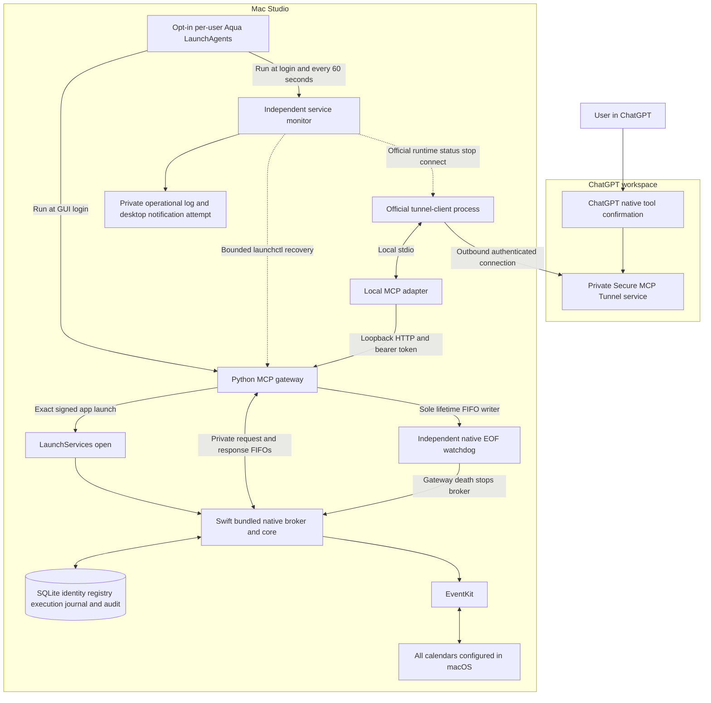
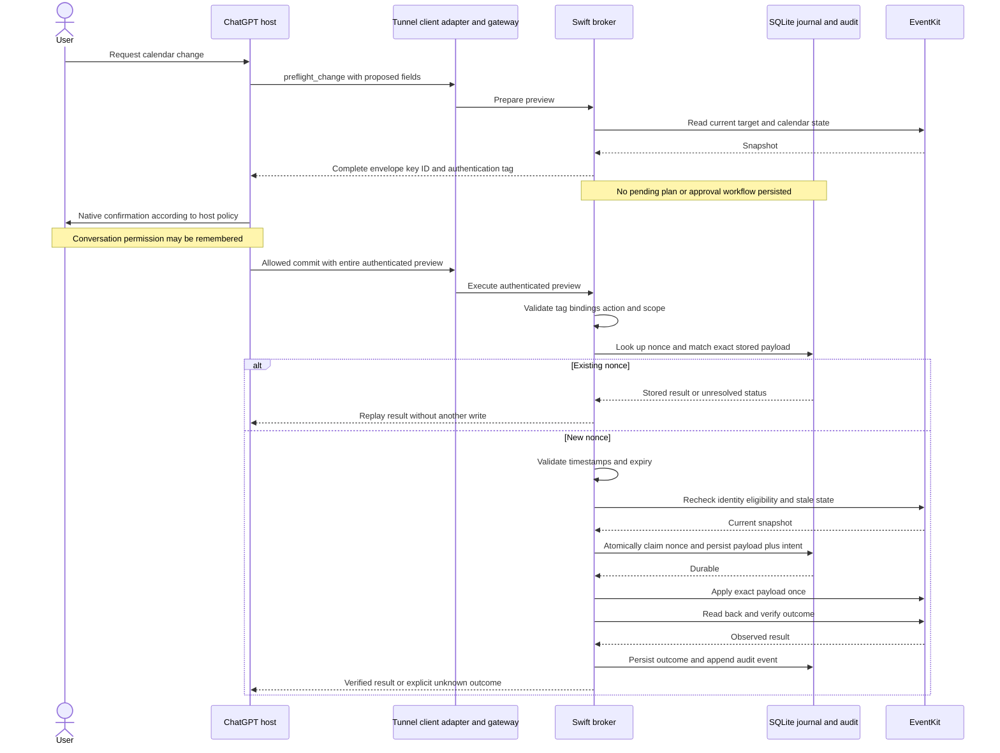
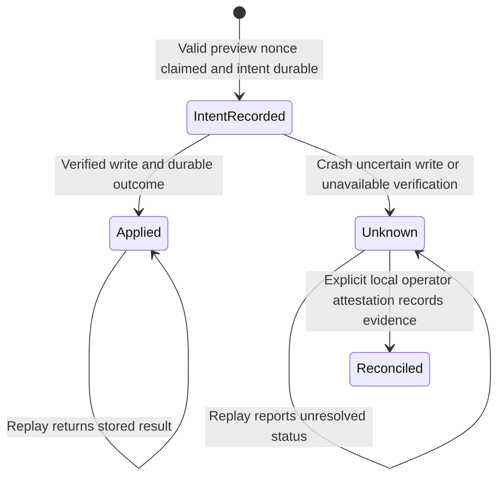

# Calendar MCP architecture

Updated 24 October 2026. This is the private calendar integration for the Mac Studio, with implementation and validation status below. ChatGPT supplies native tool confirmation; a Swift broker owns exact changes, EventKit access and a durable execution audit. This design supersedes Terminal approval and a persisted pending-plan approval workflow.

## Implementation status

| Component | Status |
| --- | --- |
| Swift core and EventKit helper | Implemented native broker/core and EventKit boundary. Swift build and 16 native tests passed, including status-only diagnostics and independent lifetime-watchdog tests. The ad-hoc signed app passed strict verification; the production broker reported full Calendar access and exited after a shutdown probe. The user later verified a representative real read from ChatGPT on iPhone; provider/timezone coverage remains incomplete. |
| Native previews, identity, journal and audit | Implemented native-only HMAC previews, opaque identity registry, durable intent, serialized execution, conservative unknown outcomes and audit chain. Synthetic tests passed; live user test create and delete both reached `applied` with backend verification and durable intent/completion. A read-only audit check verified the five-record chain and zero unresolved executions on 23 October 2026. |
| Python gateway and stdio adapter | Implemented stdlib-only authenticated loopback HTTP and fixed-loopback stdio adapter. On 24 October the full Python suite ran 57 tests: 54 passed and three explicit LaunchServices tests were skipped; native synthetic HTTP/stdio tests used the unchanged built helper. The earlier 24-test suite, including explicit synthetic LaunchServices lifecycle tests, passed on 23 October. |
| ChatGPT tunnel and confirmation | Verified local official `tunnel-client` v0.0.17 runs managed alias `calendar-studio`. Healthy/ready runtime, authenticated polling, doctor OK and MCP initialization verified. User verified a real read, test create and delete on 23 October 2026, and confirmed a prompt before create. Current-epoch `tools/list`, the delete prompt and complete prompt fields were not independently observed. Real modify/provider edge cases remain unverified. |
| Optional login service and independent monitor | Implemented and reviewed; all 33 service tests passed with synthetic/fake launchd and runtime operations. User-authorized Studio installation is enabled with both Aqua jobs registered; separate controlled stops verified natural periodic gateway and official managed-tunnel recovery. An actual GUI-login/reboot cycle and visible desktop notification delivery remain unverified. |

Operational status on 24 October 2026: the user-authorized optional service is installed/enabled on the Studio, with the gateway and monitor registered in the owning user's GUI launchd domain. Metadata-only checks found the gateway reachable on `127.0.0.1:18765`, its resident EventKit broker reporting `full_access`/raw 3 and the official managed tunnel healthy/ready. Natural periodic checks recovered the gateway and tunnel after separate controlled stops. The settled helper bundle was unchanged. Protected state remains at `$HOME/Library/Application Support/Private Calendar MCP`, with active launch diagnostics under `service`. Port 8765's existing listener was untouched. Managed alias `calendar-studio` uses the configured absolute Python interpreter with `-m calendar_mcp stdio --state-dir <configured-state> --port 18765` from the repository working directory; its protected profile references the approved local environment credential without plaintext. The user verified a real read, create and delete through ChatGPT on 23 October; no additional Calendar query or mutation was run for the service work. No event details, exact personal times or opaque IDs were copied here. See [Installation and operation](setup.md) for reproducible fresh setup and the separate current-host restart note.

Automated data validation uses synthetic providers and temporary protected state. A separately authorized live metadata-only probe verified the final production broker's Calendar permission and shutdown, without constructing an EventKit store, querying calendars/events or mutating Calendar data. Build/test commands do not authorize Calendar access or changes. Synthetic test success alone does not establish permission attribution, provider behavior or host confirmation rendering.

The explicit local `--authorize` path retains its EventKit store across the request and reports bounded NSError domain/code/message and bundle context on failure. It never emits error `userInfo` or changes MCP error responses. Production launches use LaunchServices for the exact signed app path: direct Python subprocess launch attributed permission differently and could not use the app's grant. Explicit authorization and resident status must use the same app identity. A remote laptop Codex UI does not determine which Mac owns the permission request or displays its consent dialog; that belongs to the execution Mac's logged-in desktop.

## System design

The official tunnel client establishes the outbound private connection and starts or communicates with the local stdio adapter. Python handles MCP framing, authentication and schema validation. Swift owns EventKit, opaque event identity, preview signing, stale checks, serialized writes and durable execution state. Python cannot choose replacement write payloads.

The optional launchd layer in this diagram is a separate installation choice; see its implementation and deployment status below. It supervises availability and never submits Calendar tools or replays a mutation.

All calendars exposed by macOS can be queried, including subscribed and read-only calendars. Write eligibility is checked per target. No separate iCloud credentials are needed. New events and presentation default to `Europe/London` unless the user specifies otherwise; existing event timezone semantics are preserved.

Private deployment uses a `tunnel_id`, runtime credential and workspace association with read and use access, following [Secure MCP Tunnels](https://developers.openai.com/api/docs/guides/secure-mcp-tunnels). A public deployment would need the documented [OAuth authentication flow](https://developers.openai.com/plugins/build/auth) and is outside the initial scope.

The ChatGPT Tunnel form uses **No authentication** for this private adapter design: trusted tunnel/workspace access is the outer boundary, while the adapter independently authenticates to the local gateway. There is no per-user backend identity or multi-user authorization layer. No local gateway token is pasted into that form, and no arbitrary static bearer-token form is assumed. Local Codex stdio configuration applies only to the gateway host; remote SSH arrangements require separate explicit configuration.

## User flow and consent

1. Install the signed helper and explicitly grant macOS full calendar access. This operating system permission is separate from consent to a particular change.
2. Connect the private tunnel to the intended ChatGPT workspace and ask for a calendar change.
3. ChatGPT requests preflight. The broker reads current state and returns an authenticated preview of the complete change, without queuing it or creating approval state.
4. ChatGPT invokes the appropriate write tool with that full preview visible in its arguments. Native confirmation follows the host's current approval policy.
5. The broker validates the preview, rechecks state, durably records intent, executes the authenticated payload once and verifies the result.

Normal writes have no Terminal approval step, remote `approve` endpoint or caller-provided `userApproved` boolean. Stateless preflight aims for one write confirmation. The host may still request permission for reads.

Custom MCP write tools require confirmation by default, with `readOnlyHint` informing host handling. ChatGPT can remember approval or denial per tool for the conversation; a new or refreshed chat prompts again. The documentation does not guarantee permanent “Always allow” for custom MCP tools. See [Custom MCP servers](https://developers.openai.com/api/docs/guides/custom-mcp-server).

The backend trusts an authenticated caller using ChatGPT's host policy. An allowed call is not cryptographic proof of a fresh human decision; remembered permissions may prevent a new prompt. Audit records use `approval_source: chatgpt_host_policy` and `approval_evidence: not_provided`.

## Trust boundaries

| Boundary | Required behavior |
| --- | --- |
| ChatGPT and tunnel | Restrict workspace access; protect and revoke runtime credentials. Test native confirmation display. |
| Adapter and gateway | Literal `127.0.0.1` binding, dedicated 256-bit token on every valid HTTP method, exact Host and fail-closed Origin validation, bounded request size/concurrency/execution time. No redirects, proxy-environment routing or arbitrary caller-selected URLs. Loopback alone is not authentication. |
| Gateway and broker | EventKit launches exact app through LaunchServices; private owned request/response/lifetime FIFOs, noninherited sole lifetime writer and independent native watchdog. Synthetic normally uses direct pipes. Narrow operation allowlist, strict typed schemas and unknown-argument rejection. No approval API or arbitrary native dispatch. |
| Broker and state | Native-only signing secret; protected SQLite registry, journal and audit; serialized mutations and fail-closed durability checks. |
| Local account | The token identifies an adapter credential, not a cryptographically established human. Same-user malicious processes are outside file-permission isolation. |

Calendar text is untrusted data and cannot authorize actions. Credentials never appear in tool responses or audit records. Preview authentication supplies integrity and authenticity, not confidentiality or proof of consent.

## Optional login service and independent monitor

The implemented optional service uses two per-user **Aqua LaunchAgents**, not a root daemon. The gateway runs in the foreground with `RunAtLoad` and no `KeepAlive`; the independent monitor runs at login and on a 60-second `StartInterval`. This is configured to start after the owning user logs into the GUI following a restart; actual login/reboot operation remains unverified. FileVault unlock, login, an available user session and network connectivity remain prerequisites; it cannot provide pre-login availability. The helper bundle keeps its existing signature and LaunchServices permission identity.

Only the monitor owns automatic recovery. It asks launchd to restart the owned gateway job and uses the official tunnel client's `runtimes status`, `stop` and `connect` commands for the configured managed alias/profile. It does not start a second raw tunnel daemon or signal a native PID, unrelated listener or arbitrary process. The official managed client detaches its runtime from the short-lived monitor process; no launchd `AbandonProcessGroup` override is needed. The installer must reject conflicting jobs, listeners and runtimes rather than taking them over.

Health uses authenticated local gateway/native authorization metadata and official runtime metadata. It never queries calendars/events, constructs a test event, requests Calendar authorization or treats a healthy tunnel as proof that MCP tools work. A busy broker interrupts the failure streak and must not be restarted. Repeated five-second HTTP timeouts can recover the owned gateway only after three failed checks and the 120-second threshold, exceeding the native request deadline. Denied/not-determined Calendar access and runtime ownership conflicts require an alert and local repair, rather than restart attempts. A startup grace of 120 seconds and three consecutive failures gate recovery. Per component, durable retry state applies nominal 60/120/240-second backoff, caps delays at 15 minutes and allows at most three restart attempts per hour. A 120-second grace floor after each restart makes the first three effective delays 120/120/240 seconds. This bounds recovery even across monitor invocations.

A hashed local boot/login episode marker refreshes observation grace and failure streaks for a new session while preserving rolling attempt budgets, backoff and existing incidents. The expected initial managed-tunnel connection records a startup action and consumes the same bounded budget without announcing an outage; a failed startup can alert after grace. Raw boot/session identifiers are not emitted to logs or responses.

The monitor records bounded private operational events and attempts deduplicated outage/recovery desktop notifications, with recovery reported after 120 seconds of sustained healthy checks. Missing, corrupt or incompatible persisted monitor state fails closed: recovery is suspended and a private error marker plus one notification attempt records the problem. A shared lifecycle lock serializes render/install/uninstall and monitor actions. These operational records are separate from the native execution audit and contain no credentials, event data or before/after snapshots. Notification delivery depends on the GUI session, macOS notification permissions and Focus settings; local notifications cannot alert an absent user through another device or report a whole-Mac outage. External alert delivery is a separate user choice.

Service registration is explicit and opt-in: `service render` stages configuration/plists without activation; `service install` activates them after ownership/conflict checks. LaunchAgent arguments and plists contain paths and environment references, never credentials. Runtime credentials are read by a strict private-file loader, without shell sourcing or evaluation, and passed only through the official runtime process's environment. Profiles retain an `env:` credential reference. Uninstall stops the monitor before the gateway and the service-owned managed tunnel; a staged-only uninstall cannot stop preexisting manual services. It preserves credentials, profiles and native journal/audit state. Stopped-state maintenance requires uninstalling the service first so monitoring cannot race a rotation, backup/restore or reconciliation; resuming requires explicit installation.

A gateway or broker restart never resubmits a Calendar request. Native startup preserves consumed nonces and marks interrupted durable intent conservatively unknown. An unresolved write continues to block new writes until evidence-based local reconciliation. The service does not turn availability recovery into write recovery or a new consent surface.

## MCP tools

All nine tools are implemented and published by `calendar_mcp/schema.py`. Read tools use `readOnlyHint: true`. All tools use `openWorldHint: false` because they operate within the bounded configured calendar account set, with no arbitrary recipients, invitations or public publishing. Provider synchronization alone does not change that scope.

| Tool | Purpose | Other target annotations |
| --- | --- | --- |
| `list_calendars` | Read opaque calendar references, sources and eligibility. | Read-only. |
| `query_events` | Read a bounded time range with optional calendar filters. | Read-only. |
| `get_event` | Read one uniquely resolved event or occurrence. | Read-only. |
| `get_availability` | Derive free/busy windows from bounded calendar reads with explicit timezone and filters. | Read-only; no reservations or event creation. |
| `preflight_change` | Return the complete native-authenticated create, modify or delete preview. | `readOnlyHint: true`, `destructiveHint: false`. |
| `commit_create` | Execute an authenticated create preview. | `readOnlyHint: false`, `destructiveHint: false`. |
| `commit_modify` | Execute an authenticated modify preview. | `readOnlyHint: false`, `destructiveHint: true`. |
| `commit_delete` | Execute an authenticated delete preview. | `readOnlyHint: false`, `destructiveHint: true`. |
| `get_change_status` | Read a nonce's journal outcome and audit reference. | Read-only; no write resubmission. |

Separate commit tools keep remembered permission scopes distinct. Write tools advertise `idempotentHint: true` after native journal tests and end-to-end replay validation passed; this does not authorize automatic transport retries. Preflight advertises false because each call creates a new nonce. Preflight reads configured calendar state and returns a preview; incidental identity-cache or diagnostic bookkeeping creates no pending action, approval state or user-visible workflow.

The resident helper launches with `--serve --state-dir <private-native-state> --backend eventkit|synthetic --credential-binding <SHA256-local-token>`. EventKit mode requires a matching `.app` bundle and uses `/usr/bin/open -n -W -g` with its exact path, private stdin/stdout FIFOs and `--lifetime-fifo <private-path>`. Python alone selects these local startup arguments. Synthetic mode normally retains a direct child process. One newline JSON request `{op: <tool_name>, arguments: {...}}` receives one `{result: <object>}` or `{error: {code, message}}` response. Remote requests cannot select an executable, native state, backend, binding or replacement execution payload. A transport failure closes the channel/lifetime and marks the broker unavailable. Recovery requires an operator restart or the separately installed bounded service monitor; neither path retries a possibly submitted write.

Per-launch FIFOs live in an owned `0700` temporary directory with `0600` FIFO permissions. Anchors are nonblocking, close-on-exec and never inherited by `open`. Request/response RDWR anchors prevent startup rendezvous/EOF races, while the monitored `open -W` wrapper detects app exit. Only Python owns the lifetime writer; an independent native watcher installed before state access exits on EOF/error/unexpected input even if request execution is blocked. Clean teardown closes request input first, waits briefly, then closes lifetime to bound a hung broker and finally cleans the wrapper. Native PID is diagnostic metadata, never a signalling authority. No private TCC/responsibility API or additional host Calendar grant is used.

Native internal `authorization_status` accepts only `{}` and returns backend, PID, authorization name and raw value. Synthetic returns `not_applicable`/null without invoking EventKit; EventKit uses only static authorization status, with no store construction/query/prompt. LaunchServices startup validates this handshake. Authenticated fixed GET `/status` and the local status CLI query that actual resident broker without exposing another MCP tool. Reachability remains distinct from full access; denied/not-determined status does not itself prevent diagnostic service startup.

HTTP POST `/mcp` supports JSON responses with no session state or SSE subscription. Initialized notifications return 202; GET/other methods at `/mcp` return authenticated 405. Supported versions are `2025-03-26`, `2025-06-18` and `2025-11-25`; unsupported versions fail closed. Bodies are limited to 1 MiB, native responses to 4 MiB and HTTP responses to 8 MiB; JSON duplicate keys, nonfinite numbers, excessive nesting and unknown tool arguments are rejected. Eight request threads, five-second socket inactivity, a 55-second connection deadline and 45-second native deadline bound resources. Native dispatch is independently serialized and validated.

This follows the official [annotation guidance](https://developers.openai.com/plugins/plugin-guidelines#correct-annotation) for previews and bounded private accounts. Annotations inform host safeguards and do not replace [server authentication and validation](https://developers.openai.com/plugins/build/mcp-server#tool-annotations-and-elicitation).

## Authenticated preview and exact execution

The broker returns `{preview: {envelope, authentication_tag}}` using a versioned deterministic canonical envelope and HMAC-SHA-256. The envelope includes version, nonce, issued/expiry timestamps, installation ID, credential generation, key ID, action, calendar identity, explicit occurrence scope, complete before event and complete proposed after fields. Create has null before; delete has null after. Before includes reviewable deterministic details such as URL, alarms, recurrence and structured location alongside its fingerprint. The signing secret stays native.

Native metadata binds the state directory to its backend mode. It also binds signing/credential generation to SHA-256 of the current high-entropy local bearer credential, passed only at startup. A binding change rotates signing key/key ID/generation atomically and audits it while preserving consumed nonces and unresolved intents. The hash is not a bearer credential. A running gateway retains its previous credential until stopped; rotation requires stopping/restarting the gateway and adapters.

The complete envelope is visible in write-tool arguments, not hidden behind an opaque ID or digest. Review content includes calendar and source, scope, title, start/end offsets and timezone, all-day and exclusive-end semantics, location, notes and other details relevant to the action. Changed fields must not be silently truncated. Host rendering needs testing; visible arguments do not prove a person read every field.

The gateway authenticates the HTTP caller; the broker receives requests over private local FIFOs/pipes and does not independently verify a bearer token or human identity per request. Before trusting preview data, the broker enforces envelope size/schema limits, validates typed fields/canonical encoding, selects a recognized key ID and compares the tag in constant time. It validates native installation/configured credential bindings, action and scope, never trusting caller actor claims. It then looks up the nonce and checks the exact stored payload: terminal replays return the stored result without rerunning expiry or freshness checks; committing/unknown attempts return status without writing. Only a new nonce proceeds to timestamp/expiry checks and refreshed identity, eligibility and full relevant fingerprint checks. Only the authenticated payload executes; no replacement fields are accepted. Canonicalization and fingerprints are deterministic and versioned, not archive byte equality.

Preflight creates no persisted pending plan, queue or approval record. At commit, one SQLite transaction inserts the immutable execution payload, nonce claim, journal state and durable audit intent before EventKit is called. A completed nonce with a currently authentic preview returns its stored result; a committing or unknown nonce never calls EventKit again. An expired unexecuted preview requires new preflight. Credential/signing rotation invalidates old preview authentication, including replays; `get_change_status` still reads the preserved journal by nonce.

## Write sequence

A host denial never reaches the backend. This allowed path does not guarantee a fresh prompt for every write.

## Identity and initial write scope

The native registry maps opaque references to native calendar/event identifiers, occurrence identity and stale-state fingerprints. Synchronization may change native identifiers. Missing or ambiguous identity requires a new query; titles and timestamps alone are unsafe identity fallbacks.

Initial writes target one event or occurrence with explicit this-occurrence semantics. Entire-series changes, series creation and mutations of events with attendees or an organizer are unsupported. Subscribed and read-only calendars cannot be written. Recheck eligibility and invitation status at commit.

Current mutation guards also reject nil-timezone all-day events and events with email/procedure alarms. A location edit is rejected when the existing event has a structured location, because preserving that structure while replacing its text cannot be guaranteed. Other supported edits preserve the existing structured location and unrelated alarms/recurrence.

Preserve nil EventKit timezones and supported floating-time semantics; the London default for new events/display must never rewrite an existing event's nil timezone. Reject unsupported semantics and ambiguous/nonexistent local DST input unless an explicit offset resolves it to a valid instant consistent with the chosen timezone. All-day ends are exclusive and use calendar-day arithmetic in the relevant timezone. Preserve unrelated alarms, recurrence and structured location when editing, or reject the operation if preservation cannot be guaranteed.

EventKit provides no cross-client compare-and-swap. Immediate stale checks and post-write verification cannot exclude concurrent edits by Calendar or a provider; report conflicts/uncertainty accurately. Availability is a snapshot, not a reservation: exclude cancelled/free events and conservatively count busy, tentative, unavailable and unknown statuses by default. Return the selected calendars, time window, policy and snapshot limitation with availability results.

## Audit and execution journal

Native audit records commit attempts reaching the native broker: native validation rejection, durable intent, verified completion, unknown outcome and replay, plus native configuration/recovery changes. Stateless preview issuance is not logged and creates no pending approval workflow. Gateway authentication/schema rejections are enforced before native dispatch and are not represented as native audit rows. Host-denied calls and edits through Calendar, other apps or devices are outside complete backend visibility. Every error after entering the EventKit apply boundary is conservatively unknown, so no post-intent confirmed-failure state is currently claimed.

| Record fields | Contents |
| --- | --- |
| Identity and time | Schema version, monotonic sequence, unique audit event ID, event type, optional execution nonce and UTC timestamp. Event ID and nonce provide correlation; there is no separate attempt/correlation ID. |
| Action and observations | Intent payload contains the complete authenticated execution envelope, including action, targets, scope and before/after. Result records contain observed event/deletion or unknown outcome as applicable. Rejection records contain operation and safe code only. There is no separate authenticated-payload-hash field. |
| Consent provenance | Commit records use `approval_source: chatgpt_host_policy`; configuration, recovery and reconciliation use `local_configuration`, `native_recovery` or `local_operator_attestation` as applicable. `approval_evidence: not_provided` never claims a fresh human click. |
| Outcome and integrity | Event type and payload describe the transition, recorded result or safe rejection. Replay records refer to the same nonce and stored result. Previous-record hash and current hash cover the complete audit body. |

Audit rows are append-only through the application interface; mutable journal state is separate. A deterministic hash chain is tamper-evident relative to a trusted checkpoint, not tamper-proof against a same-user attacker who can rewrite it. It does not prove consent.

SQLite and EventKit cannot share one atomic transaction. Fail closed if intent cannot be persisted. An EventKit error does not prove no change occurred. A crash after intent, failed verification or unavailable outcome persistence requires unknown-outcome reconciliation, never blind retry. A new write needs new preflight after the earlier attempt is safely resolved.

Use a `0700` state directory and `0600` database/associated files, protecting backups and exports equally. Before/after data is sensitive; retain what explains/verifies changes and never log secrets. Retention is indefinite; there is no automatic purge or supported audit export/purge CLI. Future purge functionality must preserve consumed nonces through preview expiry plus allowed clock skew at minimum, and unresolved intents until reconciliation. Back up only a fully stopped broker's protected native state; restore only while stopped, then run local `--rotate-keys` before restarting. That invalidates prior signing/credential generation while preserving restored journal rows; unresolved external outcomes still require inspection. Do not overwrite a live SQLite file or manually delete journal/audit rows.

Repository hygiene excludes environment/credential files, private keys, generated profiles/state, SQLite/associated files, logs, backups, bundles and downloaded tools. Source and synthetic code/JSON/SQL fixtures remain versionable; sanitized environment examples are the only environment-file exception. Never commit live tokens, account/workspace/tunnel IDs, audit before/after data or personal event details. Ignore rules are defense in depth; stage explicit source/documentation paths and inspect/scan staged blobs before committing.

Exceptional local `--reconcile` requires a TTY, nonce, `applied|not_applied`, bounded evidence and typed nonce confirmation; it never mutates EventKit. This is an operator attestation, not automatic proof of an external outcome or a write-consent surface. The exclusive native state lock excludes a running broker. Unknown outcomes block new writes until resolved. Reconciled nonces stay consumed. See [setup](setup.md) for exact recovery commands and limitations.

## Validation and remaining work

1. Sixteen native tests passed for signing, identity, journal/audit, date/scope/eligibility, recovery, status-only diagnostics and lifetime watchdog behavior. Live user test create and delete were verified on 23 October 2026: read-only journal/audit inspection found both `applied`, matching intent/completion for each, a valid five-record chain and no unresolved executions. Native completion requires EventKit read-back/deletion verification. No additional Calendar query or mutation was run by the agent, and no event details/times/IDs were retained here.
2. Historical validation on 23 October 2026: the then-current 24 Python tests passed for strict tool dispatch, supported versions, notifications, HTTP+stdio round-trips, authentication on all valid HTTP methods, Host/Origin rejection, duplicate-header/key checks, bounded JSON, protected credentials, large Unicode snapshot preservation and resident-child timeout/no retry. Actual-native synthetic HTTP/stdio lifecycle and credential rotation passed. Explicit synthetic LaunchServices tests passed for clean shutdown/state-lock release, abrupt gateway-death shutdown and lifetime EOF with unread response output. Final live production status returned `gateway: reachable`, `backend_mode: eventkit`, `authorization_status: full_access`, raw 3 from the actual resident broker, followed by `native_exited_after_gateway_stop: true`; no calendars/events were queried or changed.
3. The private managed tunnel, ChatGPT iPhone read path and signed-preflight/create/delete paths are verified. The user confirmed a create prompt; the delete prompt and complete UI fields were not independently verified. Earlier health showed MCP initialization without current-epoch `tools/list` and a dispatcher failure, so not every call is claimed successful. Separate write permissions, remembered decisions, denial visibility and dropped-connection recovery still need validation. Real modify and recurrence/provider/timezone edge cases remain unverified. A user-reported prompt does not supply backend cryptographic proof of fresh human approval.
4. The final settled LaunchServices app's TCC grant is verified; durable signing/permission continuity across rebuilds remains unverified. The development rebuild did reset its earlier grant. Exercise provider recurrence, metadata preservation and concurrent external edits only under separately authorized integration scope.
5. On 24 October 2026 the full Python suite ran 57 tests: 54 passed, including all 33 service tests and existing native synthetic HTTP/stdio integration using the unchanged built helper; three explicit LaunchServices lifecycle tests were skipped. Service tests covered protected rendering, strict secret loading, metadata-only probes, ownership conflicts, fake launchd installation/rollback/uninstall, shared lifecycle locking, persisted recovery budgets/backoff, busy/dependency suppression, failed-state suspension and notification deduplication. This automated run made no real launchd calls or Calendar data access and did not rebuild Swift.
6. Separate user-authorized real service installation and controlled-fault checks passed on 24 October. Both Aqua jobs are registered and the monitor ran naturally on its periodic schedule. An owned-gateway stop led to one bounded restart on the third failed check; its old native broker exited through the lifetime channel and the replacement reported full access, without a tunnel dependency restart. A later official managed-tunnel stop led to one reconnect on the third failed check while the gateway remained healthy. Persistent budgets retained one gateway attempt and two tunnel attempts (initial start plus controlled recovery). The exact deployed stdio command initialized protocol `2025-11-25` and listed nine expected tools with zero `tools/call` requests; this is local adapter/gateway protocol evidence, not refreshed ChatGPT discovery or a new Calendar read. Exactly one matching managed runtime was found, the settled helper hash was unchanged, and read-only native state checks found two applied executions, zero unresolved executions and a valid five-record audit chain. No Calendar data was queried or changed. Actual reboot/login operation and visible desktop notification delivery remain unverified.

Synthetic testing is the default. Do not trigger TCC prompts or mutate real calendars during unattended tests. Once OS access and scoped real integration validation are authorized, normal scoped reads need no repeated confirmation. Actual writes require exact concrete consent through the selected host policy. Update this file, its diagrams and status in the same change as architecture, contracts, consent, audit or implementation milestones.

## Official sources

Checked 23 October 2026: [Custom MCP servers](https://developers.openai.com/api/docs/guides/custom-mcp-server), [Secure MCP Tunnels](https://developers.openai.com/api/docs/guides/secure-mcp-tunnels), [Authentication](https://developers.openai.com/plugins/build/auth), [Annotation guidance](https://developers.openai.com/plugins/plugin-guidelines#correct-annotation) and [Tool annotations](https://developers.openai.com/plugins/build/mcp-server#tool-annotations-and-elicitation). Native authenticated previews and the journal are project decisions. These sources do not supply a backend-verifiable human approval receipt or guarantee fresh confirmation on every call.
