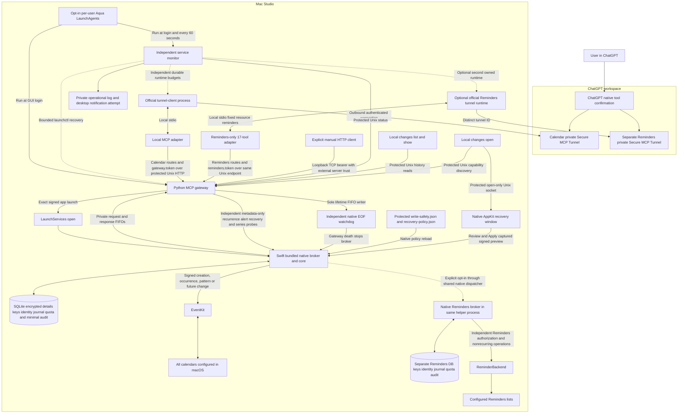
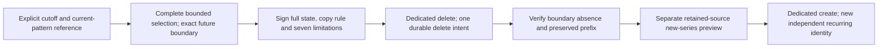
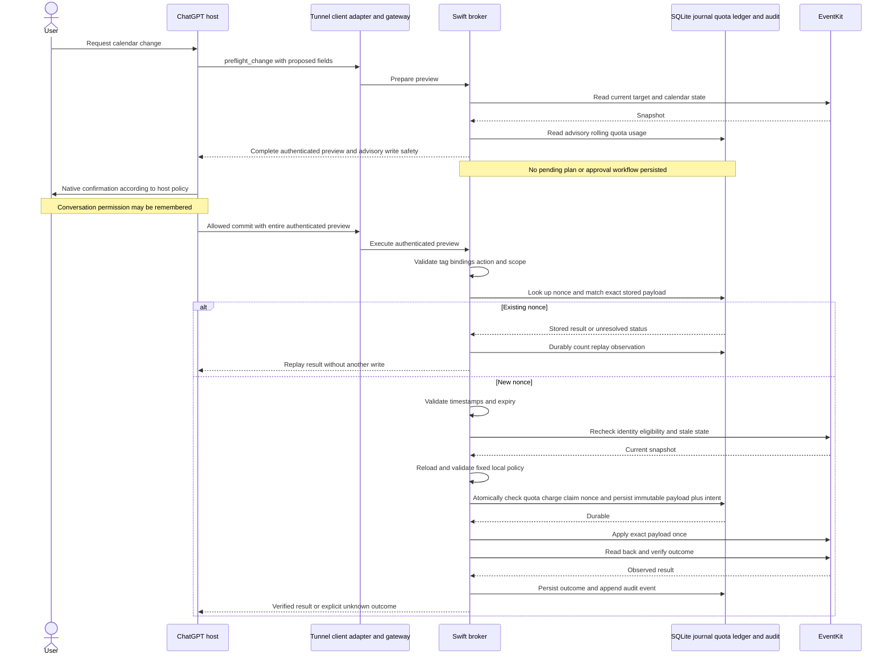
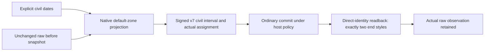
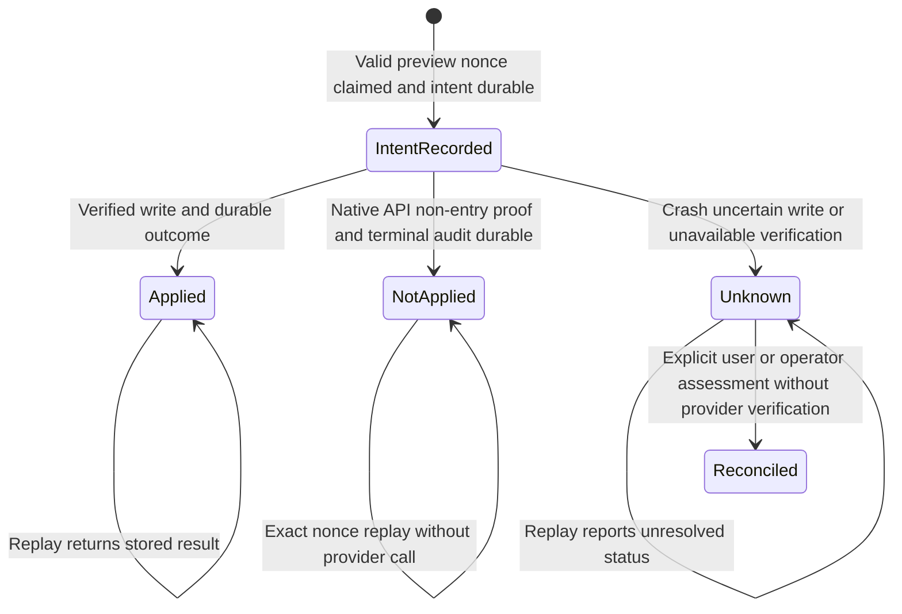
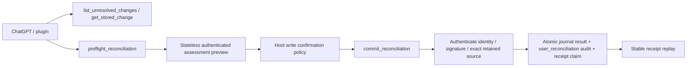

# Calendar MCP architecture

This document describes the current implementation and its safety boundaries. For installation use [quick install](quick-install.md) or the [full operating guide](setup.md).

## Implementation status

| Component | Current contract |
| --- | --- |
| Native broker | Swift/EventKit owns identity, previews, stale checks, serialized mutation, journal, audit and quotas. Writer compatibility floor 7; encrypted detail/marker encoding 2. |
| Transport | Dependency-free Python gateway and stdio adapter; protected Darwin Unix HTTP with peer-UID verification. Official private tunnel supplies remote ingress. |
| Event operations | Individual/recurring creation, occurrence edit/delete, multiple alerts and retained recovery. 22 tools are published only after exact native capability checks. |
| Pattern operations | Dedicated v4 current-pattern defaults, v5 future defaults/inverse and v6 cutoff termination/limited independent-copy recovery. Structural user edits and arbitrary full-series deletion remain unsupported. |
| Civil all-day dates | v7 nonrecurring floating creation/date correction and supported inverse; minimum floor 6 within writer floor 7. No fresh all-day delete/cutoff/copy restoration. |
| Retained nominal master | v5/v6 prefix witnesses can use the exact retained master when its first expanded occurrence is excluded. Public reads and selected-boundary absence semantics remain unchanged; the analogous v4 inverse case is separate work. |
| Non-execution proof | Only typed native API non-entry proof plus atomic terminal result/audit yields not_applied. Entered or unproven failures remain unknown. |
| Journal assessment | Three journal-only tools record an explicit user assessment of an earlier unknown. They provide no provider verification or automatic retry. |
| Optional service/UI | Per-user GUI-login gateway/monitor and native history window are implemented. Reboot/visible alerts and production UI Apply are not comprehensively verified. |
| Attachments | Not implemented; supported provider-native access versus MCP-only associations remains a user choice. |
| Optional Reminders | Deployed and explicitly enabled in the current installation; disabled by default for fresh installations. The resident signed helper reports independent Reminders Full Access/raw 3 and publishes seventeen tools on its separate resource. Native models/state/keys/history/quotas remain isolated from Calendar. Host catalog and provider use remain separate checks. See [Reminders](reminders.md). |

Current local observations (28 October 2026) verify the resident signed app's separate Calendar and Reminders Full Access/raw 3, registered gateway/monitor jobs, a current monitor check and both healthy, ready owned tunnel runtimes. Protected Unix/stdio discovery confirms Calendar-only 22 and Reminders-only 17 catalogs. Existing Calendar history, encrypted details/keys, identities, bindings, quota/audit/assessment history and durable restart budgets remain preserved. The user reports creating the separate Reminders plugin in ChatGPT web; its 17-tool host catalog and provider reads are not yet confirmed; no provider item reads or writes were performed during deployment. Treat authorization and health as observations to recheck with metadata, not timeless guarantees or provider-write validation. Synthetic coverage is extensive; complete provider and host behavior remains unverified. See [validation limits](#validation-and-remaining-work).

## System design

The diagram describes the deployed separate-resource backend and protected project-client boundary; the user reports creating the separate Reminders plugin, while its host catalog remains unconfirmed. Manual TCP compatibility has a separate residual server-identity limitation.



The official tunnel client establishes the outbound private connection and starts or communicates with the local stdio adapter. Python handles MCP framing, authentication and schema validation. Swift owns EventKit, opaque event identity, preview signing, stale checks, serialized writes, the local destructive-write policy and durable execution state. Python cannot choose replacement write payloads. The recovery implementation keeps local review and Apply inside the native broker; the local Unix socket can only open its window.

The optional launchd layer in this diagram is a separate installation choice; see its implementation details below. It supervises availability and never submits Calendar tools or replays a mutation.

All calendars exposed by macOS can be queried, including subscribed and read-only calendars. Write eligibility is checked per target. No separate iCloud credentials are needed. New events and presentation default to `Europe/London` unless the user specifies otherwise; existing event timezone semantics are preserved.

Private deployment uses a `tunnel_id`, runtime credential and workspace association with read and use access, following [Secure MCP Tunnels](https://developers.openai.com/api/docs/guides/secure-mcp-tunnels). A public deployment would need the documented [OAuth authentication flow](https://developers.openai.com/plugins/build/auth) and is outside the initial scope.

The ChatGPT Tunnel form uses **No authentication** for this private adapter design: trusted tunnel/workspace access is the outer boundary, while the adapter independently authenticates to the local gateway. There is no per-user backend identity or multi-user authorization layer. No local gateway token is pasted into that form, and no arbitrary static bearer-token form is assumed. Local Codex stdio configuration applies only to the gateway host; remote SSH arrangements require separate explicit configuration.

## User flow and consent

1. Install the signed helper and explicitly grant macOS full calendar access. This operating system permission is separate from consent to a particular change.
2. Connect the private tunnel to the intended ChatGPT workspace and ask for a calendar change.
3. ChatGPT requests preflight. The broker reads current state and returns an authenticated preview of the complete change, without queuing it or creating approval state.
4. ChatGPT invokes the appropriate write tool with that full preview visible in its arguments. Native confirmation follows the host's current approval policy.
5. The broker validates the preview, rechecks state and the current local write-safety policy, atomically records any quota charge with durable intent, executes the authenticated payload once and verifies the result.

Normal writes have no Terminal approval step, remote `approve` endpoint or caller-provided `userApproved` boolean. Stateless preflight aims for one write confirmation. The host may still request permission for reads.

Custom MCP write tools require confirmation by default, with `readOnlyHint` informing host handling. ChatGPT can remember approval or denial per tool for the conversation; a new or refreshed chat prompts again. The documentation does not guarantee permanent “Always allow” for custom MCP tools. See [Custom MCP servers](https://developers.openai.com/api/docs/guides/custom-mcp-server).

The backend trusts an authenticated caller using ChatGPT's host policy. An allowed call is not cryptographic proof of a fresh human decision; remembered permissions may prevent a new prompt. Audit records use `approval_source: chatgpt_host_policy` and `approval_evidence: not_provided`.

## Trust boundaries

| Boundary | Required behavior |
| --- | --- |
| ChatGPT and tunnel | Restrict workspace access; protect and revoke runtime credentials. Test native confirmation display. |
| Adapter and gateway | Project clients derive a protected Darwin Unix endpoint from canonical gateway state and the configured authority port. They validate the private OS temporary base, owned `0700` parent and owned `0600` socket, then check peer UID using Darwin libc `getpeereid` before sending HTTP bytes. The Unix listener checks peer UID before HTTP parsing. All HTTP requests retain bearer authentication and exact Host/Origin checks, with bounded sizes, concurrency and deadlines. No redirects, proxy-environment routing, retries or TCP fallback. Manual literal-`127.0.0.1` HTTP does not authenticate server identity: an external/manual bearer client can expose credentials to a port prebinder and must use the protected project client or an independently authenticated encrypted channel. |
| Gateway and broker | EventKit launches exact app through LaunchServices; private owned request/response/lifetime FIFOs, noninherited sole lifetime writer and independent native watchdog. Synthetic normally uses direct pipes. Narrow operation allowlist, strict typed schemas and unknown-argument rejection. No approval API or arbitrary native dispatch. |
| Broker and state | Native-only signing secret; protected SQLite registry, journal, destructive-intent ledger and audit; serialized mutations and fail-closed policy/durability checks. |
| Recovery details and local UI | Native version-2 detail encoding at compatibility floor 7 encrypts event-bearing execution details with per-record keys and keeps minimal replay/audit/quota metadata. A protected open-only socket can activate the AppKit window; native review captures the exact signed step and Apply executes inside the broker with fixed `local_native_ui` provenance. Neither Python nor the socket accepts approval or replacement write payloads. |
| Native local policy | Only the fixed protected `write-safety.json` in native state is accepted. A trusted local operator can edit it; no MCP tool, preview argument, transport-selected path or approval flag can raise/disable limits. |
| Local account | The token identifies an adapter credential, not a cryptographically established human. Same-user malicious processes are outside file-permission isolation. |

Calendar text is untrusted data and cannot authorize actions. Credentials never appear in tool responses or audit records. Preview authentication supplies integrity and authenticity, not confidentiality or proof of consent.

## Optional login service and independent monitor

The implemented optional service uses two per-user **Aqua LaunchAgents**, not a root daemon. The gateway runs in the foreground with `RunAtLoad` and no `KeepAlive`; the independent monitor runs at login and on a 60-second `StartInterval`. This is configured to start after the owning user logs into the GUI following a restart; actual login/reboot operation remains unverified. FileVault unlock, login, an available user session and network connectivity remain prerequisites; it cannot provide pre-login availability. The helper bundle keeps its existing signature and LaunchServices permission identity.

Only the monitor owns automatic recovery. It asks launchd to restart the owned gateway job and uses the official tunnel client's `runtimes status`, `stop` and `connect` commands for the configured managed alias/profile. It does not start a second raw tunnel daemon or signal a native PID, unrelated listener or arbitrary process. The official managed client detaches its runtime from the short-lived monitor process; no launchd `AbandonProcessGroup` override is needed. The installer must reject conflicting jobs, listeners and runtimes rather than taking them over.

Health uses authenticated local gateway/native authorization metadata and official runtime metadata. It never queries calendars/events, constructs a test event, requests Calendar authorization or treats a healthy tunnel as proof that MCP tools work. A busy broker interrupts the failure streak and must not be restarted. Repeated five-second HTTP timeouts can recover the owned gateway only after three failed checks and the 120-second threshold, exceeding the native request deadline. Denied/not-determined Calendar access and runtime ownership conflicts require an alert and local repair, rather than restart attempts. A startup grace of 120 seconds and three consecutive failures gate recovery. Per component, durable retry state applies nominal 60/120/240-second backoff, caps delays at 15 minutes and allows at most three restart attempts per hour. A 120-second grace floor after each restart makes the first three effective delays 120/120/240 seconds. This bounds recovery even across monitor invocations.

A hashed local boot/login episode marker refreshes observation grace and failure streaks for a new session while preserving rolling attempt budgets, backoff and existing incidents. The expected initial managed-tunnel connection records a startup action and consumes the same bounded budget without announcing an outage; a failed startup can alert after grace. Raw boot/session identifiers are not emitted to logs or responses.

The monitor records bounded private operational events and attempts deduplicated outage/recovery desktop notifications, with recovery reported after 120 seconds of sustained healthy checks. Missing, corrupt or incompatible persisted monitor state fails closed: recovery is suspended and a private error marker plus one notification attempt records the problem. A shared lifecycle lock serializes render/install/uninstall and monitor actions. These operational records are separate from the native execution audit and contain no credentials, event data or before/after snapshots. Notification delivery depends on the GUI session, macOS notification permissions and Focus settings; local notifications cannot alert an absent user through another device or report a whole-Mac outage. External alert delivery is a separate user choice.

Service registration is explicit and opt-in: `service render` stages configuration/plists without activation; `service install` activates them after ownership/conflict checks. LaunchAgent arguments and plists contain paths and environment references, never credentials. Runtime credentials are read by a strict private-file loader, without shell sourcing or evaluation, and passed only through the official runtime process's environment. Profiles retain an `env:` credential reference. Uninstall stops the monitor before the gateway and the service-owned managed tunnel; a staged-only uninstall cannot stop preexisting manual services. It preserves credentials, profiles and native journal/audit state. Ordinary stopped-state maintenance requires uninstalling the service first so monitoring cannot race a rotation, backup/restore or reconciliation; resuming requires explicit installation.

A gateway or broker restart never resubmits a Calendar request. Native startup preserves consumed nonces and marks interrupted durable intent conservatively unknown. An unresolved write retains scoped conflict protection until evidence-based local reconciliation; legacy or insufficient identity evidence uses conservative calendar/global fallbacks. The service does not turn availability recovery into write recovery or a new consent surface.

## Calendar container deletion prohibition

Deleting a calendar container is a permanent, non-configurable prohibition for this integration, including future providers and local tooling. No confirmation, write-safety policy change or recovery operation can enable it. Individually authorized event deletions remain supported within the existing quotas; those deletions can empty a calendar while leaving its container intact.

The public and native operation allowlists expose no calendar-removal operation. Ordinary delete preflight requires one opaque event identity, rejects `calendar_id` and accepts only `scope: this`; the dedicated version-6 cutoff route has its separately bounded future contract. Native identity resolution distinguishes calendar identities from event identities. Commit authenticates and independently checks the exact action and scope, resolves the signed before-event identity, and journals that event change. Recovery writes are create/modify only. EventKit deletion accepts an `EKEvent` with the authenticated occurrence/future span, with no calendar-removal call.

## MCP tools

The complete current capability set publishes 22 tools from `calendar_mcp/schema.py`. The original nine remain available when newer native capabilities are absent; recovery, series/future and journal tools require their independent exact capability probes. Read tools use `readOnlyHint: true`. All tools use `openWorldHint: false` because they operate within the bounded configured calendar account set, with no arbitrary recipients, invitations or public publishing. Provider synchronization alone does not change that scope.

| Tool | Purpose | Other target annotations |
| --- | --- | --- |
| `list_calendars` | Read opaque calendar references, sources and eligibility. | Read-only. |
| `query_events` | Read a bounded time range with optional calendar filters. | Read-only. |
| `get_event` | Read one uniquely resolved event or occurrence. | Read-only. |
| `get_availability` | Derive free/busy windows from bounded calendar reads with explicit timezone and filters. | Read-only; no reservations or event creation. |
| `preflight_change` | Return the complete native-authenticated create, modify or delete preview. | `readOnlyHint: true`, `destructiveHint: false`. |
| `commit_create` | Execute an authenticated create preview. | `readOnlyHint: false`, `destructiveHint: false`. |
| `commit_modify` | Execute an authenticated modify preview. | `readOnlyHint: false`, `destructiveHint: true`. |
| `commit_delete` | Execute an authenticated delete preview. | `readOnlyHint: false`, `destructiveHint: true`. |
| `get_change_status` | Read a nonce's journal outcome and audit reference. | Read-only; no write resubmission. |
| `list_changes` | Browse retained integration modifications/deletions with snapshot-bound cursor pagination and optional filters. | Read-only; pages are not all-history selections. |
| `get_stored_change` | Inspect one change's retained before/proposed/observed details and recovery eligibility. | Read-only; expired details are null. |
| `preflight_rollback` | Prepare complete signed recovery steps for exact source IDs or all matching sources within limits. | Read-only; non-idempotent; at most 25 sources and 450 KiB complete response. |
| `commit_rollback` | Execute one unchanged signed recovery step. | Write/destructive/idempotent; separate host permission scope. |
| `commit_series_modify` | Deployed, capability-gated current-pattern default-field modification using a complete version-4 preview. | Write/destructive/idempotent; dedicated host permission scope. |
| `commit_series_rollback` | Deployed, capability-gated inverse fields for one retained version-4 series source. | Write/destructive/idempotent; dedicated host permission scope. |
| `commit_future_modify` | Deployed version-5 selected future-occurrence default fields; actual resident access verified; live checks pending. | Write/destructive/idempotent; dedicated host permission scope. |
| `commit_future_rollback` | Deployed version-5 inverse fields for one original future source before its boundary; live checks pending. | Write/destructive/idempotent; dedicated host permission scope. |
| `commit_future_delete` | Deployed version-6 cutoff termination from an exact future boundary; live checks pending. | Write/destructive/idempotent; dedicated host permission scope. |
| `commit_future_restore` | Deployed version-6 new independent series from one retained termination; live checks pending. | Write/non-destructive/idempotent like creation; dedicated host permission scope. |
| `list_unresolved_changes` | Browse unresolved integration outcomes without querying Calendar. | Read-only. |
| `preflight_reconciliation` | Prepare an exact user-assessment preview for one unknown execution. | Read-only; non-idempotent. |
| `commit_reconciliation` | Record the reviewed user assessment in the journal only. | Write/destructive/idempotent; no Calendar mutation. |

Separate commit tools keep remembered permission scopes distinct. Write tools advertise `idempotentHint: true` after native journal tests and end-to-end replay validation passed; this does not authorize automatic transport retries. Preflight tools advertise false because each call creates new nonces. The four recovery tools are published and dispatched only after an exact successful internal `recovery_capabilities({})` probe against the actual resident helper: `{version:1,storage_version:7,recovery:true,detail_retention:true,local_ui:<boolean>,max_selection:25}` (the matcher also accepts integer storage versions 2 through 7 for supported compatibility; `local_ui` must be a real boolean). The probe is cached once per native process and uses no EventKit. Old-helper `unknown_operation`, malformed responses or any probe failure leave only the original nine tools and recovery calls return `feature_unavailable`; they never dispatch. The existing strict four-field `authorization_status` contract is unchanged. Preflight reads configured calendar state and returns a preview; incidental identity-cache or diagnostic bookkeeping creates no pending action, approval state or user-visible workflow.

The resident helper launches with `--serve --state-dir <private-native-state> --backend eventkit|synthetic --credential-binding <SHA256-local-token>`. EventKit mode requires a matching `.app` bundle and uses `/usr/bin/open -n -W -g` with its exact path, private stdin/stdout FIFOs and `--lifetime-fifo <private-path>`. Python alone selects these local startup arguments. Synthetic mode normally retains a direct child process. One newline JSON request `{op: <tool_name>, arguments: {...}}` receives one `{result: <object>}` or `{error: {code, message}}` response. Remote requests cannot select an executable, native state, backend, binding or replacement execution payload. A transport failure closes the channel/lifetime and marks the broker unavailable. Recovery requires an operator restart or the separately installed bounded service monitor; neither path retries a possibly submitted write.

Per-launch FIFOs live in an owned `0700` temporary directory with `0600` FIFO permissions. Anchors are nonblocking, close-on-exec and never inherited by `open`. Request/response RDWR anchors prevent startup rendezvous/EOF races, while the monitored `open -W` wrapper detects app exit. Only Python owns the lifetime writer; an independent native watcher installed before state access exits on EOF/error/unexpected input even if request execution is blocked. Clean teardown closes request input first, waits briefly, then closes lifetime to bound a hung broker and finally cleans the wrapper. Native PID is diagnostic metadata, never a signalling authority. No private TCC/responsibility API or additional host Calendar grant is used.

Native internal `authorization_status` accepts only `{}` and returns backend, PID, authorization name and raw value. Synthetic returns `not_applicable`/null without invoking EventKit; EventKit uses only static authorization status, with no store construction/query/prompt. LaunchServices startup validates this handshake. Authenticated fixed GET `/status` and the local status CLI query that actual resident broker without exposing another MCP tool. Reachability remains distinct from full access; denied/not-determined status does not itself prevent diagnostic service startup.

The deployed project-client transport is protected Darwin AF_UNIX HTTP. `GatewayClient.send` and `.status` use it, so stdio, status CLI, history list/show/open capability discovery and service monitoring inherit the same boundary. `--port` remains the conventional HTTP authority and selects the matching Unix endpoint; project clients never use it as a TCP route. Missing or unsafe Unix transport fails closed before HTTP credentials or payloads are sent. Unsupported platforms or unavailable peer-identity APIs also fail closed. Same-UID malicious processes remain outside file-permission isolation. Manual TCP compatibility retains its server-identity risk; the direct TCP security tests establish authentication/parser behavior only.

The endpoint is `<confstr(_CS_DARWIN_USER_TEMP_DIR)>/cmgw-<hash>/s`. Its hash is the first 20 lowercase SHA-256 hex characters of strict UTF-8 canonical gateway-state path, NUL and ASCII decimal actual authority port. Darwin's numeric confstr fallback is 65537. The supplied temporary-base leaf is validated before and after POSIX canonicalization: owned directory, no symlink leaf and no group/other mode bits. There is no `TMPDIR` or shared `/tmp` fallback. The owned child is exactly `0700`; the owned socket is exactly `0600` with one link; its encoded full path is under 104 bytes. Both peers require current installation UID through the documented libc `getpeereid` call before HTTP parsing/emission. A port-0 synthetic server learns its actual TCP authority before deriving this endpoint.

Startup binds TCP first, obtains an exclusive private per-endpoint `flock`, and reclaims only a valid stale owned socket under that lock before binding Unix. Unsafe existing nodes are refused. Unix setup failure is fatal and closes the TCP listener. Cleanup removes only the socket device/inode recorded after bind, preserving replacement nodes. It does not recursively remove directories. Both listeners share the same protocol/native broker, eight-connection semaphore and HTTP limits; shutdown closes both and joins the secondary listener. Native previews, host consent, journal, audit and replay semantics are unchanged.

Synthetic regression coverage includes zero fake-TCP connections when Unix is missing or unsafe, wrong connect/accept peer UID before HTTP bytes, peer-query failure, Unicode/long-state and port-specific derivation, `TMPDIR` manipulation, unsafe directories/sockets/lock files, repeated path/peer checks, shared connection limits, partial-startup cleanup, exclusive ownership, stale socket reclaim and inode-safe replacement preservation. These synthetic checks establish source behavior; separate deployment metadata verifies the current transport. Neither establishes live Calendar behavior.

HTTP POST `/mcp` supports JSON responses with no session state or SSE subscription. Initialized notifications return 202; GET/other methods at `/mcp` return authenticated 405. Supported versions are `2025-03-26`, `2025-06-18` and `2025-11-25`; unsupported versions fail closed. Bodies are limited to 1 MiB, native responses to 4 MiB and HTTP responses to 8 MiB; JSON duplicate keys, nonfinite numbers, excessive nesting and unknown tool arguments are rejected. Eight request threads, five-second socket inactivity, a 55-second connection deadline and 45-second native deadline bound resources. Native dispatch is independently serialized and validated.

Incoming HTTP/stdio JSON remains limited to depth 20. The local adapter's bounded HTTP response parser allows depth 32 so complete tool discovery can include nested version-specific preview, alert and recurrence JSON Schemas. This response allowance does not relax tool argument validation. Synthetic HTTP and stdio discovery tests round-trip complete 22-tool schemas and supported legacy contracts within the existing response-size/depth bounds and verify the incoming depth limit remains enforced.

Deployed input hardening rejects invalid Unicode scalar strings and object keys, and recursively rejects nonfinite numbers including numeric exponent overflow. The same checks protect direct Python schema/protocol calls and native request serialization. Invalid requests rejected before submission return `invalid_arguments` without closing or poisoning a healthy resident native channel. Channel failures after possible submission retain the conservative unknown-outcome/no-retry behavior. These changes are deployed; synthetic regression checks do not establish live Calendar behavior.

The deployed stdio adapter accepts only string or integer request identifiers, excluding booleans, and uses a null error identifier for invalid IDs. Nonobject initialize parameters are forwarded for protocol rejection without unsafe local field access. Invalid gateway results are contained before output serialization; a safe error preserves the validated request ID and reports no-retry/status guidance after possible submission. Subsequent framed requests can continue. This is deployed and does not retry ambiguous writes.

Deployed local-window IPC derives its short endpoint from canonical UTF-8 state-path bytes inside Darwin's protected per-user temporary base, independently of `TMPDIR` and public legacy endpoint preclaims. Optional UI startup failure leaves the broker available and reports `local_ui:false`; the exact recovery capability contract permits either boolean for this field while keeping every other key, value and type fixed. The four remote history/recovery tools remain available when local UI is unavailable. Synthetic availability checks do not establish production UI or Calendar behavior.

File attachment support is a documented future requirement, not part of the current 22 tools. Public EventKit does not expose native file attachment APIs; reads and retained recovery snapshots cannot establish native attachment inventory, preservation or restoration. The future contract must keep ordinary reads/listings metadata-only and retrieve bytes through an explicit separate operation. Provider-native attachments and MCP-only file associations are distinct options pending user choice. The current MCP subset has no attachment fields/tools, resource/file-transfer methods or binary-result mapping. [Attachment findings and requirements](attachments.md) records primary sources, transport limits and unresolved authentication, identity, execution, retention and security boundaries.

This follows the official [annotation guidance](https://developers.openai.com/plugins/plugin-guidelines#correct-annotation) for previews and bounded private accounts. Annotations inform host safeguards and do not replace [server authentication and validation](https://developers.openai.com/plugins/build/mcp-server#tool-annotations-and-elicitation).

## Scoped conflict guard

After original preview authentication, native code derives a version-1 `conflict_scope` for each new immutable `storage_version:2` execution marker. The footprint records the native calendar and calendar-item groups, affected opaque event IDs, source/ancestor nonces, whether the target already exists, completeness and the maximum identity-registry rowid at claim. Selected series references and first anchors must resolve to the same native group. Recovery includes the complete available source/ancestor closure and current bindings, unioning frozen and current affected groups so a rebind cannot erase a conflict. Closure traversal rejects cycles, missing evidence or more than 512 nodes / 128 depth. The complete marker must fit 256 KiB before quota or intent is recorded. Transport cannot choose this footprint.

Shared affected IDs, source nonces or native groups remain conflicting. With complete same-calendar evidence, an existing candidate group can pass only when every native group has an exact registry witness at or before the unresolved execution's frozen cutoff, outside its affected IDs. A newly observed occurrence/first-anchor alias is not automatically unsafe or independent: an older witness for that independent group can suffice, while a genuinely new group or possible write-output alias without a prior witness stays blocked. Frozen/current affected group aliases always block. Historical rebinds without a qualifying old witness remain conservatively blocked. New creation or standalone restoration in the same calendar cannot use this existing-target exception. An unknown creation can still permit independently witnessed pre-existing groups; its possible new output remains blocked.

Missing legacy footprints supply no retrospective same-calendar witness: a trustworthy native calendar limits the fallback to that calendar; missing calendar evidence blocks globally. Malformed or inconsistent present footprints fail closed, including across calendars. Shared dependencies veto independence before cross-calendar separation is considered. Authenticated early commit checks, the transactional native claim, exact rollback steps and later series/recovery boundaries use the same independence predicate. Preflight remains read-only/advisory; an unrelated operation is not guaranteed to pass when evidence is incomplete.

## Authenticated preview and exact execution

The broker returns `{preview: {envelope, authentication_tag}, safety: ...}` using a versioned deterministic canonical envelope and HMAC-SHA-256. The envelope includes version, nonce, issued/expiry timestamps, installation ID, credential generation, key ID, action, calendar identity, explicit occurrence scope, complete before event and complete proposed after fields. Create has null before; delete has null after. Before includes reviewable deterministic details such as URL, alarms, recurrence and structured location alongside its fingerprint. The signing secret stays native.

Native metadata binds the state directory to its backend mode. It also binds signing/credential generation to SHA-256 of the current high-entropy local bearer credential, passed only at startup. A binding change rotates signing key/key ID/generation atomically and audits it while preserving consumed nonces and unresolved intents. The hash is not a bearer credential. A running gateway retains its previous credential until stopped; rotation requires stopping/restarting the gateway and adapters.

The complete envelope is visible in write-tool arguments, not hidden behind an opaque ID or digest. Review content includes calendar and source, scope, title, start/end offsets and timezone, all-day and exclusive-end semantics, location, notes and other details relevant to the action. Changed fields must not be silently truncated. Host rendering needs testing; visible arguments do not prove a person read every field.

The integration supports legacy version-1/version-2 previews, version-3 ordinary occurrence/creation, version-4 current-pattern, version-5 future-field, version-6 cutoff/copy and version-7 civil-date contracts. Each commit route accepts only its exact native-authenticated contract. `preflight_change.fields.alerts` is an optional complete replacement list of zero through ten display/time alerts: each object has exactly one integer `relative_minutes` from -525600 through 525600, or explicit-offset timestamp `at`. Negative offsets precede the start; positive offsets follow it; zero means at start. Relative minutes measure elapsed time, including all-day events and DST transitions. Absolute timestamps normalize to UTC. Same-kind canonical duplicate triggers are rejected; an absolute trigger and relative trigger that currently coincide remain distinct. Omission on modify preserves the complete existing native alarm list; an explicit empty list clears it. Create omission defaults to an explicit empty list. Replacements create plain display alerts; richer existing sound/location/proximity settings are represented in `before.details.alarms` and are replaced only when an explicit list is supplied.

Alert support is independent of recovery support. A metadata-only `alerts_capabilities({})` probe must exactly return `{version:1,alerts:true,max_alerts:10,preview_version:2}` with matching JSON types. The result is cached per resident helper. Only a verified helper receives alert-enabled schema, version-2 commit schema and alert instructions; unsupported helpers reject alert requests and version-2 commits before dispatch. Tool count and recovery capability contract do not change. Event read snapshots keep the seven-field legacy `fields` shape and complete alarms in `details.alarms`, preserving existing snapshot/fingerprint and encrypted-history interpretation. Version 1 cannot contain `after.alerts` or the new recovery restoration field. No storage migration rewrites prior execution payloads or retained snapshots.

Alarm-order hardening preserves exact alarm values while removing order-only fingerprint instability. New EventKit records and event views sort complete raw alarm objects by their canonical JSON bytes, preserving duplicates and every exact value. Compatibility comparison first validates both original event fingerprints, then permits only a different ordering of those complete alarm objects; all other snapshot fields and alarm values must match. The same narrow comparison is used for stale checks, retained-history bridges and generated rollback metadata. Retained, restored and unmasked alarms use complete-object multiset equality for provider readback verification. HMAC verification, supplied authenticated envelopes, retained bytes, source digests and replay payload equality remain exact and unchanged. No schema, preview version, tool contract or storage compatibility floor changes.

Version-2 recovery previews sign `rollback.alarm_restoration`, the exact retained raw alarm array, for both create and modify recovery; the public ten-alert replacement cap does not truncate retained native alarms. The native broker owns this provenance and rejects caller substitutions through the existing authentication, stale-state, immutable journal and replay checks. Recovery need not translate richer retained alarms into the public display/time replacement format. Existing version-1 recovery payloads remain readable and valid under their original contract. Synthetic validation cannot establish EventKit/provider normalization or alarm delivery.

The recurrence release adds optional `preflight_change.fields.recurrence` only for `action:create,scope:series`. Its typed rule has `frequency:daily|weekly|monthly|yearly`, optional integer `interval:1..999` (default 1), optional `end:null|{count:1..1000}|{until:<explicit-offset timestamp>}` (default null/unbounded), and optional unique nonempty weekly-only `days_of_week` integers 1 Sunday through 7 Saturday. The native broker validates the named timezone, requires until at/after start and the anchor start weekday in explicit weekly days, then signs canonical frequency/interval/end and sorted supplied weekdays. Weekly intervals use Monday week boundaries; monthly/yearly recurrence skips invalid anchor dates. Nonseries creation and modification omit recurrence entirely, and explicit null is rejected. Existing event snapshots keep their original `fields` shape and raw recurrence in `details`, so legacy fingerprints and encrypted history are not reinterpreted.

Ordinary version-3 envelopes retain the existing fields and add mandatory `recovery:{mode,limitations}`. Create signs `not_applicable` with an empty list; modify signs `occurrence_fields`, with a fixed structural warning for recurring/detached occurrences; delete signs `standalone_copy`, with the fixed new-provider-identity warning and, for a recurring/detached occurrence, this exact additional warning: "Recovery recreates only this occurrence as a standalone event with new provider identity. It does not remove the series exclusion, reattach the occurrence, restore series membership, or make future series edits apply to the copy." Python rejects malformed/action-inconsistent disclosures before dispatch; native authentication and semantics remain authoritative. Create may use scope series only with the canonical rule; modify/delete remain scope this. The warning is visible before deletion and copied into the later version-2 rollback limitations. Eligibility requires that exact retained version-3 deletion contract, so older recurring delete previews and history remain blocked. No caller flag can waive it.

The independent metadata-only `recurrence_capabilities({})` probe must exactly return `{version:1,recurrence:true,preview_version:3,create_series:true,modify_occurrence:true,delete_occurrence:true,future_scope:false,series_modify_delete:false,delete_recovery:"standalone_copy",max_count:1000}` with exact JSON types. It is cached once per resident helper. Python additionally requires exact alert capability support before publishing combined version-3 schemas; recovery tools continue to require the independent recovery probe. Unknown/malformed/failed recurrence probes preserve the helper's exact prior version-1/version-2 schema and reject recurrence or version-3 arguments before dispatch, without dropping fields. The legacy recurrence capability alone exposes thirteen tools with recovery or nine without it. The independent storage-3 series capability adds the two dedicated version-4 tools. The series capability retains minimum storage floor 3 within the current writer floor 7. No pending approval workflow, transport-selected replacement payload or calendar-container override is added.

The gateway authenticates the HTTP caller; the broker receives requests over private local FIFOs/pipes and does not independently verify a bearer token or human identity per request. Before trusting preview data, the broker enforces envelope size/schema limits, validates typed fields/canonical encoding, selects a recognized key ID and compares the tag in constant time. It validates native installation/configured credential bindings, action and scope, never trusting caller actor claims. It then looks up the nonce and checks the exact stored payload: terminal replays return the stored result without rerunning expiry or freshness checks; committing/unknown attempts return status without writing. Only a new nonce proceeds to timestamp/expiry checks and refreshed identity, eligibility and full relevant fingerprint checks. Only the authenticated payload executes; no replacement fields are accepted. Canonicalization and fingerprints are deterministic and versioned, not archive byte equality.

Preflight creates no persisted pending plan, queue or approval record. At commit, one SQLite transaction rechecks the current quota and inserts any destructive-intent charge, immutable execution payload, nonce claim, journal state and durable audit intent before EventKit is called. A completed nonce with a currently authentic preview returns its stored result; a committing or unknown nonce never calls EventKit again. An expired unexecuted preview requires new preflight. Credential/signing rotation invalidates old preview authentication, including replays; `get_change_status` still reads the preserved journal by nonce.

## Current-pattern default-field modification

This feature is implemented, synthetically validated and deployed for title, notes, plain location and alerts. Live Calendar propagation, exception behavior and confirmation rendering remain unverified. Version-1 through version-3 ordinary previews and version-1/version-2 recovery keep their existing contracts. The broader operation has dedicated `commit_series_modify` and `commit_series_rollback` tools; the existing `commit_modify` and `commit_rollback` reject version 4. Separate names provide distinct host permission scopes without proving a fresh human click.

Publication requires verified alerts, recurrence and recovery contracts plus the independent cached, metadata-only `series_modification_capabilities({})` result with exact keys, values, array order and JSON types:

```json
{"version":1,"storage_version":3,"preview_version":4,"current_series_modify":true,"fields":["title","notes","location","alerts"],"inverse_field_recovery":true,"future_scope":false,"series_delete":false,"structural_changes":false,"commit_tools":["commit_series_modify","commit_series_rollback"]}
```

With only v4 and its legacy prerequisite capabilities, publication exposes fifteen tools; the complete current capability set exposes 22. A failed, old or malformed probe keeps the exact prior thirteen-tool schema when legacy capabilities are present. Python rejects unsupported series requests before dispatch and never removes fields to fit an older helper. Complete tool discovery must remain within the existing 8 MiB/depth-32 HTTP/stdio response bounds. Full ordinary and inverse version-4 request fixtures fit the unchanged incoming depth-20 limit.

The current writer reports floor 7 and recognizes supported recovery floors 2 through 7. The exact legacy series capability storage version 3 remains its minimum; series publication additionally requires recognized actual floor >=3 and all dependent capabilities. Encrypted details and immutable minimal markers retain encoding 2. Forward-only compatibility upgrades prevent older writers from treating series history as ordinary occurrence history. Preserve all authoritative history; never downgrade or restore older state after a migration commits.

`preflight_change` accepts `action:modify,scope:series,event_id,fields` with a nonempty subset of the four allowed fields and no calendar argument. The version-4 envelope signs the full canonical first-anchor event as `before`, the full merged seven stable fields as `after`, and `series:{provider_scope:"current_pattern_from_first_occurrence",selected:<complete originally selected event>,changed_fields:<sorted unique field mask>}`. Ordinary `after.alerts` is present exactly when alerts are masked; no recurrence property is permitted. Dates, times, timezone, all-day state and unmasked text must equal the anchor snapshot. Editable text bounds apply only to masked ordinary values; unmasked and inverse fields preserve retained snapshot bounds. Native validation remains authoritative for all-no-change detection, structured-location eligibility, alarms, provider provenance and exact signed state.

The native implementation resolves a non-detached selected occurrence and the provider's first occurrence of its current recurring pattern, with the same calendar/provenance and no guessed query horizon. Commit refreshes both full signed snapshots and the anchor again immediately before provider entry, changes only masked properties and saves from the first occurrence using `.futureEvents`. Only the anchor opaque identity may be rebound after verified save; a later-occurrence identity is never turned into an anchor identity. Readback verifies anchor defaults and unchanged anchor structure/raw recurrence; it does not inspect every exception. Apple documents first-occurrence lookup through [`calendarItem(withIdentifier:)`](https://developer.apple.com/documentation/eventkit/ekeventstore/calendaritem%28withidentifier%3A%29) and instance-forward saving through [`EKSpan`](https://developer.apple.com/documentation/eventkit/ekspan). This supports the scoped current-pattern design, not full historical-series restoration.

Every ordinary and inverse preview signs the exact four ordered limitation strings defined in `SERIES_LIMITATIONS`: the current pattern includes its past and future occurrences but does not merge split segments; detached overrides and exclusions remain provider-controlled; recovery reverses only retained prior defaults without reconstructing structure or identities; and one operation may affect an unbounded number of occurrences while consuming one modify intent. This version-4 contract does not support future-only scope; the separate version-5 contract below adds restricted future default fields. User-directed structural edits, arbitrary historical/full-series deletion and calendar-container deletion remain unsupported; restricted cutoff termination is a separate version-6 contract below. Quotas count durable intents and do not bound the number of affected occurrences.


Inverse-field recovery uses exactly one original applied, retained version-4 source selected alone. Mixed series/occurrence selections and multiple series sources are rejected. Its version-4 preview has the same series/recovery contract plus `rollback`: exactly one source ID, existing source digest/selection ID, `restoration:null`, and `alarm_restoration` equal to the retained raw array exactly when alerts are masked, otherwise null. Its `series.selected` is the current full first-anchor view, and its seven-field `after` restores only masked prior text while preserving other current values; typed alerts are absent. It expires at the earlier of ten minutes or source detail expiry. Each `preflight_rollback` step includes a `commit_tool` hint; clients route the complete preview to that tool, and native version/scope/authentication checks enforce the target independently of the hint.

The deployed native lineage checks preserve opaque calendar/scope markers on new immutable intents and a series-anchor marker on version-4 series intents after secret details expire. Series inverse recovery is blocked by any later execution intent in the same calendar; a legacy row whose independence cannot be established blocks conservatively. Ordinary occurrence recovery cannot cross a newer series-default edit in that calendar since its earliest selected source. Row ordering uses authoritative journal order. Replays do not create new intents. Existing unresolved outcomes, consumed nonces, quotas and authoritative history remain protected; no automatic retry or reconciliation is added.

## Future default-field modification

Version-5 future default-field modification and inverse are implemented and synthetically validated. Provider behavior, inverse recovery and host presentation are not comprehensively verified. Cutoff termination and independent-copy recovery use the separate version-6 contract below.

`preflight_change` accepts `action:modify,scope:future,event_id,fields`, with the exact selected non-detached recurring occurrence and a nonempty subset of title, notes, plain location and alerts. Its occurrence equals its actual start, and that start must be strictly later than native now. The selected occurrence is included; there is no automatic boundary advance. Both selected reference and original first anchor retain writable-calendar, invitation, structured-location and alarm guards. The initial subset accepts exactly one valid supported raw recurrence rule, unbounded or date-ended; count-ended and multiple-rule patterns are rejected before intent. User-directed structural changes and arbitrary historical/full-series deletion remain unsupported; cutoff termination has its own version-6 contract below.

The independent cached metadata-only probe is exact in keys, values, array order and JSON types:

```json
{"version":1,"storage_version":4,"preview_version":5,"future_modify":true,"fields":["title","notes","location","alerts"],"inverse_field_recovery":true,"boundary":"selected_occurrence_inclusive_strictly_future","recurrence_ends":["unbounded","until"],"series_delete":false,"structural_changes":false,"commit_tools":["commit_future_modify","commit_future_rollback"]}
```

Version-5 publication requires a recognized actual recovery floor >=4 plus the exact new probe and all legacy alert/recurrence/series capabilities. The source recognizes actual integer recovery floors 2 through 7; feature objects keep their original minimum floors. The exact old recurrence capability remains version 1/preview 3 with `future_scope:false`; the exact old series capability remains storage 3/preview 4 with `future_scope:false`, identifying those unchanged contracts rather than the new dedicated feature. A version-5-only helper exposes seventeen tools; a verified version-6 helper adds its two dedicated tools. Old/failed/malformed capabilities preserve their supported nine/thirteen/fifteen-tool sets. No older commit route accepts version 5, and future routes accept no older preview. Write/destructive/idempotency annotations match existing modify semantics and do not bypass host gates.

The signed envelope contains version 5, existing nonce/time/installation/credential/key bindings, `action:modify,scope:future,calendar,before,after,future,recovery`, plus `rollback` only for the dedicated inverse route. `before` is the complete selected occurrence snapshot; `after` merges only masked defaults into that selected snapshot. `future` contains exactly `provider_scope:selected_occurrence_and_future`, the exact canonical selected start/occurrence `boundary`, complete original `first_anchor`, and sorted unique `changed_fields`. Both snapshots have the same native calendar/group and raw recurrence rule; anchor occurrence is no later than boundary. Equal opaque IDs require equal full snapshots. Typed `after.alerts` appears exactly when masked on an ordinary preview; inverse uses separately retained raw alarms. Unmasked and inverse fields preserve snapshot text bounds. The transport forwards the complete payload unchanged.

The exact four ordered `FUTURE_LIMITATIONS` disclose the inclusive future scope excluding earlier field/time changes and not merging prior segments; possible EventKit splitting/provider identity/end-metadata changes and provider-controlled overrides/exclusions without exhaustive verification; inverse defaults only on the same verified segment while the original boundary remains future, without structural reconstruction and potentially unavailable before detail expiry; and an unbounded occurrence impact charged as one modify intent. `structural_changes:false` prohibits user-directed structural edits while disclosing provider bookkeeping changes.

Expiry is the earliest of issue plus ten minutes, selected start and retained-source expiry when applicable. Commit authenticates exact payload before replay lookup; an authentic replay returns the stored outcome even after the boundary. A fresh commit rechecks selected time before claim. The provider refreshes the exact selected reference and first anchor, both full snapshots and all guards, assigns only mask fields and immediately rechecks time before exactly one `save(selected,span:.futureEvents,commit:true)`. It never assigns dates/timezone/calendar/recurrence or creates/removes events. A boundary crossing after intent, provider error, identity ambiguity or verification/persistence failure is conservatively unknown with no compensation/retry. Wall-clock/provider CAS remains unavailable.

Verification follows the directly saved native identity, with no title/time search fallback. The tail must resolve uniquely at the original selected boundary, be recurring/non-detached and its own first occurrence, preserve complete original recurrence, calendar, exact requested user fields/times and supported unmasked metadata/alarms. Only provider-owned identity/creation/modification metadata is retained as observed. If the original anchor precedes the boundary, its exact native identity/occurrence is reread: displayed fields/times, timezone/all-day, availability/status, complete alarms, URL, structured location and invitation state remain unchanged. Its rule body remains exact; only a provider date termination before boundary, no earlier than that anchor and no later than an existing finite end, is allowed. A missing/ambiguous tail or prefix witness is unknown. A prefix witness is not exhaustive past-instance evidence; exclusion relies on Apple's `.futureEvents` semantics.

Deployed fix 5f67417: version-5 and version-6 prefix-only verification reads the exact retained nominal series master through the provider's first-anchor API. The nominal master can still exist when its first expanded occurrence was previously excluded, so an occurrence-window lookup is not a valid substitute for this internal witness. Native identity, calendar, occurrence, recurring/non-detached state and start-equals-occurrence must match the retained anchor exactly; full snapshot, alarm/property and allowed prefix-rule comparisons remain mandatory. Version-6 independent-copy preflight, immediate pre-save and post-save checks use the same retained master identity. Public event reads, selected actual-boundary reads, deletion absence and whole-pattern absence still require actual occurrence resolution; no other visible occurrence or title match is substituted. Version-5 inverse recovery still requires its actual saved tail boundary. The analogous version-4 inverse limitation is outside this fix. All 43 focused native tests passed in 24.109 seconds, including five separate-master fixtures covering excluded public reads, version-5/version-6 success, exact replay/quotas, changed or missing masters before intent and conservative unknown outcomes after write, plus independent-copy preflight/pre-save/post-save checks. These are synthetic source results; live provider behavior remains unverified and existing unknown outcomes are neither retried nor reconciled.

Only the selected boundary opaque ID can be rebound to its verified direct-save tail identity. The earlier anchor is never rebound, and sibling references are not bulk rewritten; stale siblings require a fresh query. Results retain full tail `event` and optional earlier `past_anchor`. Native intent persists the exact immutable v5 payload and nonce before provider entry, charges one modify intent and preserves host-policy provenance without claiming fresh-click evidence.

Every original/inverse v5 claim freezes a native `conflict_scope` with trusted calendar and `complete:false`, including selected/anchor IDs, original/current groups and recovery dependencies. The incomplete footprint intentionally blocks every same-calendar mutation while unknown because a split may create unknown groups; other calendars still need existing disjoint evidence. Immutable scope/boundary/anchor markers recognize expired future history. Ordinary and version-4 recovery cannot cross a later possibly related future intent, including after application/detail expiry; a new split identity is never proof of independence. No old marker/history is rewritten.

Inverse recovery selects exactly one retained applied original v5 source alone, without prior recovery ownership, unresolved hold or later possibly related intent. Stored-history list/get remains metadata-only: eligibility is provisional from journal and time evidence, while exact provider/source checks occur at recovery preflight and commit. The current selected ID must exactly match the source's verified result and its current first anchor must be that same boundary. The original boundary remains strictly future and recurrence/calendar match exactly. The new preview roots `before` and `future.first_anchor` in that current boundary and restores only original mask values from retained source `before`; raw alarm restoration is present exactly when masked. `rollback` retains the version-4 key set with one source ID, selection/digest binding, null structural restoration and the exact future limitations. It revalidates at commit, uses the existing future segment first boundary, consumes lineage through the new intent and is not recursively recoverable. It never merges/recreates prior segments or silently selects a later boundary.

Compatibility migration validates supported prior history and preserves encoding 2 and every authoritative execution, payload/result, ciphertext/key, nonce, quota, audit/legacy and identity/signing row. The current target is floor 7; only approved floor and existing monotonic maintenance clocks can advance. After commit, repair forward without downgrade or restoration of older history. Capability probes and metadata verification do not construct a Calendar store or request authorization.


Provider splitting/normalization, complete past/override behavior and full ChatGPT/iPhone presentation are not comprehensively verified. Host confirmation policy and separate safety gates remain outside native control; no fresh-click or gate-removal guarantee is made.

## Cutoff termination and independent-tail copy

Version-6 cutoff termination stops the current provider pattern from a precisely selected future boundary, with explicit limited recovery as a new independent recurring series. Synthetic validation does not establish complete provider exclusion/identity behavior or host confirmation rendering.

`preflight_change` accepts only `action:delete,scope:future,event_id,cutoff`, without fields or calendar arguments. The reference identifies one non-detached current pattern. Cutoff is either exact real `date:YYYY-MM-DD` plus explicit IANA `time_zone`, or explicit-offset `at`; native canonicalizes the instant and rejects invalid/ambiguous/nonexistent local midnight. It resolves the first anchor and reads the complete bounded same-calendar native-group window from cutoff through 366 calendar days (UTC days for `at`), independently of public query pagination. The earliest eligible non-detached default must have occurrence equal actual start and be strictly future; no elapsed candidate is skipped. A known detached/moved candidate before the chosen default boundary raises `unsupported_detached_boundary`. An excluded date has no default occurrence to select. No candidate returns bounded `future_boundary_unavailable`, not proof of no later series events.

Fresh all-day deletion and copy restoration, including version-6 cutoff termination, are unsupported in every timezone. Timed version-6 behavior remains supported. Before issuing timed deletion, the exact single unbounded/date-ended raw rule must roundtrip through the public typed creation constructor and retain an honest default phase. Named timezone, wall-clock start/end and calendar-day duration must match original anchor semantics; implicit weekly weekday, explicit weekday set/first-day phase, monthly original day and yearly month/day/leap-day are checked. Count ends, multiple/unsupported selectors, nil timezone and normalized substitutes that cannot start the same default phase fail before intent. This derives a possible independent copy; it never sets recurrence during deletion.

The independent cached metadata-only capability remains exact with minimum floor 5; the current writer reports actual recovery floor 7:

```json
{"version":1,"storage_version":5,"preview_version":6,"future_delete":true,"cutoff_forms":["date_with_time_zone","offset_datetime"],"max_selection_days":366,"recurrence_ends":["unbounded","until"],"recovery":"independent_tail_copy","past_occurrence_delete":false,"calendar_container_delete":false,"commit_tools":["commit_future_delete","commit_future_restore"]}
```

The current writer recognizes supported recovery floors 2 through 7. Exact older series and v5 capability objects keep minimum floors 3 and 4; v6 keeps minimum floor 5. Older helpers expose only their independently verified contracts; the full current capability set publishes 22 tools. No old route accepts version 6. Delete remains write/destructive/idempotent. Dedicated restore is write/non-destructive/idempotent like `commit_create`: it creates a new series without modifying the prefix. Action-based annotations are not weakened to evade host gates.

The signed v6 deletion envelope uses existing nonce/time/installation/credential/key bindings, `action:delete,scope:future,calendar,before:<complete chosen boundary>,after:null,future,recovery`. The exact nine-key `future` contains `provider_scope:selected_occurrence_and_future`, canonical cutoff, `resolved_cutoff`, inclusive `boundary`, full `reference`, full `first_anchor`, exact `selection_window`, native-computed `removes_entire_current_pattern` and canonical typed `copy_recurrence`. All snapshots share the original calendar/group/rule; the full boundary, raw alarms and details remain visible. A true whole-pattern flag is valid only when first anchor equals the future boundary, allowing the entire not-yet-started current pattern to be removed without authorizing historical/full-series deletion. Transport never chooses the boundary or replacement payload.

Both delete and restore sign exact `recovery:{mode:independent_tail_copy,limitations:[...]}` with all seven ordered `FUTURE_TERMINATION_LIMITATIONS`: current-pattern future scope excludes earlier field/time changes and other segments/copies; cutoff is inclusive and excluded dates have no default boundary; detached/moved events may survive and deletion is not exhaustive; recovery creates a separate new series without merging prefix; exclusions/overrides are not restored, so skipped dates can recur and survivors can duplicate; recovery may recreate now-past dates under separate exact confirmation and retained/current-prefix guards; and unbounded deletion consumes one delete intent while recovery follows creation policy. This accepted fidelity compromise never promises full undo.

Fresh commit authenticates the complete signed payload, redoes the exact bounded selection and full reference/boundary/first-anchor checks, then refreshes the full native time/TTL checks immediately before claiming immutable intent/nonce and one delete charge. Expiry is capped at min(issue+600s,boundary); boundary is checked before claim and immediately before one `remove(selected,span:.futureEvents,commit:true)`. No manual end assignment, occurrence deletion loop, creation or compensation occurs. A crossing after claim is conservatively unknown. Readback requires exact original boundary absence by precise `event_missing`; permission/ambiguity/errors are not absence. An earlier anchor must preserve complete displayed fields/times, calendar/alarms/supported metadata/status/invitation state and original occurrence, with only allowed provider date-end shortening before boundary; a whole not-yet-started pattern requires exact original-anchor absence. A bounded witness is not exhaustive past/override topology proof. Original IDs are never rebound. Results retain `event:null`, original boundary/cutoff and optional observed prefix; any post-intent failure is unknown without retry.

Recovery list/get stays metadata-only with provisional source/lineage eligibility. Preflight/commit selects exactly one retained applied original v6 termination, no prior owner/unresolved hold/possibly related later intent, and requires exact original boundary absence plus exact observed post-delete prefix (including end metadata) or whole-pattern absence. Re-grown or externally changed prefix is stale; independent copies elsewhere are not claimed detectable. Unlike v5 inverse fields, this independent-copy option can be approved after the original boundary is past, within ordinary TTL/detail retention.

Restore signs `action:create,scope:future,before:null,after:<complete retained boundary fields plus canonical recurrence>`, the exact original source `future` object and same seven disclosures. `rollback` uses exactly selection ID, one source ID, source digest, `restoration` and limitations; restoration contains supported retained `details`, `availability` and exact current `past_anchor` or null. Typed alert directives are absent because complete raw alarms come from retained details. Long unchanged text keeps snapshot bounds. Native commit re-derives all exact creation/source/prefix bindings, refreshes full native time/TTL checks immediately before claim, persists immutable create intent plus source linkage, and invokes one dedicated new-tail creation with public typed recurrence constructors and exact fields/URL/structured location/alarms/availability. Direct identity readback rejects any copied native identity already bound in the registry and verifies a new recurring first occurrence at the original boundary and exact copied fields/rule/metadata, with unchanged prefix and no original ID rebound. Success returns a genuinely new opaque identity and lineage; unknown save/verification/persistence never triggers retry or compensation. Normal creation policy applies with no new modify/delete charge, and the original delete charge stays consumed. Source ownership is once-only, including unknown restoration; mixed/recursive recovery is rejected.

Every v6 delete/restore freezes a trusted-calendar `complete:false` native footprint with original identities and full source closure, never claiming split/created aliases are exhaustive. An unresolved v6 intent blocks all same-calendar mutations; other calendars still need established independence. Immutable future/version/kind markers preserve series-boundary/crossing and lineage behavior after detail expiry. Ordinary/v4/v5 recovery cannot cross later possibly related v6 original or restoration intents. Retention pins unresolved source evidence, replay stays exact and no historical marker is rewritten.

Startup validates supported prior history before compatibility migration. The current target is floor 7, with detail/marker encoding 2 and every authoritative execution, payload/result, ciphertext/key, nonce, quota, audit/legacy, identity/signing and receipt preserved. Older helpers refuse unsupported floors. Repair forward after migration commits, with no downgrade or older-state restore.



Provider termination/normalization, detached survivors, complete topology/past preservation and ChatGPT/iPhone presentation remain unverified pending separately scoped live validation. No host safety gate is bypassed or fresh click attested.

## Retained details and recovery

Retained recovery is implemented and synthetically validated; real provider recovery behavior is not comprehensively verified. Five-day default detail retention is controlled only by the fixed protected `recovery-policy.json`: strict `{version:1,retention_days:5}`, with integer days from 1 through 365. Native capture fixes each expiry. New detail capture uses the maximum of the current wall clock and the persisted retention high-water mark, preventing a clock rollback from immediately expiring newly captured history; execution and quota timestamps retain their own existing semantics. Existing expiry dates remain fixed, configuration changes affect future records, and expired data never resurrects. Event-bearing change payloads, results and migrated legacy-audit details for creates, modifies and deletes use per-execution AES-GCM encryption, including associated data binding to the nonce and detail field. Plaintext execution rows and the v2 audit contain only minimal metadata, digests and detail references. The operational identity registry separately retains native calendar/event identifiers, occurrence identity and `known_start` timestamp metadata needed for safe lookup; bounded detail retention does not promise that all event-related identifiers or times disappear. This avoids indefinite duplicate event snapshots in journal/audit history. Keys and ciphertext share the protected local state boundary; encryption is a detail-lifecycle mechanism, not isolation from a same-user process while keys remain available.

Startup, operations and a metadata-only 60-second resident timer remove overdue per-record keys and record expiry. A stopped broker does so on next startup. Unresolved executions and the source details required by unresolved recovery are pinned; expiry must not destroy evidence needed to establish unknown outcomes. Minimal nonce claims, immutable payload digests, terminal states, recovery lineage, quota charges, effective-time watermark and audit integrity records persist. Expiry is not a Calendar mutation, quota refund, nonce reset or proof of erasure from SQLite remnants, backups, filesystem snapshots or SSD history. Those copies need separate retention.

Storage-v2 migration verifies the legacy audit chain, converts event-bearing execution data to encrypted details and replaces its plaintext audit with a minimal checkpoint containing the legacy record count/tail hash and conversion digest. A minimal legacy manifest preserves original sequence/hash and provenance metadata, with its digest bound into the migration checkpoint; event-bearing legacy audit bodies use the corresponding execution detail key and expire with it. Native verification checks the manifest/checkpoint. This is an explicit chain transition, not a claim that the old detailed audit remains queryable forever. It preserves consumed nonces, unresolved intent/outcome history, destructive charges and the clock watermark. Original capture times determine migrated expiry. Transactional failure prevents startup/writes; migration does not reconcile an existing unknown. SQLite v2 constraints prevent a frozen legacy helper from inserting plaintext execution/result records; after a v2 checkpoint commits, maintenance must repair forward with the upgraded helper rather than restart an older bundle. A durable cleanup-pending flag preserves this boundary across failed cleanup or a crash. Complete stopped-state backups must preserve the new keys and ciphertext alongside authoritative replay/audit/quota history.

`list_changes` accepts optional `since`, `until`, `action: modify|delete`, `event_id`, `include_expired`, `limit: 1..100` (default 50) and a bounded opaque `cursor`. It returns `changes`, `next_cursor`, `snapshot_at` and `retention_policy`. Each summary includes change ID, capture/action/state/event reference, fixed expiry, detail-expired/retention-hold flags, recovery lineage, eligibility/reason and a retained title where available. Cursor pagination is tied to the same snapshot; terminal null cursor is required to establish a complete matching inventory. `get_stored_change({change_id})` returns that summary with `before`, `proposed_after`, `observed_after` and `execution_result`; expired sensitive data is null. These are integration-received mutations only, never a complete record of other clients.

`preflight_rollback` accepts exactly either unique `change_ids` alone (1..25), or `all: true` plus optional `since`, `until`, `action` and `event_id` filters. It rejects unsupported, expired, unknown, already-recovered or overlapping sources instead of skipping them. It groups compatible same-event sources into ordered steps. An external edit between recorded changes breaks the required before/observed-after bridge and blocks grouped or earlier sequential undo; expired bridge evidence can also block an older source even when its own longer-retained details remain available. It returns `{selection_id,selected_change_ids,selected_count,step_count,steps:[{preview,safety,commit_tool}],atomic:false,limitations}`. Complete responses exceeding 450 KiB or selections exceeding 25 sources fail with narrowing/batching guidance. No snapshot or step is truncated. The plan creates no pending approval workflow or capacity reservation.

For a larger all-matching job, clients first traverse every snapshot-bound history page and freeze the complete newest-first ID inventory and total count. They expose blocked entries for explicit subset choice, then preflight explicit batches of at most 25 newest-first source IDs. They review/commit each step in order and finish a batch before preparing the next. The native window implements the same **Select all matching** workflow. The first page or first batch is never presented as the whole selection. On any failure/unknown outcome, stop, report completed/remaining sources, inspect the existing nonce, and refresh remaining previews after safe resolution. Steps and batches are independent writes; there is no atomic rollback transaction across EventKit.

Each `commit_rollback` accepts only `{preview}`. Its signed envelope retains the existing version-1 fields with action `create|modify` and adds mandatory `rollback: {selection_id,source_change_ids,source_digest,restoration,limitations}`. `before` is the current full event for modify or null for recreation; `after` is the complete desired field state. `restoration` is null for modify or a native-computed `{details,availability}` for recreate. The native broker authenticates source binding and availability, checks present identity/staleness/eligibility, records exact immutable intent and nonce before applying, and verifies the new result. Existing `commit_create`/`commit_modify` strictly reject the recovery extension, so the dedicated recovery host-permission scope cannot be bypassed. Recovery creates new journalled changes and preserves original nonce consumption; modifications consume current destructive quota, while recreation uses normal create policy. Unknowns cannot be automatically rolled back. The scoped guard blocks conflicting writes and recovery dependencies, permitting independent existing native groups only with complete disjoint evidence and qualifying prior registry witnesses; legacy/ambiguous evidence retains calendar/global fallbacks.

Recovery restores supported writable metadata, including URL, alarms, structured location and availability, while rejecting unsupported cases rather than silently discarding data. Recreated deletes receive new native/provider identity; provider provenance/timestamps and invitations cannot be reconstructed faithfully and must be disclosed or rejected. The recurrence release permits a retained recurring/detached occurrence deletion only when its version-3 source signed the exact standalone-copy warning; version-2 rollback signs that warning and creates an independent nonrecurring event, preserving the series exclusion. Legacy recurring deletion sources lacking that contract remain blocked. For a supported recurring/detached occurrence modification, recovery restores the displayed event fields while preserving the current occurrence/series structure; it cannot undo historical detachment or reattach an occurrence to its former series inheritance. This limitation is included in its signed preview. EventKit offers no cross-client transaction or compare-and-swap.

Local `changes list/show` use authenticated protected Unix MCP history reads; Python never opens native SQLite or keys. `changes open` verifies published recovery capability and sends only the exact bounded NDJSON `{op:"open_changes"}` to the deterministic `<protected-Darwin-user-temp>/cmui-<state-path-hash>/s`, an owned `0600` AF_UNIX socket inside a strict owned `0700` directory, with peer-UID validation. The suffix is the first 20 hex characters of SHA-256 of the canonical real native-state path; this keeps long state paths within macOS socket-path bounds. Its sole response acknowledges window activation. No preview, source selection, Apply command, approval bit or configurable path is accepted there, and no second broker/state owner is launched. The native AppKit window owns detailed review and captures the exact signed preview for its Apply control. Apply runs through the same serialized native validation/journal path with fixed `approval_source: local_native_ui`; MCP commits retain `chatgpt_host_policy` and `approval_evidence: not_provided`. The GUI does not imitate a ChatGPT confirmation or claim evidence of a fresh host click. See [the runbook](setup.md#retained-history-and-recovery).

## Cumulative destructive-write protection

The native broker enforces both rolling limits below. There is no additional short burst cap, so a legitimate job involving dozens of changes can proceed within the remaining allowance. Creates do not consume this destructive-write allowance.

| Charged intents | Rolling 1 hour | Rolling 24 hours |
| --- | --- | --- |
| Delete | 50 | 200 |
| Modify and delete combined | 100 | 500 |

Each fresh durable modify/delete intent counts once, including another edit of an event already edited. A delete consumes both the delete and combined allowances. Counts span calls, conversations, credentials, calendars and process restarts. Preflight, pre-intent rejection and replay do not consume another allowance. An unknown outcome or later `not_applied` reconciliation never refunds a charge: intent was durably accepted and could have crossed the EventKit boundary. A limit is checked before EventKit and fails closed before applying the change. Occurrence modification/deletion targets one event/occurrence per call; version-4/current-pattern and version-5/future-field modifications can affect unbounded occurrences while consuming one modify intent; a version-6 future termination can remove unbounded occurrences while consuming one delete intent. Version-6 independent-copy recovery follows normal creation policy without refunding the original charge. These are cumulative intent limits. Creating a new series does not consume destructive quota and does not authorize later occurrence changes.

The append-only quota ledger is separate from the mutable journal outcome. On upgrade it is backfilled from existing durable execution intents, preserving their action and recorded intent time. Within the serialized broker, one SQLite transaction checks rolling usage and commits the quota charge, nonce claim, immutable payload, journal intent and audit intent. A durability failure prevents EventKit entry. Replays take the existing nonce path before a quota charge. The latest timestamp retained in the append-only charge ledger supplies a durable effective-time watermark: `effective_now = max(wall_clock_now, latest_charged_at)`. This clamps backward wall-clock movement so a clock rollback cannot make earlier charges disappear; a trusted OS clock moving forward can age the window. History and watermark survive restarts, credential/signing rotation, policy edits and reconciliation.

The only policy source is the fixed `write-safety.json` in the native state directory. Its complete strict version-1 schema has integer `delete_hour`, `delete_day`, `destructive_hour` and `destructive_day` limits from 1 through 100000, each day limit at least its hour limit and each combined limit at least the corresponding delete limit. Unknown fields, duplicate JSON keys, unsafe file types/ownership/permissions and invalid values fail closed for new destructive preflight/commit calls. Reads, status, creates and authenticated replay remain available; the scoped unresolved-intent guard independently blocks conflicting or insufficiently evidenced writes, with conservative calendar/global fallbacks for legacy history. Native SQLite corruption or migration failure can still prevent startup. No zero, unlimited or disable setting exists. The native loader accepts a user-owned, single-link regular file with mode `0600`, at most 16 KiB, inside protected state; it rejects symlinks. Native startup initializes/migrates the default SQLite policy and ledger without reading the external file. A missing file initially selects defaults. A valid explicit file is adopted only by a destructive commit; preflight is advisory and cannot adopt it. Once a commit adopts an explicit file, a later missing file fails closed for new destructive calls even if its previous values equaled defaults.

The broker reloads policy natively during use. At destructive commit, an accepted new/changed policy is durably recorded with its revision/hash and old/new configuration under `approval_source: local_configuration`, including when the commit is then rejected for insufficient quota. A config change does not clear any quota history or watermark. There is no remote configuration tool, caller override or transport-selected policy path. Preflight returns a `safety` object beside the authenticated preview with policy/hash, per-limit usage and remaining allowance, allowed-now and retry-time feedback; `advisory: true` states that it reserves nothing. `commit_modify` and `commit_delete` still accept only the authenticated preview; advisory fields are not authority. A limit rejection uses `write_safety_limit` with a safe UTC retry time and local-operator guidance; policy repair errors use `write_safety_configuration`. Commit uses current policy and usage, so another call or local policy edit can exhaust an allowance after preflight. Normal ChatGPT host confirmation remains required under the selected host policy even when quota remains or a local operator raises a limit. See the [configuration runbook](setup.md#bulk-modify-and-delete-protection).

These limits constrain destructive volume and rate; they do not establish benign intent, guarantee a fresh confirmation, or protect a small calendar whose contents fit below the caps. Other Calendar clients are outside this ledger. Same-user processes with full filesystem access can alter authoritative history and are outside the remote-MCP threat model. Restoring an older SQLite database can lose post-backup intents/nonces/charges; key rotation does not repair that loss and automatic write resumption is unsafe until newer history is preserved or recovered.

## Write sequence



A host denial never reaches the backend. This allowed path does not guarantee a fresh prompt for every write.

## Identity and initial write scope

The native registry maps opaque references to native calendar/event identifiers, occurrence identity and stale-state fingerprints. Synchronization may change native identifiers. Missing or ambiguous identity requires a new query; titles and timestamps alone are unsafe identity fallbacks.

The deployed integration creates either one event with scope this or a typed new recurring series with scope series. Modification/deletion targets one identified event or occurrence with scope this. New recurring/detached occurrence deletes require the signed standalone-copy recovery disclosure described above; legacy contracts lacking it remain blocked. Recovery restores displayed occurrence fields or recreates one independent event; it does not restore exclusion/detachment topology or historical series inheritance. The installed combined helper supports restricted version-5 future default fields and version-6 cutoff termination through the dedicated contracts above. User-directed structural series edits, arbitrary historical/full-series deletion, changing existing rules and mutations of events with attendees or an organizer remain unsupported. Restricted cutoff termination is the separate version-6 contract above. Version-4 current-pattern default-field modification is supported only through the dedicated tools and limitations above. EventKit does not expose a complete authoritative exception/exclusion topology, so a bounded query cannot support an exact full-series snapshot, verification and recovery contract. Future structural operations require a separate reviewed provider contract. Subscribed and read-only calendars cannot be written. Recheck eligibility and invitation status at commit.

The installed helper supports preserve-only nil-timezone all-day metadata/alert edits and inverse paths, plus v7 nonrecurring floating civil creation/date correction/inverse. Fresh all-day deletion, copy restoration and cutoff termination remain blocked in every timezone. Events with email/procedure alarms remain unsupported. A location edit is rejected when the existing event has a structured location, because preserving that structure while replacing its text cannot be guaranteed. Other supported edits preserve the existing structured location and unrelated alarms/recurrence.

Preserve nil EventKit timezones and supported floating semantics. Legacy timestamp inputs and new timed events use the Europe/London default when no named zone is supplied; that default must never rewrite an existing nil timezone. Reject unsupported or ambiguous/nonexistent local timestamp input unless its explicit offset resolves consistently with the named timezone. Legacy all-day timestamp creation uses exclusive local-midnight input ends before conversion to v7. The v7 civil object has no caller zone or offset: its exclusive end is the first excluded Gregorian label, native default-zone projection supplies adapter coordinates, and the signed assignment uses the preceding last second while the event remains floating. Raw EventKit snapshots retain their observed representation. Preserve unrelated alarms, recurrence and structured location when editing, or reject the operation if preservation cannot be guaranteed.

EventKit provides no cross-client compare-and-swap. Immediate stale checks and post-write verification cannot exclude concurrent edits by Calendar or a provider; report conflicts/uncertainty accurately. Availability is a snapshot, not a reservation: exclude cancelled/free events and conservatively count busy, tentative, unavailable and unknown statuses by default. Return the selected calendars, time window, policy and snapshot limitation with availability results.

## Floating all-day metadata preservation: source fix

The preserve-only path is implemented and synthetically validated. It preserves existing nil-timezone all-day temporal snapshots opaquely while permitting supported title, notes, plain location and alert changes through existing ordinary/version-3, current-pattern/version-4 and future/version-5 routes and their supported inverse recovery. An exact start/end/timezone/all-day preservation context is required; equivalent instants with replacement text are not a substitute. Raw snapshot fields, fingerprints, signed payloads and retained history are never normalized or rewritten.

Native field validation separates parsed-instant safety from civil-midnight interpretation. For a supported metadata edit of an existing nil-timezone all-day record, the broker and provider validate the exact preserved temporal context and avoid assigning unchanged temporal properties. Ordinary inverse recovery uses the same exact current context; creation/copy restoration does not inherit this exception. Existing writability/invitation/unsupported-alarm/structured-location checks, exact stale verification, serialized native intent, nonce, quota, audit and conservative unknown behavior remain intact.

Within this preserve-only contract, nil-timezone all-day create/delete/date edits, timezone replacement, timed/all-day conversion and version-6 termination/copy recovery remain unsupported. The separate v7 contract below supplies narrow civil-date creation/correction; fresh all-day deletion/copy remains blocked in every timezone. The preserve-only fix supplies no civil-date model and does not repair provider creation normalization. Existing unknown outcomes and immutable history remain unchanged; neither preservation nor civil-date support automatically retries or reconciles them.

This preservation path adds no structural scope or normalization. Civil-date creation/correction uses the separate v7 contract below.

## Civil all-day dates: version-7 source feature

Version-7 civil all-day dates are implemented and synthetically validated. Broader provider validation remains incomplete. It supports nonrecurring floating all-day creation, civil-date correction of one nonrecurring/non-detached existing nil-timezone all-day event and one-source inverse of an applied original v7 modification. Metadata-only operations keep preserve-only v3/v4/v5 routes. Fresh all-day deletion, cutoff termination and copy restoration are unsupported for every timezone, including previously unverified named-zone cases; timed version-6 behavior is unchanged. No recurring/detached structural mutation, series/future scope, calendar move, recurrence change, timezone change or timed/all-day conversion is introduced.

Preflight uses fields.all_day_dates with strict Gregorian start_date/end_date_exclusive spanning 1–366 calendar days; both are required and cannot mix with start/end/time_zone/all_day/recurrence. Creation implies floating time_zone null/all_day true and needs title/calendar_id. Named-zone timestamp all-day creation is strictly validated and converted to fresh v7 civil labels, never executed as v3. Nil-zone timestamp creation and structural timestamp edits require the civil object. Commit_create, commit_modify and commit_rollback add v7 branches only for their matching action and scope this; all dedicated v4/v5/v6 routes stay exact.

The v7 path keeps the raw event and civil interval distinct:



The independent metadata-only all_day_dates_capabilities object is exact:

```json
{"version":1,"storage_version":6,"preview_version":7,"create":true,"modify":true,"scope":"nonrecurring_floating","date_fields":["start_date","end_date_exclusive"],"end_semantics":"exclusive","inverse_field_recovery":true,"delete":false,"recurring_structural_changes":false,"commit_tools":["commit_create","commit_modify","commit_rollback"]}
```

The signed ordinary envelope adds exact all_day keys: version 1, semantics floating_civil_dates, native projection_time_zone, civil before/after intervals, write_end inclusive_last_second and ordered readback_ends exclusive_midnight/inclusive_last_second. Create has null raw/civil before and not_applicable recovery; modify has unchanged complete raw before/fingerprint and exact all_day_fields recovery limitation. Full after signs actual raw assignment, with floating nil timezone, all-day true, native-projected start midnight and exclusive-end midnight minus exactly one second. It contains no all_day_dates or recurrence property. Requested alerts are explicit on creation and optional replacement on modification. Raw observations are never coerced into intent form.

A pure native codec validates strict Gregorian labels in years 0001–9999 with integer proleptic ordinal arithmetic, independent of Foundation's historical calendar cutover. Projection must round-trip the exact labels and day interval; unsupported historical Foundation mappings fail closed. It uses independent strict endpoint construction and calendar-day arithmetic, rejects invalid/nonexistent/ambiguous midnight and overflow, and derives an existing interval only from exact midnight start plus exclusive-midnight or inclusive-last-second end. Native EventKit/default timezone identity is captured at preview and rechecked before claim, immediately before mutation and after refresh. Recomputed mappings must still exactly match signed instants. Preclaim changes fail without intent; post-intent races are conservatively unknown. No caller-selected timezone or global timestamp tolerance is accepted. Python validates exact contract shapes/civil bounds and preserves raw payloads; native Foundation remains authoritative for projection and raw endpoint interpretation.

A distinct native provider path saves one event with thisEvent after exact stale/identity/eligibility checks. Direct saved-identity readback verifies target calendar/nonrecurring state, floating all-day fields, exact projected start, either of the two signed raw end representations of the SAME civil interval, requested metadata/alarms and unrelated supported preservation. A next-day inclusive endpoint does not match. Actual observed values/fingerprint are returned and encrypted as observed. Provider/verification/persistence errors retain unknown state; there is no automatic retry or compensation.

The separate plain-location verification source fix applies only to fresh v7 creation: structured_location may be null or exactly `{title:<signed location string>,radius:"0.0"}`. EventKit can expose this coordinate-free wrapper after assigning plain text, including an empty location. Exact object equality rejects absent/mismatched titles, alternate numeric spellings or types, nonzero radii, coordinate keys even when null, and every extra key. The observed wrapper remains in the returned/encrypted raw snapshot and its fingerprint; no global snapshot normalization occurs. Existing modification/inverse paths still preserve structured_location exactly and keep their structured-location edit guard. Existing v7 unknown executions still replay their original result and block related writes; this change does not retry, reinterpret or reconcile them.

Inverse recovery precedes generic ordinary recovery and selects exactly one applied retained original v7 modification. It requires current exact latest observed result, intact source digest/linkage, no unresolved conflict, retention validity and original projection zone still current. It restores original civil dates/title/notes/location with complete raw alarm restoration, preserving identity and unrelated properties. The new v7 rollback signs exactly one source, restoration null and the limitation: "Recovery restores the retained civil-date interval and supported fields. EventKit may return an exclusive-midnight or inclusive-last-second end representation; the original raw endpoint representation is not guaranteed." No alerts directives appear in inverse after; complete alarms are separately signed. No mixed/multiple/creation recovery is added.

The current writer floor is 7, with civil-date support gated at minimum floor 6, preserving version-2 detail/marker encoding and every old authoritative row, immutable payload/result, cipher/key, nonce, quota, audit/legacy and identity/signing value. Exact older capability minima remain 3/4/5 with support predicates recognizing supported floors through 7. Existing old signed preview authentication and exact-nonce replay run before unclaimed structural all-day rejection; old unknown results remain unknown. Civil-date writes perform no historical snapshot normalization, nonce reuse, automatic unknown reconciliation or conflict bypass. Separately confirmed journal assessment is an independent journal-only feature. Source/synthetic validation and metadata deployment cannot establish live EventKit normalization or exclusive past visibility.

## Native proof of non-execution (deployed)

Fix 675d1a3 is deployed after Astra review and synthetic validation; current-build real provider behavior remains unverified. Each EventKit leaf mutator has a private monotonic attempt flag. Preflight checks, object construction and restoration validation run with entry false; the flag becomes true immediately before each `store.save` or `store.remove` call. Only a typed failure from that exact mutating backend call with entry still false can produce `not_applied`. Error codes or stage names alone never prove non-entry. A normal leaf return without API entry becomes an internal preflight failure. The ordinary alarm-restoration wrapper delegates to the instrumented leaf and cannot reclassify its errors. The same fence covers ordinary creation/modification/deletion, standalone restoration, current-pattern and future fields and their inverses, future termination/independent-copy restoration, and civil all-day writes.

Errors from an entered API call, post-write refresh/prefix reads, broker readback or verification, and uninstrumented backend exceptions remain `unknown`. In particular, a typed non-entry failure from a later readback cannot reclassify an already-returned provider write. Diagnostic objects have exactly version 1, a closed stage and a closed code; arbitrary NSError domain, message, userInfo and event content are discarded. Stages distinguish provider preflight, mutation, refresh and prefix reads, boundary absence, prefix/result verification and outcome persistence. Only provider preflight can accompany non-entry proof. Crash recovery still converts stranded durable intent to unknown and does not infer which provider calls ran.

Native `finishNotApplied` atomically compares the journal state with `intent_recorded`, stores a terminal result and appends one hash-linked `write_not_applied` audit. The result and retained minimal result bind the consumed nonce, immutable action, state, intent audit sequence, exact `execution_evidence:{version:1,provider_mutation:"not_entered"}` and closed diagnostic. The audit contains the same proof and diagnostic, with normal `chatgpt_host_policy/not_provided` or reviewed `local_native_ui/native_control_activated` provenance. Failed terminal persistence returns unknown and leaves unresolved intent or an unknown record; its in-memory safety cache is never advanced before commit. Quota charges are retained and the old nonce remains consumed. Exact replay returns the recorded terminal outcome without a provider call; trying the intended change again requires a fresh exact preview and normal confirmation. No automatic retry is added.

Before expiry, stranded-intent handling or serving, startup checks every `not_applied` row against its version-2 marker/result encoding, primary-key nonce, immutable action, exact proof/diagnostic and matching native-context chained audit. Retained encrypted result identity, shape and values must agree too. This collection shares the existing audit-chain scan, then caches each nonce and canonical minimal proof digest. Later recovery checks use that validated cache and reject any changed minimal proof, avoiding an audit scan per row. The proof/diagnostic remain in minimal result and audit after detail-key expiry. Historical unknown results and user/operator-assessed `reconciled/not_applied` outcomes are not native non-entry evidence and are never converted or silently skipped.

Validated native non-execution rows remain visible and are ineligible as recovery sources. They do not create a state bridge, consume once-only inverse ownership or block later-history guards. Ordinary recovery excludes them from active suffix/latest-state reconstruction; series/future/civil guards and bulk recovery skip only the shared validated proof. Bulk selection applies its 25-source cap after this exclusion. Failed inverses before API entry can therefore receive a fresh review; entered/unknown inverses still retain their unresolved dependency hold. Native UI batches stop on non-execution and require a fresh review, preserving previously applied steps.

The deployed writer advanced compatibility floor 6 to 7 transactionally, retaining version-2 detail/marker encoding, all existing rows, ciphertexts, keys, nonce/quota/audit/legacy/identity data and assessment receipts; only the floor and existing allowed maintenance clocks can advance. Frozen floor-6 helpers reject floor 7 before serving, so they cannot omit the new proof validation. Existing feature capability objects retain their minimum floor values; actual recovery metadata reports 7. Python recognizes floor 7 and keeps the same 22 tools, including the civil-date and journal-assessment gates at recognized floors >=6. Repair forward after upgrade; no downgrade or historical-state restoration is supported. No existing incident is reclassified, retried or reconciled by this fix.

## Audit and execution journal

Native execution audit individually records accepted quota charges, immutable durable intents, verified completions, unknown outcomes and configuration/recovery changes. Fixed operational counters durably account for native validation/quota rejections and authenticated replay; hourly cumulative checkpoints join the hash chain. Stateless preview issuance is not logged and creates no pending approval workflow. Gateway authentication/schema rejections are enforced before native dispatch and are not represented as native audit rows. Host-denied calls and edits through Calendar, other apps or devices are outside complete backend visibility. Failures after entering EventKit’s mutating save/remove API, including exceptions and failed readback or outcome persistence, remain conservatively unknown. The historical floor-6 helper had no native post-intent non-execution outcome. In the deployed floor-7 helper, only typed native proof that the mutating API was never entered, atomically persisted with its `write_not_applied` audit, can instead produce `not_applied`; stage labels, error strings and user assessments cannot establish that proof.

Deployed accounting hardening replaces new per-attempt rejection/replay audit rows with durable cumulative operational counters. Fixed operation/reason/origin categories bound storage to at most 240 counter rows; arbitrary caller operation/code text, execution nonces and event payloads are not stored in these counters. Native validation failures and quota denials are counted once at the broker rejection boundary. Authenticated replays durably increment their bucket and return the recorded result without another provider write or quota charge. Accounting failure or counter exhaustion fails closed. Accepted quota charges, immutable intents, outcomes and reconciliation remain individually durable, and the additive upgrade preserves every existing execution, consumed nonce, unresolved outcome, quota claim, key and audit/legacy row.

A dirty cumulative `commit_observation_checkpoint` joins the existing hash chain at most once per 3600 effective seconds. Its persisted clock clamps backward movement; restart, clean maintenance and missed intervals do not generate extra checkpoint rows. Checkpoints use `native_maintenance` / `not_provided`, without claiming fresh human approval. Counter rows between checkpoints are mutable operational accounting, **not per-attempt hash-chain evidence**; each checkpoint binds its exact cumulative snapshot. Internal metadata-only `commit_observation_status({})` exposes bucket totals, checkpointed/pending counts and persisted clock fields without Calendar access. The table below describes the deployed audit format; previous per-attempt rows remain intact after this upgrade.

Retention semantics are unchanged: startup, each operation and the 60-second maintenance timer still persist the effective retention high-water mark and enforce exact fixed expiry. An indexed due check skips held-history traversal when no detail is due; unresolved retention traversal starts from the execution-state index and follows only source nonces by primary key. It preserves transitive unresolved ancestors without reconstructing all resolved history. A due cleanup may process many legitimately expired records; this does not promise bounded time for every request or weaken no-resurrection behavior.

| Record fields | Contents |
| --- | --- |
| Identity and time | Schema version, monotonic sequence, unique audit event ID, event type, optional execution nonce and UTC timestamp. Event ID and nonce provide correlation; there is no separate attempt/correlation ID. |
| Action and observations | With deployed version-2 detail encoding and compatibility floor 7, event-bearing immutable payload/result details are encrypted by execution and referenced by minimal metadata/digests; expired keys remove detailed recovery access. Intent remains durable before EventKit. New validation/quota-denial/replay observations use fixed cumulative counters and hourly chained checkpoints; accepted quota charges remain individually durable. Historical per-attempt rows are preserved. Before migration, the legacy format contained complete plaintext envelopes and observations; deployed v2 moved those retained details under encrypted execution keys. |
| Consent provenance | MCP commit records use `approval_source: chatgpt_host_policy`; local window Apply uses `local_native_ui`; configuration, crash recovery, retention/migration maintenance and exceptional local CLI reconciliation use `local_configuration`, `native_recovery`, `native_maintenance` or `local_operator_attestation` as applicable. MCP journal user assessment uses `chatgpt_host_policy / not_provided`. MCP uses `approval_evidence: not_provided`; local window Apply uses `approval_evidence: native_control_activated`. Neither is cryptographic proof of a fresh human decision. |
| Outcome and integrity | Event type and payload describe the transition, recorded result or safe rejection. Authenticated replay returns the same nonce/result and increments its fixed operational counter; historical replay audit records remain preserved. Previous-record hash and current hash cover the complete audit body. |

Audit rows are append-only through the application interface; mutable journal state is separate. A deterministic hash chain is tamper-evident relative to a trusted checkpoint, not tamper-proof against a same-user attacker who can rewrite it. Storage-v2 migration starts the minimal chain with the verified legacy-tail/conversion checkpoint described above. It does not prove consent.



SQLite and EventKit cannot share one atomic transaction. Fail closed if intent cannot be persisted. An EventKit error does not prove no change occurred. A crash after intent, failed verification or unavailable outcome persistence requires unknown-outcome reconciliation, never blind retry. A new write needs new preflight after the earlier attempt is safely resolved.

Use a `0700` state directory and `0600` database/associated files, keys, policies and local socket, protecting backups and exports equally. Before/after data is sensitive and must not appear in logs. The pre-migration legacy format retained details indefinitely. Deployed version-2 detail encoding at compatibility floor 7 implements the bounded encrypted-detail lifecycle above while keeping minimal consumed-nonce, unresolved-intent, lineage, quota and audit integrity history. There is no general audit export/purge CLI; automatic detail expiry never refunds quota or makes a nonce reusable. Back up only a fully stopped broker's complete protected native state, including both policies, encrypted execution details, per-record keys and SQLite history. Never replace newer authoritative history with an older backup and resume writes: an older database omits later nonces, intents and quota charges, and key rotation cannot reconstruct them. Preserve or recover the newer immutable execution/quota history before any write resumption; no automatic history-merge CLI is implemented. A valid stopped-state restore also requires local `--rotate-keys` before restart to invalidate earlier previews, plus inspection of unresolved external outcomes. Do not overwrite a live SQLite file or manually delete journal/audit/quota rows.

Repository hygiene excludes environment/credential files, private keys, generated profiles/state, SQLite/associated files, logs, backups, bundles and downloaded tools. Source and synthetic code/JSON/SQL fixtures remain versionable; sanitized environment examples are the only environment-file exception. Never commit live tokens, account/workspace/tunnel IDs, audit before/after data or personal event details. Ignore rules are defense in depth; stage explicit source/documentation paths and inspect/scan staged blobs before committing.

The exceptional local operator procedure remains available independently of the plugin journal-assessment flow below. Exceptional local `--reconcile` requires a TTY, nonce, `applied|not_applied`, bounded evidence and typed nonce confirmation; it never mutates EventKit. This is an operator attestation, not automatic proof of an external outcome or a write-consent surface. The exclusive native state lock excludes a running broker. Unknown outcomes block conflicting or insufficiently evidenced writes until resolved; conservative legacy/identity fallbacks can broaden that scope. Reconciled nonces stay consumed. See [setup](setup.md) for exact recovery commands and limitations.

## Validation and remaining work

Native tests run in isolated XCTest worker processes through `scripts/test-native`; fixture state remains private to each scenario. Mutation-family and excluded-master matrix entries are separately discoverable cases calling shared assertion helpers, so parallel scheduling preserves the complete scenario inventory. The default stress lane retains the original 600 rejection/800 replay operations. A separately labelled routine lane reduces only that repetitive volume to 60/80; semantic boundaries and compatibility checks remain unchanged. Only setup fixture seeds and completed synthetic legacy/audit rewrites are batched transactionally, with invariant seed serialization hoisted. Every scenario keeps fresh state; production durability settings and exercised claim/outcome/expiry/crash boundaries are unchanged. Strict compatibility runs require frozen helpers and zero skips. Benchmark records bind mode, workers and exact test/helper artifacts and separate compilation from execution.

Synthetic fixtures cover native signing, stale checks, journal integrity/replay, quota accounting, migration preservation, unknown-outcome holds, non-entry proof, recovery, protected HTTP/stdio and packaged lifecycle behavior. Tests do not establish complete EventKit recurrence/exclusion behavior or host confirmation presentation. SyntheticBackend does not simulate complete provider recurrence expansion or topology.

Some scoped user workflows have succeeded, but broader provider validation remains incomplete: all-day and recurring edge cases, current-pattern/future inverse behavior, independent-copy recovery, detached/excluded events and the current retained-master/non-entry paths need separately scoped checks. Host discovery, full preview rendering, remembered permissions and mobile presentation require independent checks. Runtime health and tools/list are not proof of a successful Calendar write or a fresh human click.

The optional history window has programmatic review-gate coverage; visual click-through and production Apply remain separate checks. Controlled service recovery is covered; actual GUI reboot/login and visible notification delivery remain unverified. A Calendar grant verified for one settled signature is not a guarantee across rebuilds.

Synthetic testing is the default. Do not trigger TCC prompts or mutate real calendars during unattended tests. Once OS access and scoped real integration validation are authorized, normal scoped reads need no repeated confirmation. Actual writes require exact concrete consent through the selected host policy.

## Optional Reminders extension

The [Reminders contract and runbook](reminders.md) describe the deployed optional extension and fresh-install setup. Disabled startup performs no Reminders probe, state creation, access or prompt and preserves existing Calendar tools/status. Explicit opt-in persists through foreground/service configuration and gates the exact independent native capability. Calendar discovery remains Calendar-only (22 tools); Reminders discovery is fixed to its separate resource (17 tools), with no combined plugin catalog. Enabled tools remain visible without a Reminders grant so journal history/assessment remain accessible; provider operations fail `reminders_access_required` until separately granted. Calendar monitor health remains independent.

Its independently typed `reminders_capabilities({})` result is exactly:

```json
{"version":1,"storage_version":1,"preview_version":1,"nonrecurring":true,"recovery":true,"reconciliation":true,"max_selection":1}
```

Private `reminders_authorization_status({})` has the same four-field shape as Calendar metadata but consults only Reminders authorization; its output is separately named, never treated as Calendar permission. Explicit opt-in against an older helper may fail as unsupported configuration without automatic fallback/relaunch.

The separate Reminders store uses domain `reminders`, storage contract 1 and its own DB/installation/signing identity, encrypted details, replay/assessment claims, audit and budgets. Calendar writer floor 7, encoding 2 and all existing authoritative history remain unchanged. Domain-separated signed ordinary/recovery and journal-assessment envelopes cannot cross resource/commit routes. Each write signs supported before/after state, mask, completion policy and fixed recovery limitations; raw inverse/copy restoration details are also host-visible. Five-day retained details, unresolved-source holds, immutable intent/nonces and bounded observation counters follow the independent reminder contract. Backups include the entire reminder subdirectory; Calendar-only key rotation is not a reminder-key rotation. No global cross-resource quota is claimed.

Final split-plugin source validation passed 374 strict native tests with zero failures/skips (26.376 seconds after a 13.233-second build) and the full 192-test Python suite (189 passed; three existing opt-in packaged lifecycle skips; 10.351 seconds). Both used raw helper SHA-256 `126fddc3920424a00d0f7541e3feb1dd57357613fdccd04fdf79af3e5cc06fa5`. Actual-helper resource isolation, independent credential binding, lifecycle, Reminders actions/recovery and closed synthetic unknown-assessment export/replay tests executed without a feature skip, alongside pure callback/witness and service ownership/budget tests. Separate 22/17 discovery and snapshot/preview/wire limits were checked without relaxing Calendar contracts. These tests establish synthetic behavior; the current deployment observations above separately establish local availability and grants. See the runbook for exact date, absolute-alarm, one-source inverse and journal-assessment limitations; provider/host behavior remains unverified.

## Official sources

Checked 23 October 2026: [Custom MCP servers](https://developers.openai.com/api/docs/guides/custom-mcp-server), [Secure MCP Tunnels](https://developers.openai.com/api/docs/guides/secure-mcp-tunnels), [Authentication](https://developers.openai.com/plugins/build/auth), [Annotation guidance](https://developers.openai.com/plugins/plugin-guidelines#correct-annotation) and [Tool annotations](https://developers.openai.com/plugins/build/mcp-server#tool-annotations-and-elicitation). Native authenticated previews and the journal are project decisions. These sources do not supply a backend-verifiable human approval receipt or guarantee fresh confirmation on every call.


## Plugin journal assessment

Deployed guidance update 9113919: an unresolved-write conflict names `list_unresolved_changes`, `get_stored_change`/original-change `get_change_status`, followed by explicit evidence-based user assessment through `preflight_reconciliation` and exact-preview `commit_reconciliation` under normal host confirmation. It explains that uncertain future operations can hold the entire calendar and asks for a plugin tool-definition refresh when journal tools are missing. It never infers an outcome, approves an assessment, requests Terminal reconciliation or retries Calendar data. Initialization adds the native `not_applied` versus unknown distinction only for a verified actual recovery floor >=7; old floor-6 initialization text and all 22 tool schemas remain unchanged. No conflict scopes, codes, stored markers, capability objects or journal behavior change.

The journal-only feature adds `list_unresolved_changes`, `preflight_reconciliation` and `commit_reconciliation`, independently gated on the exact `reconciliation_capabilities` version-1 object and recognized actual recovery floors >=6. The current floor-7 helper publishes all 22 tools. Existing nineteen tool contracts, Calendar preview versions 1–7 and capability minima remain unchanged. This is a user assessment of an earlier unknown outcome, not provider verification or evidence of a fresh human confirmation. No automatic outcome recheck engine is added.



There is no Calendar-backend edge in this path: inventory, preflight and commit perform no Calendar reads, writes, authorization checks or identity updates. `list_unresolved_changes` includes unknown create/modify/delete and recovery executions, using minimal metadata only: change ID, action, scope, creation time, unknown state, calendar ID and details availability. Its optional HMAC-authenticated versioned cursor uses a fixed insertion-row cutoff and last row ID; limit is 1–100 (default 50). Sources resolved between pages disappear, so pagination makes no immutable-inventory promise. New inserts are outside an existing cursor cutoff. `get_stored_change` exposes the retained before/proposed/observed fields and unknown result, including unknown creation details.

`preflight_reconciliation` accepts exactly `change_id`, `outcome: applied|not_applied` and nonblank evidence of at most 2000 Unicode scalars. It signs the complete retained original execution envelope and exact current unknown result plus their digests, the assessment, native installation/credential/key binding, random nonce, ten-minute expiry and three fixed limitations. Preview version 1 and kind `journal_reconciliation` have a separate cryptographic domain from Calendar previews and cursors. Envelopes are bounded to 512 KiB, with enough framing space for the existing 512 KiB native request limit. Preflight stores no workflow, approval, pending intent, quota reservation or evidence.

`commit_reconciliation` accepts only the exact `{preview:{envelope,authentication_tag}}`. After identity, credential, key, exact top-level keys and domain/signature validation, an identical consumed preview durably increments the existing replay observation counter (`other_commit`) and returns its immutable receipt before fresh expiry/source checks. Normal hourly observation checkpoints may append audit records, while exactly one `user_reconciliation` event remains recorded for that assessment. A consumed nonce with a different authenticated preview digest fails with `nonce_conflict`. After uncertain assessment transport, replay that exact authenticated preview for its stable receipt; `get_change_status` addresses the original source `change_id`, not the assessment nonce, which has no Calendar execution row. Never create a fresh assessment or retry Calendar data merely to recover a receipt. Fresh commits compare the source's unknown state, complete displayed payload/result and both digests inside one immediate transaction. They update only the selected result/state to `reconciled`, retaining the exact old unknown result under `previous_result`, the outcome/evidence, `resolution_source:user_assessment`, `verification:not_performed` and reconciliation nonce. They append exactly one `user_reconciliation` audit using the source nonce with `chatgpt_host_policy / not_provided` provenance; audit metadata excludes evidence and event contents. No fresh human click is inferred.

The same transaction inserts one immutable `reconciliation_claims(nonce,source_nonce,preview_digest,receipt,created)` row. The source nonce is unique; receipts contain only IDs, reconciled state/outcome, assessment/verification labels and audit sequence, with no evidence text or original event content. Insert-only triggers retain claims through detail expiry and prohibit nonce collisions with Calendar executions in both directions, including inserts by frozen floor-6 helpers. Audit or storage failure rolls back all assessment effects. No Calendar execution action/intent, quota charge, refund, payload cipher/key rewrite, original nonce reuse or recovery link is created. Original payloads, quota claims and audit history remain authoritative; retained mutable result ciphertext changes through the existing encrypted result writer. Existing retention rules may later expire resolved details; the minimal receipt remains replayable.

User assessment may remove a related unknown conflict block, but cannot make the source eligible for automatic rollback. A separately authorized Calendar change still needs a fresh exact preview and normal host/native safeguards. Assessment claims and original unknown evidence remain part of authoritative retained state.


## Separate Calendar and Reminders plugin boundary

Reminders tool descriptions state the individual action, effect and material limits; shared preview, consent, retry, journal and retention guidance is supplied once in the Reminders initialization instructions. Names, schemas, annotations and complete signed previews are unchanged. Calendar metadata is unchanged. This metadata does not establish host selection/confirmation behavior or resolve a host refusal or `InstructionAttempt` warning.

The gateway dispatches Calendar `/mcp` and `/status` using the existing `gateway.token`, and Reminders `/reminders/mcp` and `/reminders/status` using independent `reminders.token`. Route credentials and tool allowlists both enforce resource isolation over shared TCP/Unix listeners. Fixed `stdio --resource calendar|reminders` adapters cannot select a new resource per request. Calendar is the backward-compatible default. Explicit `init --enable-reminders` initializes the new token; serving only reads it, rejects equal resource tokens and never silently initializes/rotates one. Disabled startup never reads it or probes the Reminders broker.

The single native helper uses independent Calendar and Reminders credential hashes. Changing one token rotates only that store's signing generation while preserving its authoritative history; no existing state migration or provider operation is needed. The optional service `reminders_tunnel` is exactly `{tunnel_id,tunnel_env,profile_dir,alias,profile}`, requires `enable_reminders:true`, shares the official client binary and requires distinct tunnel ID, alias and canonical profile directory. Profile names and the protected runtime credential environment may be reused. Each tunnel ID has one fixed MCP target; no undocumented app-ID-aware multiplexing is assumed.

The monitor retains the existing Calendar component/startup fields and adds independent Reminders episode/startup markers and durable attempts/backoff. Both runtime ownerships are checked before uninstall stops either. Install validates and preserves existing monitor state, so reconfiguration cannot replenish a restart budget. A Calendar permission denial can leave the shared channel available to the Reminders runtime, while unavailable/busy/indeterminate channels and ambiguous ownership prevent recovery. Neither permission denial is a reason to restart the gateway. Both owned runtimes are deployed and healthy; The user reports creating the separate Reminders plugin in ChatGPT web. Its 17-tool host catalog and provider use still require verification; they are not inferred from runtime health.


Official v0.0.17 local-only `init` was checked in a fresh private temporary home with a synthetic tunnel ID and fixed harmless command, without runtime connection or credentials. A narrowly sanitized read-only inspection confirmed that the actual managed runtime writes JSON to `<profile>.yaml`, with `mcp.commands:[{channel,command}]`. New Reminders runtime verification uses the strict bounded JSON parser, rejects duplicate keys/nonfinite values, requires the owned `0700` profile directory and owned `0600` single-link regular file, and compares the sole `main` command text exactly with the canonical `shlex.join` output for the fixed configured Reminder adapter. Extra targets/channels, alternate HTTP, unsupported manual YAML and command drift suspend recovery. Existing Calendar profile ownership/path-mode handling stays compatible; its private-profile relocation remains deferred. This is a configured-target check within the trusted-user boundary, not an OS sandbox against same-user profile/configuration tampering.
